# M8 输入输出闭环：发布与版本管理

| 项 | 内容 |
|---|---|
| 模块 | M8（P0） |
| 版本 / 日期 | v1.0 / 2026-10-14（草稿，结构待确认） |
| 同目录文档 | [产品文档](PRD.md) · [User Journey](User_Journey.md) |
| 格式说明 | 见 [模块索引 README](../README_Modules.md#闭环文档格式) |
| 实现现状 | 🟡 versions / publish 已有；审批未实现（P1 中“已批准”条件为 known gap）；无发布渠道（P4、P9 暂缓） |

本模块拆成两个子流程：**M8a 发布**、**M8b 版本对比与恢复**。

## 1. 结构化规格

```yaml
# ---------- M8a 发布 ----------
flow_id: M8a
actor: recruiter_a
seed: S_job_approved          # Ready，且 HR Approver 已批准；含 Public / Internal / Confidential 三种块
entry: M8a.N1
external: [channel.test]       # 线上暂无渠道，有测试渠道后启用

nodes:
  - {id: M8a.N1, type: action, do: "点击 Publish", inject: [double_click, network_down]}
  - {id: M8a.G1, type: decision, on: "是否 Ready 且已批准"}
  - {id: M8a.C1, type: check, expect: {ui: "Publish 不可用并说明原因", api: "直接调用 publish 返回 422", db: "版本数不变"}}
  - {id: M8a.C2, type: check, expect: {ui: "发布窗口：JD ID 格式 JD-年份-编号、新版本号、版本说明、渠道；说明只有 Public 块对外"}}
  - {id: M8a.N2, type: action, do: "填写版本说明，只选测试渠道，确认"}
  - {id: M8a.C3, type: check, expect: {ui: "发布成功；版本徽章更新", db: "新版本 vN（内容哈希、发布人、时间、对应审批决定）；职位 status=published", record: "活动记录新增发布"}}
  - {id: M8a.G2, type: decision, on: "渠道回执"}
  - {id: M8a.C4, type: check, expect: {ext: "对外页面只含 Public 内容，无 Internal / Confidential"}}
  - {id: M8a.C5, type: check, expect: {ui: "显示结果未知；主操作是查询状态；不自动重发"}}
  - {id: M8a.N3, type: action, do: "修改一条要点"}
  - {id: M8a.C6, type: check, expect: {ui: "页头 Unpublished changes；Publish 需重新审批后才可用", ext: "对外仍是旧内容"}}
  - {id: M8a.T1, type: terminal, state: published.vN}
  - {id: M8a.T2, type: terminal, state: no_change}
  - {id: M8a.T3, type: terminal, state: published_with_unpublished_changes}

edges:
  - [M8a.N1, M8a.G1]
  - [M8a.G1, M8a.C1, {when: "seed 改为 S_job_ready_not_approved 或 S_job_incomplete"}]
  - [M8a.C1, M8a.T2]
  - [M8a.G1, M8a.C2, {when: "是"}]
  - [M8a.C2, M8a.N2]
  - [M8a.N2, M8a.C3]
  - [M8a.C3, M8a.G2]
  - [M8a.G2, M8a.C4, {when: "成功"}]
  - [M8a.C4, M8a.T1]
  - [M8a.G2, M8a.C5, {when: "超时 / 无回执"}]
  - [M8a.C5, M8a.T1]
  - [M8a.T1, M8a.N3]
  - [M8a.N3, M8a.C6]
  - [M8a.C6, M8a.T3]

---
# ---------- M8b 版本对比与恢复 ----------
flow_id: M8b
actor: recruiter_a
seed: S_job_published_v1_v2   # 已发布 v1、v2，v2 相对 v1 有新增、删除、修改和可见范围变化
entry: M8b.N1

nodes:
  - {id: M8b.N1, type: action, do: "打开 Version history，选择 v1 与 v2 对比"}
  - {id: M8b.C1, type: check, expect: {ui: "显示新增、删除、修改、可见范围变化，与 seed 中的差异一致"}}
  - {id: M8b.N2, type: action, do: "恢复到 v1"}
  - {id: M8b.C2, type: check, expect: {ui: "草稿内容 = v1；需重新提交审批", db: "v1、v2 仍存在且内容不变；新增恢复记录"}}
  - {id: M8b.N3, type: action, do: "直接调用接口修改已发布版本 v1 的内容"}
  - {id: M8b.C3, type: check, expect: {api: "拒绝（4xx）", db: "v1 内容哈希不变"}}
  - {id: M8b.T1, type: terminal, state: draft_restored_from_v1}

edges:
  - [M8b.N1, M8b.C1]
  - [M8b.C1, M8b.N2]
  - [M8b.N2, M8b.C2]
  - [M8b.C2, M8b.T1]
  - [M8b.N3, M8b.C3]
```

## 2. 测试数据

| 名称 | 内容 |
|---|---|
| S_job_approved | Ready + 已批准；三种可见范围的块各至少一个 |
| S_job_ready_not_approved | Ready，审批 pending 或未提交 |
| S_job_incomplete | 有必填缺失 |
| S_job_published_v1_v2 | 已发布两个版本，差异覆盖新增、删除、修改、可见范围变化 |
| 渠道 | 测试渠道（待确认）；渠道桩：成功 / 超时 / 无回执 |

## 3. 路径清单

| 路径 | 节点序列 | 数据 / 注入 | 终态 |
|---|---|---|---|
| P1 未批准 / 未 Ready | M8a: N1 → G1 → C1 | S_job_ready_not_approved、S_job_incomplete | no_change |
| P2 服务端门禁 | 直接调用 publish | 同 P1 | no_change，422 |
| P3 发布 v1 | M8a: N1 → G1 → C2 → N2 → C3 | S_job_approved | published.v1 |
| P4 对外只含 Public | P3 → G2 → C4 | 渠道成功 | published.v1 |
| P5 未发布修改 | P3 → N3 → C6 | — | published_with_unpublished_changes |
| P6 版本对比 | M8b: N1 → C1 | S_job_published_v1_v2 | — |
| P7 恢复旧版本 | M8b: N1 → C1 → N2 → C2 | S_job_published_v1_v2 | draft_restored_from_v1 |
| P8 双击 Publish | P3 在 N1 注入 double_click | S_job_approved | 只生成 1 个版本 |
| P9 渠道超时 | P3 → G2 → C5 | 渠道超时 | published.v1（渠道状态 outcome_unknown） |
| P10 已发布版本不可改 | M8b: N3 → C3 | S_job_published_v1_v2 | v1 不变 |

## 4. 流程图（由规格生成）

```mermaid
flowchart TD
  subgraph M8a["M8a 发布"]
    S1(["S_job_approved"]) --> a1["M8a.N1 点击 Publish<br/>注入：双击 / 断网"]
    a1 --> ag1{"M8a.G1 Ready 且已批准?"}
    ag1 -->|"否"| ac1["M8a.C1 ✔ 不可用，422"] --> at2(["T2 no_change"])
    ag1 -->|"是"| ac2["M8a.C2 ✔ 发布窗口信息"] --> a2["M8a.N2 确认发布"]
    a2 --> ac3["M8a.C3 ✔ 新版本、状态、活动记录"] --> ag2{"M8a.G2 渠道回执"}
    ag2 -->|"成功"| ac4["M8a.C4 ✔ 对外只含 Public"] --> at1(["T1 published.vN"])
    ag2 -->|"超时 / 无回执"| ac5["M8a.C5 ✔ 结果未知，先查询"] --> at1
    at1 --> a3["M8a.N3 修改内容"] --> ac6["M8a.C6 ✔ Unpublished changes"] --> at3(["T3 有未发布修改"])
  end
  subgraph M8b["M8b 版本对比与恢复"]
    S2(["S_job_published_v1_v2"]) --> b1["M8b.N1 对比 v1 / v2"] --> bc1["M8b.C1 ✔ 差异正确"]
    bc1 --> b2["M8b.N2 恢复 v1"] --> bc2["M8b.C2 ✔ 草稿 = v1，历史保留"] --> bt1(["T1 草稿恢复自 v1"])
    b3["M8b.N3 直接改已发布版本"] --> bc3["M8b.C3 ✔ 拒绝，哈希不变"]
  end
```



## 5. 待确认

- 测试渠道（P4、P9 依赖）。
- 恢复接口是否存在（P7）。
- 恢复后是否必须重新审批（本文按必须处理）。
