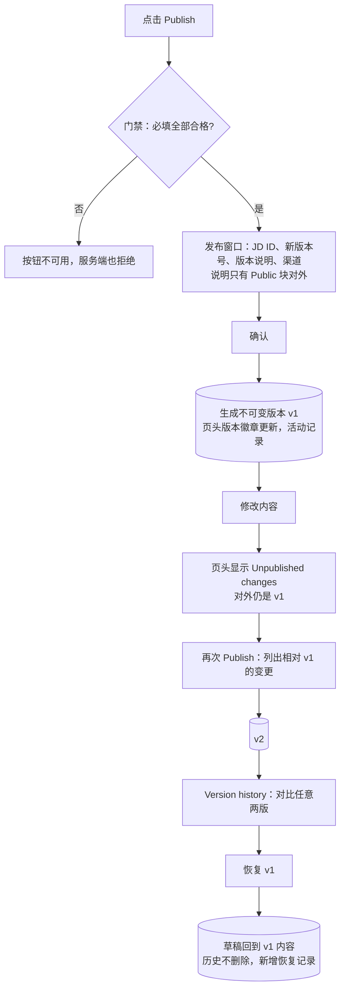

# M8 User Journey：发布与版本：发布 v1、修改、发布 v2、对比与恢复（P0）

| 项 | 内容 |
|---|---|
| 模块 | M8（测试脚本 J8） |
| 版本 / 日期 | v1.0 / 2026-10-14（草稿，待评审） |
| 同目录文档 | [产品文档](PRD.md) · [输入输出闭环](Loop_IO.md) |
| 来源 | [九模块 User Journey v1.0](../HireOS_Command_JD_Management_Module_User_Journeys_v1.0.md) M8 节；测试数据见 [输入输出闭环 §2](Loop_IO.md)（原测试脚本 v0.1 已于 #30 删除） |

## 角色与权限（公共，摘自 [九模块 User Journey §0.1](../HireOS_Command_JD_Management_Module_User_Journeys_v1.0.md)）

| 角色 | 登录后的主要目的 | 核心操作 | 默认限制 |
|---|---|---|---|
| Recruiter / TA | 将招聘需求整理成合格 JD，协调协作者并推动审批/交付 | 创建职位、补全字段、应用 AI 建议、保存草稿、提交审批、追踪发布 | 不能替审批人作出审批结论，不能绕过阻断项提交或发布 |
| Hiring Manager | 说明为什么招、招什么人、成功标准和团队上下文，并确认业务取舍 | 回答追问、编辑授权字段、解决冲突、确认岗位内容、参与审批 | 不能修改未授权预算/敏感字段，不能自动替代 HR 或审批政策发布 |
| HR Approver | 确认内容、预算、风险和流程前置条件已经处理 | 查看候选版本、差异、风险和影响，批准、退回或拒绝 | 不能把 AI 建议当成人工决策；无权限时不能查看 restricted 字段 |
| Viewer | 阅读获授权的 JD、分析结论和当前有效版本 | 查看职位、来源、版本和授权的 Agent 结论 | 不能应用修改、保存、提交审批、发布或查看敏感字段 |

> 2026-10-14 用户决定：采用以上四个角色，并恢复审批流程。这替代了 [#15](https://github.com/JsonSuCoder/HireOSV2/issues/15) 的三档权限和 [#9](https://github.com/JsonSuCoder/HireOSV2/issues/9) 中“去掉审批”的部分。审批流程目前后端没有实现，相关用例在实现前标记为 known gap。

# 旅程

**主角色**：Recruiter / TA（发布）；HR Approver（发布前审批，见 M7）
**登录目的**：把合格的 JD 发布出去，之后的修改可以追溯、对比，必要时能回到旧版本。
**入口**：职位编辑页 → Publish；页头 → Version history

## 输入

| 类型 | 内容 |
|---|---|
| 前置数据 | 一份全部合格的草稿（seed，或 M6 的结果），含 Public / Internal / Confidential 三种块 |
| 用户数据 | 版本说明；修改一条要点；修改某块的可见范围 |
| 外部依赖 | 发布渠道（**线上暂无**；先用测试渠道或“仅生成版本”模式） |

## 流程

## 步骤

| # | 用户意图与操作 | 系统反馈 | 用户需要判断 |
|---|---|---|---|
| 1 | 点击 Publish | 窗口显示 JD 唯一 ID（JD-年份-编号）、新版本号、可选说明、渠道；说明只有 Public 块对外 | 发布到哪里 |
| 2 | 填说明并确认（只选测试渠道） | 发布成功；版本徽章更新；活动记录新增一条 | — |
| 3 | 打开对外页面 | 只有 Public 内容；没有 Internal 和 Confidential | 对外内容是否合适 |
| 4 | 修改一条要点 | 页头出现 `Unpublished changes`；对外仍是旧内容 | — |
| 5 | 再次 Publish | 版本号 +1；窗口列出本次相对上一版的变更 | 变更是否都要发布 |
| 6 | 版本页对比两版 | 显示新增、删除、修改、可见范围变化 | — |
| 7 | 恢复到旧版本 | 草稿回到旧版内容；历史版本保留；新增恢复记录 | — |
| 8 | 撤回测试渠道 | 对外页面下线，记录撤回时间 | — |

## 异常与恢复

| 场景 | 预期 |
|---|---|
| 双击 Publish | 只生成一个版本（幂等键） |
| 渠道超时或无回执 | 显示结果未知，主操作是查询状态，不默认重发 |
| 发布时网络断开 | 不显示成功；恢复后可以查询实际结果 |

## 输出与交接

| 输出 | 内容 |
|---|---|
| 持久化 | JobDocumentVersion（版本号、内容哈希、发布者、时间、说明）；Job 状态 draft→published（Core 为 open）；JD 唯一 ID |
| 记录 | 活动记录：发布、恢复、撤回 |
| 交接 | 对外：只含 Public 块的精确版本；对下游（筛选/面试）：引用精确的版本号，而不是“最新版” |

**禁止副作用**：Internal/Confidential 内容出现在对外页面；修改已发布的版本内容；恢复时删除历史；不合格时服务端放行发布。

**成功标准**：每次发布生成新的不可变版本；对外只有 Public 内容；历史可追溯、可对比、可恢复。

**测试映射**：闭环 F1、E1、E2、E4（部分）；线上问题 F-005、F-013。

**待确认**：测试渠道是哪个、怎么控制对外影响；后端是否已有恢复接口；发布前必须经过 HR Approver 审批（2026-10-14 已决定恢复审批）。
