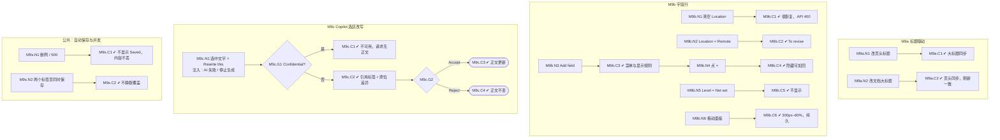

# M9 输入输出闭环：职位编辑与 Copilot 改写

| 项 | 内容 |
|---|---|
| 模块 | M9（P1） |
| 版本 / 日期 | v1.1 / 2026-10-15（产品决定同步；实现待验收） |
| 同目录文档 | [产品文档](PRD.md) · [User Journey](User_Journey.md) |
| 格式说明 | 见 [模块索引 README](../README_Modules.md#闭环文档格式) |

本模块拆成三个子流程和一组公共路径：**M9a 标题联动**、**M9b 字段行**、**M9c Copilot 选区改写**、**公共：自动保存与并发**。

## 1. 结构化规格

```yaml
# ---------- M9a 标题联动 ----------
flow_id: M9a
actor: recruiter_a
seed: S_job_ready
nodes:
  - {id: M9a.N1, type: action, do: "修改页头标题为 T 并回车"}
  - {id: M9a.C1, type: check, expect: {ui: "文档第一行大标题 = T；必填检查仍通过", db: "Core Job title = T"}}
  - {id: M9a.N2, type: action, do: "修改文档大标题为 T2"}
  - {id: M9a.C2, type: check, expect: {ui: "页头标题 = T2", db: "刷新、返回列表后一致"}}
edges:
  - [M9a.N1, M9a.C1]
  - [M9a.N2, M9a.C2]

---
# ---------- M9b 字段行 ----------
flow_id: M9b
actor: recruiter_a
seed: S_job_ready
nodes:
  - {id: M9b.N1, type: action, do: "清空 Location"}
  - {id: M9b.C1, type: check, expect: {ui: "提示不能为空，值恢复", api: "PATCH 空 location 返回 400"}}
  - {id: M9b.N2, type: action, do: "Location 改为 Remote，运行 Analyze"}
  - {id: M9b.C2, type: check, expect: {ui: "To revise：需写明地区或时区"}}
  - {id: M9b.N3, type: action, do: "打开 Add field，添加 Recruiter"}
  - {id: M9b.C3, type: check, expect: {ui: "菜单不含已显示字段和 Workplace type；Recruiter 添加后一直显示"}}
  - {id: M9b.N4, type: action, do: "点击 Recruiter 字段的 ×"}
  - {id: M9b.C4, type: check, expect: {ui: "字段隐藏；可从 Add field 加回"}}
  - {id: M9b.N5, type: action, do: "Level 设为 Not set"}
  - {id: M9b.C5, type: check, expect: {ui: "Level 不显示；A4 不计 Missing，Ready 不因此受阻"}}
  - {id: M9b.N6, type: action, do: "拖动右侧面板边缘到 200px、到 80% 宽度；刷新"}
  - {id: M9b.C6, type: check, expect: {ui: "宽度被限制在 300px 到窗口宽度 60% 之间；刷新后保持"}}
edges:
  - [M9b.N1, M9b.C1]
  - [M9b.N2, M9b.C2]
  - [M9b.N3, M9b.C3]
  - [M9b.C3, M9b.N4]
  - [M9b.N4, M9b.C4]
  - [M9b.N5, M9b.C5]
  - [M9b.N6, M9b.C6]

---
# ---------- M9c Copilot 选区改写 ----------
flow_id: M9c
actor: recruiter_a
seed: S_job_with_confidential
external: [llm.rewrite]
nodes:
  - {id: M9c.N1, type: action, do: "选中块 B 中的文字，在 Copilot 输入 Rewrite this", inject: [llm_fail, stop_generation]}
  - {id: M9c.G1, type: decision, on: "B 是否为 Confidential"}
  - {id: M9c.C1, type: check, expect: {ui: "Copilot 输入框不可用，提示不能读取保密内容", api: "请求中没有该块正文"}}
  - {id: M9c.C2, type: check, expect: {ui: "输入框上方出现引用标签；文档原位显示新增 / 删除 / 替换；改动只在选区内", db: "接受前正文不变"}}
  - {id: M9c.G2, type: decision, on: "Accept 还是 Reject"}
  - {id: M9c.C3, type: check, expect: {db: "正文更新，文档 revision +1；建议 accepted"}}
  - {id: M9c.C4, type: check, expect: {db: "正文不变；建议 rejected", ui: "无残留标记"}}
  - {id: M9c.T1, type: terminal, state: doc.updated}
  - {id: M9c.T2, type: terminal, state: no_change}
edges:
  - [M9c.N1, M9c.G1]
  - [M9c.G1, M9c.C1, {when: "B = confidential_block"}]
  - [M9c.C1, M9c.T2]
  - [M9c.G1, M9c.C2, {when: "B = public_block"}]
  - [M9c.C2, M9c.G2]
  - [M9c.G2, M9c.C3, {when: "Accept"}]
  - [M9c.C3, M9c.T1]
  - [M9c.G2, M9c.C4, {when: "Reject"}]
  - [M9c.C4, M9c.T2]

---
# ---------- 公共：自动保存与并发 ----------
flow_id: M9s
actor: recruiter_a
seed: S_job_ready
nodes:
  - {id: M9s.N1, type: action, do: "编辑正文，期间断网或让保存接口返回 500", inject: [network_down, http_500]}
  - {id: M9s.C1, type: check, expect: {ui: "显示 Offline / Save failed，不显示 Saved；内容不丢；恢复后重试成功"}}
  - {id: M9s.N2, type: action, do: "两个标签页基于同一版本修改同一段并先后保存"}
  - {id: M9s.C2, type: check, expect: {ui: "过期保存显示冲突；点击查看双方差异；人工处理重叠内容并预览；确认合并后才保存，取消保留本地草稿", db: "确认前远端保持先保存版本；确认后产生合并后的新 revision"}}
edges:
  - [M9s.N1, M9s.C1]
  - [M9s.N2, M9s.C2]
```

## 2. 测试数据

| 名称 | 内容 |
|---|---|
| S_job_ready | 必填合格的职位 |
| S_job_with_confidential | 含 Public 块和 Confidential 块 `Internal budget ceiling: 100000 USD` |
| T / T2 | `[UJ-TEST] Staff Backend Engineer` / `[UJ-TEST] Senior Backend Engineer` |
| public_block | Responsibilities 中的一段 |
| confidential_block | 上述 Confidential 块 |
| 语言 | 英文、中文界面各跑一次 M9a、M9b |

## 3. 路径清单

| 路径 | 节点序列 | 数据 / 注入 | 终态 |
|---|---|---|---|
| M9a-P1 | N1 → C1 | T | 标题同步 |
| M9a-P2 | N2 → C2 | T2 | 标题同步，刷新一致 |
| M9b-P1 | N1 → C1 | 清空 Location | 值恢复，API 400 |
| M9b-P2 | N2 → C2 | `Remote` | To revise |
| M9b-P3 | N3 → C3 | Recruiter | 字段显示 |
| M9b-P4 | N3 → C3 → N4 → C4 | — | 字段隐藏 |
| M9b-P5 | N5 → C5 | Not set | Level 不显示，A4 不计 Missing |
| M9b-P6 | N6 → C6 | 200px、80% | 宽度受限且持久 |
| M9c-P1 | N1 → G1 → C2 → G2 → C3 | public_block，Accept | doc.updated |
| M9c-P2 | N1 → G1 → C2 → G2 → C4 | public_block，Reject | no_change |
| M9c-P3 | N1 → G1 → C1 | confidential_block | no_change，请求无正文 |
| M9c-P4 | N1 注入 stop_generation | public_block | 半截建议不能接受 |
| M9c-P5 | N1 注入 llm_fail | public_block | 错误可恢复，正文不变 |
| 公共-P1 | M9s.N1 → C1 | network_down、http_500 | 内容不丢 |
| 公共-P2 | M9s.N2 → C2 | 两个标签页 | 查看冲突、人工确认合并，确认前不覆盖 |
| P-中文 | M9a、M9b 在中文界面重跑 | — | 系统 UI 与新模板标题中文；已有内容保持原语言 |

## 4. 流程图（由规格生成）



## 5. 待确认

- 并发合并的产品预期已在 2026-10-15 确认；documents 接口版本校验、冲突预览与确认合并仍需工程实现/复测。
- HR Approver 能否编辑仍待 M7 确认；当前 M9 不执行多角色权限路径。
