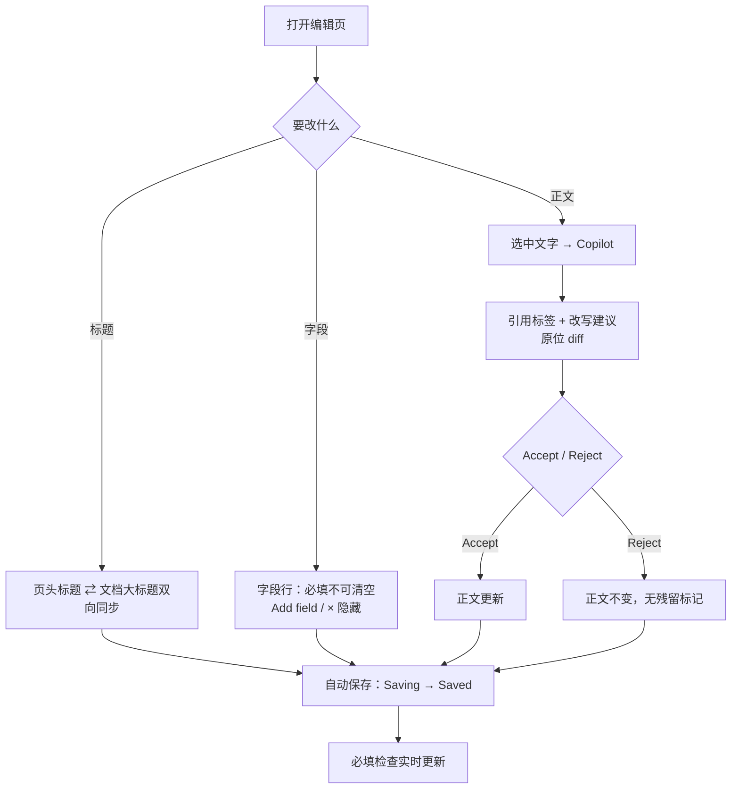

# M9 User Journey：编辑职位：字段、标题联动与 Copilot 改写（P1）

| 项 | 内容 |
|---|---|
| 模块 | M9（测试脚本 J9） |
| 版本 / 日期 | v1.0 / 2026-10-14（草稿，待评审） |
| 同目录文档 | [产品文档](PRD.md) · [输入输出闭环](Loop_IO.md) |
| 来源 | [九模块 User Journey v1.0](../HireOS_Command_JD_Management_Module_User_Journeys_v1.0.md) M9 节；测试数据见 [用户旅程与测试脚本 v0.1 §3](../HireOS_Command_JD_Management_User_Journeys_v0.1.md) |

## 角色与权限（公共，摘自 [九模块 User Journey §0.1](../HireOS_Command_JD_Management_Module_User_Journeys_v1.0.md)）

| 角色 | 登录后的主要目的 | 核心操作 | 默认限制 |
|---|---|---|---|
| Recruiter / TA | 将招聘需求整理成合格 JD，协调协作者并推动审批/交付 | 创建职位、补全字段、应用 AI 建议、保存草稿、提交审批、追踪发布 | 不能替审批人作出审批结论，不能绕过阻断项提交或发布 |
| Hiring Manager | 说明为什么招、招什么人、成功标准和团队上下文，并确认业务取舍 | 回答追问、编辑授权字段、解决冲突、确认岗位内容、参与审批 | 不能修改未授权预算/敏感字段，不能自动替代 HR 或审批政策发布 |
| HR Approver | 确认内容、预算、风险和流程前置条件已经处理 | 查看候选版本、差异、风险和影响，批准、退回或拒绝 | 不能把 AI 建议当成人工决策；无权限时不能查看 restricted 字段 |
| Viewer | 阅读获授权的 JD、分析结论和当前有效版本 | 查看职位、来源、版本和授权的 Agent 结论 | 不能应用修改、保存、提交审批、发布或查看敏感字段 |

> 2026-10-14 用户决定：采用以上四个角色，并恢复审批流程。这替代了 [#15](https://github.com/JsonSuCoder/HireOSV2/issues/15) 的三档权限和 [#9](https://github.com/JsonSuCoder/HireOSV2/issues/9) 中“去掉审批”的部分。审批流程目前后端没有实现，相关用例在实现前标记为 known gap。

# 旅程

**主角色**：Recruiter / TA；Hiring Manager 编辑授权字段
**登录目的**：在一个页面里改好 JD 的标题、字段和正文，并让 Copilot 帮忙改写选中的段落。
**入口**：职位编辑页

## 输入

| 类型 | 内容 |
|---|---|
| 前置数据 | 一个已有的 draft 职位（seed） |
| 用户数据 | 新标题 `[UJ-TEST] Staff Backend Engineer`；Location 清空 / `Remote`；Add field 选 Recruiter；Level 设为 Not set；选中一段文字 + `Rewrite this`；中英文切换 |
| 外部依赖 | LLM（rewrite） |

## 流程

## 步骤

| # | 用户意图与操作 | 系统反馈 | 用户需要判断 |
|---|---|---|---|
| 1 | 改页头标题 | 文档第一行大标题同步；必填检查仍通过 | — |
| 2 | 改文档大标题 | 页头标题同步 | — |
| 3 | 清空 Location | 提示不能为空，值恢复 | — |
| 4 | Location 改为 `Remote` | Analysis 出现 To revise：需写明地区或时区 | 补哪个地区 |
| 5 | Add field | 菜单不含已显示字段和 Workplace type；加上 Recruiter 后一直显示 | — |
| 6 | 点字段 × | 字段隐藏，可从 Add field 加回 | — |
| 7 | Level 设为 Not set | Level 不显示 | — |
| 8 | 拖动右侧面板边缘 | 宽度在 300px 到窗口 60% 之间；刷新后保持 | — |
| 9 | 选中一段，在 Copilot 输入 `Rewrite this` | 输入框上方出现引用标签；原位显示改写差异；内容只基于选中文字 | 接受还是拒绝 |
| 10 | 切换到中文界面 | 入口、字段、检查提示都有中文，没有残留英文 | — |

## 可见 / 不可见

- 选中 Confidential 块时，Copilot 输入框不可用，并提示不能读取保密内容；网络请求里没有该块正文（v0.1 E6）。
- Viewer：全部只读，没有编辑类按钮。
- Hiring Manager：预算/敏感字段只读。

## 异常与恢复

| 场景 | 预期 |
|---|---|
| 保存失败或断网 | 显示 Offline / Save failed，内容不丢，恢复后重试成功；不显示 Saved |
| 两个标签页同时编辑同一职位 | 不静默覆盖：提示冲突，或后保存者能看到对方修改 |
| AI 改写时停止生成 | 不留下半截建议进正文 |

## 输出与交接

- 持久化：Core Job 字段（title/location/HC/level 等，Core 字段名）；文档 revision；建议的 accepted/rejected 状态。
- 交接 → M6（修改后重新检查）→ M8（产生 Unpublished changes）。

**禁止副作用**：AI 改写未经 Accept 就覆盖正文；改写内容超出选区却没有说明；保存失败仍显示 Saved；Confidential 内容进入 AI 请求。

**成功标准**：编辑、保存、刷新、返回列表后，标题、Location、HC、Workplace type 一致；Copilot 改写只作用于选区并由用户确认。

**测试映射**：闭环 B1、B5、B6、C3；线上问题 F-012、F-016、F-017。

**待确认**：并发编辑的预期行为（冲突提示还是自动合并）；documents 接口是否有版本校验。
