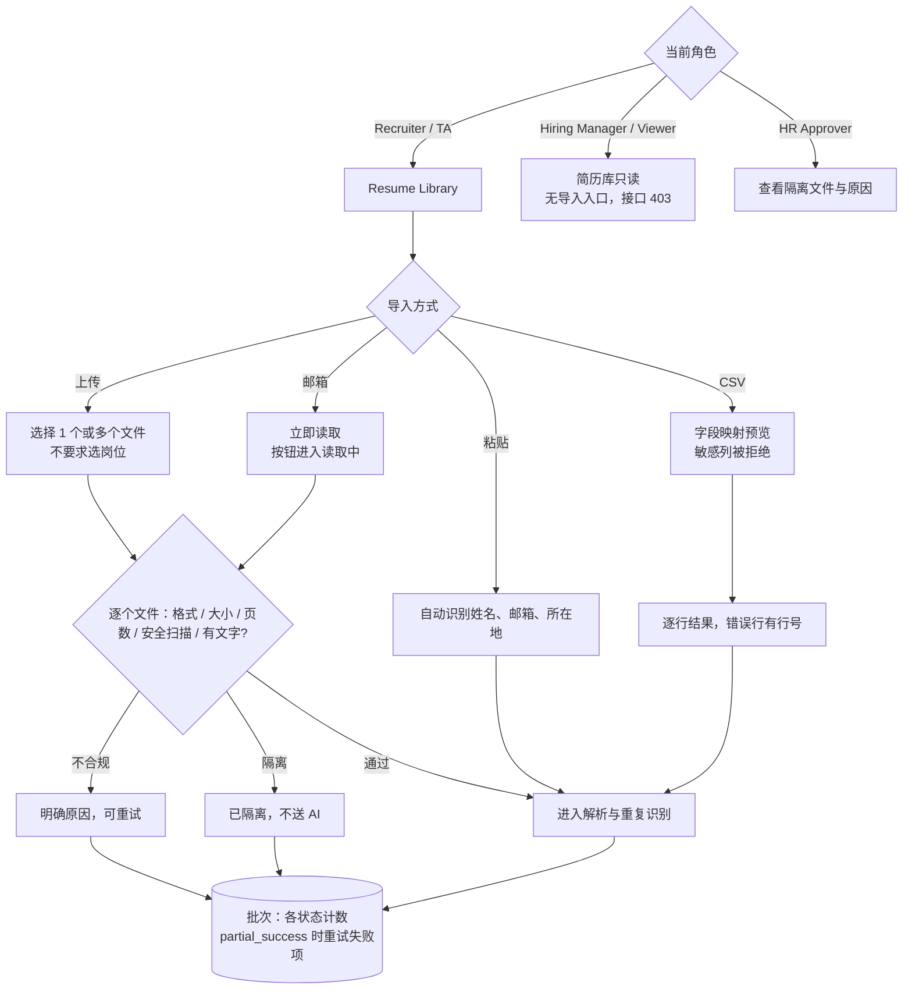

# F01 User Journey：资料接入与导入批次（P0）

| 项 | 内容 |
|---|---|
| 模块 | F01（对应测试脚本 J3、J4） |
| 版本 / 日期 | v1.0 / 2026-10-14（草稿，待评审） |
| 同目录文档 | [产品文档](PRD.md) · [输入输出闭环](Loop_IO.md) · [User Cases](User_Cases.md) |
| 来源 | [用户旅程与测试脚本 v0.2](../../user-journeys/Resume_Screening_User_Journeys_v0.2.md) J3、J4；角色见 [README 角色与权限](../README.md#角色与权限) |

## 角色与权限（本模块）

| 角色 | 在本模块的目的 | 可以做 | 不能做 |
|---|---|---|---|
| Recruiter / TA | 把各渠道的简历收进简历库 | 上传、粘贴、CSV 导入、邮箱立即读取；查看批次结果；重试、取消 | 查看隔离文件原文 |
| Hiring Manager | 不负责导入 | 查看所负责岗位候选人的导入来源 | 上传、粘贴、CSV 导入、重试 |
| HR Approver | 排查被隔离的文件 | 查看隔离原因和隔离文件原文、操作历史 | 上传、粘贴、CSV 导入 |
| Viewer | 只读 | 查看简历库（不含受限字段） | 所有导入类操作；入口不显示，接口返回 403 |

# 旅程

**主角色**：Recruiter / TA；Hiring Manager、HR Approver、Viewer 验证各自的可见内容和操作
**登录目的**：手里有一批来自不同渠道的简历，想全部收进系统，并清楚知道每一份成功没有、失败的原因是什么。
**入口**：Resume Library → Upload resumes / Paste profile / CSV 导入；已连接邮箱的「立即读取」

## 输入

| 类型 | 内容 |
|---|---|
| 前置数据 | 已登录；简历库为空（S0_empty），或已有 Nina（S_lib_nina） |
| 用户数据 | 正常简历的 PDF / DOCX / TXT；扫描件、空文件、超过 20MB、超过 10 页、`.png` / `.zip`、加密 PDF、含宏的 DOCX；粘贴资料；CSV（含中文表头、敏感列、`=` 开头的单元格、缺联系方式的行）；已连接的测试邮箱 |
| 外部依赖 | 安全扫描（本地规则 + ClamAV）；文本提取；邮箱读取 |

## 流程

## 步骤

| # | 角色 | 用户意图与操作 | 系统反馈 | 用户需要判断 |
|---|---|---|---|---|
| 1 | Recruiter | 打开简历库，点 Upload resumes | 弹出文件选择；页面说明简历可以早于岗位到达；**不要求选择岗位** | — |
| 2 | Recruiter | 选择 1 份正常 PDF | 逐步显示接收 → 安全检查 → 读取 → 身份识别；结果为新候选人，来源 Manual upload | — |
| 3 | Recruiter | 一次选择正常 DOCX、扫描件、`.png` | 三个文件各自显示结果；正常文件入库；扫描件提示无法读取文字、不支持 OCR；`.png` 提示格式不支持 | 失败的文件是否换一份重传 |
| 4 | Recruiter | 上传超过 20MB、超过 10 页的文件 | 分别提示超过大小上限、超过页数上限；不生成候选人 | — |
| 5 | Recruiter | 上传加密 PDF、含宏的 DOCX | 显示已隔离及原因；不进入简历库 | — |
| 6 | Recruiter | 扫描引擎不可用时上传 | 文件隔离，原因为扫描未完成，可稍后重试 | 什么时候重试 |
| 7 | Recruiter | 批量上传 100 份（含 1 份坏文件），完成后重试失败项 | 批次结果 partial_success，各状态数量清楚；重试只处理失败那一份，成功的 99 份不重复处理 | — |
| 8 | Recruiter | 批量运行中点取消 | 已完成的保留，未完成的停止 | — |
| 9 | Recruiter | Paste profile，粘贴一段资料 | 姓名、邮箱、所在地自动填入，所在地不带后面整句话；清空姓名后不能保存；保存后未写的字段显示未提供 | 识别是否准确 |
| 10 | Recruiter | 导入 CSV | 先显示映射预览：「姓名」自动映射为 full_name；性别列被拒绝并说明原因；未识别的列被忽略 | 映射是否正确，是否手动调整 |
| 11 | Recruiter | 确认导入 | 逐行显示结果；缺邮箱和电话的行失败并显示行号；`=1+1` 按文本保存 | — |
| 12 | Recruiter | 在已连接邮箱上点立即读取 | 按钮变为读取中且不可再点；读完后最近读取为刚刚，附件按上传流程处理；授权失效时提示重新连接 | — |
| 13 | Hiring Manager | 打开简历库，找导入入口 | 没有 Upload / Paste / CSV 入口；直接调用导入接口返回 403 | — |
| 14 | HR Approver | 打开步骤 5 中被隔离的文件 | 看到隔离原因、扫描引擎和病毒库版本、文件原文；Recruiter 看不到原文 | 是否需要进一步处理 |
| 15 | Viewer | 打开简历库，调用上传接口 | 只读列表，看不到联系方式等受限字段；上传接口返回 403 | — |

## 输出与交接

- 持久化：Material（hash、安全检查状态、隔离原因、扫描版本、读取状态）；ImportBatch / ImportItem；CandidateSource；操作历史。
- 交接：可读的材料 → F02 解析；内容摘要 → F03 重复识别。

**禁止副作用**：失败或隔离的文件生成候选人；隔离文件被送入 AI；一个文件失败导致整批失败；重试重复处理成功项；上传时要求选岗位；CSV 敏感列被导入；非 Recruiter 角色能通过接口导入。

**成功标准**：每份文件都有明确的结果和可操作的提示；坏文件不影响其他文件；导入权限只属于 Recruiter / TA，并由服务端保证。

**测试映射**：Loop_IO P1～P16；用户旅程 v0.2 J3 步骤 1～10、J4 步骤 1～11；角色步骤 13～15 对应 README 权限矩阵。

**待确认**：Hiring Manager 是否需要导入权限（权限矩阵中标 * 的默认值）。
