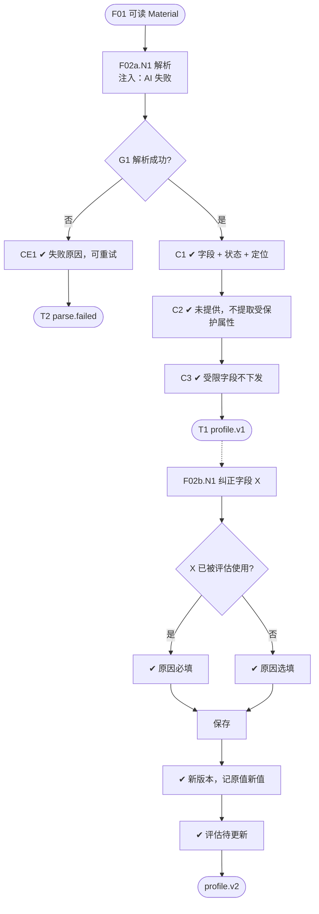

# F02 输入输出闭环：简历解析与候选人档案

| 项 | 内容 |
|---|---|
| 模块 | F02 |
| 版本 / 日期 | v1.0 / 2026-10-14（草稿，待评审） |
| 同目录文档 | [产品文档](PRD.md) · [User Journey](User_Journey.md) · [User Cases](User_Cases.md) |
| 格式说明 | 见 [模块索引 README](../README.md#闭环文档格式) |

## 1. 输入与输出

| 部分 | 内容 |
|---|---|
| **输入·身份** | recruiter_a（解析、纠正）；hm_a（看不到薪资期望和工作授权）；viewer_a（看不到全部受限字段，不能纠正） |
| **输入·前置状态** | F01 产出的可读 Material；纠正与新版本场景用 S_linked（Nina 已有有效评估） |
| **输入·用户数据** | 简历原文；纠正时的字段新值、原因（快选 + 文字）；同一候选人的新版本简历 |
| **输入·外部依赖桩** | llm.profile_parse：成功 / 失败 / 返回编造字段（用于检查过滤） |
| **输出·UI** | 候选人详情页：4.1 的全部字段，每个字段有值、状态（已知 / 未提供 / 部分识别）和原文定位；履历时间线；全部简历版本；全部岗位关系；受限字段对无权限角色显示「受限」 |
| **输出·API / 数据** | CandidateProfile（版本号、结构化字段、状态与证据位置、解析器版本、缺失字段、纠正记录）；ResumeVersion；ProcessingJob（解析状态、错误、重试） |
| **输出·事件 / 审计** | 解析的 AiRun；每次纠正写审计（原值、新值、纠正人、时间、原因） |
| **输出·禁止副作用** | AI 编造简历没写的薪资、签证、离职原因、公司规模；提取性别、年龄、出生日期、照片、婚姻状况、国籍、宗教；纠正改写原文或旧版本；新版本简历改写已有评估；工作授权为空时出现在缺失字段；受限字段值下发给无权限角色 |
| **输出·交给下游** | CandidateProfile → F03 身份信号、F04 简历库、F06 岗位匹配、F08 筛选评估；档案更新 → 相关推荐和评估标为待更新 |

## 2. 结构化规格

```yaml
flow_id: F02a  # 解析
actor: recruiter_a
seed: S0_empty
entry: F02a.N1
max_loop: 2
external: [llm.profile_parse]

nodes:
  - {id: F02a.N1, type: action, do: "F01 交来可读 Material R", inject: [llm_fail]}
  - {id: F02a.G1, type: decision, on: "解析是否成功"}
  - {id: F02a.CE1, type: check, expect: {ui: "显示解析失败原因；可重试解析或手动录入", db: "ProcessingJob.status=failed；无半成品档案"}}
  - {id: F02a.C1, type: check, expect: {ui: "4.1 全部字段可见；每个字段有状态和原文定位", db: "CandidateProfile.version=1；日期为 YYYY-MM；总工作年限为推导值", record: "AiRun"}}
  - {id: F02a.C2, type: check, expect: {ui: "简历未写的字段显示未提供", db: "受保护属性未入库；工作授权为空时不在 missingFields"}}
  - {id: F02a.C3, type: check, expect: {api: "viewer_a 读取档案时，联系方式、薪资、工作授权不在响应中", ui: "显示受限标记"}}
  - {id: F02a.T1, type: terminal, state: profile.v1}
  - {id: F02a.T2, type: terminal, state: parse.failed}

edges:
  - [F02a.N1, F02a.G1]
  - [F02a.G1, F02a.CE1, {when: "注入 llm_fail 且规则解析也失败"}]
  - [F02a.CE1, F02a.T2]
  - [F02a.G1, F02a.C1, {when: "R 属于 resume_*"}]
  - [F02a.C1, F02a.C2]
  - [F02a.C2, F02a.C3]
  - [F02a.C3, F02a.T1]
---
flow_id: F02b  # 纠正
actor: recruiter_a
seed: S_linked
entry: F02b.N1
max_loop: 2
external: []

nodes:
  - {id: F02b.N1, type: action, do: "打开 Nina 的档案，修改字段 X"}
  - {id: F02b.G1, type: decision, on: "X 是否已被有效的推荐或评估使用"}
  - {id: F02b.C1, type: check, expect: {ui: "原因必填；选「其他」时必须填文字"}}
  - {id: F02b.C2, type: check, expect: {ui: "原因选填"}}
  - {id: F02b.N2, type: action, do: "填写原因并保存", inject: [double_click, http_500]}
  - {id: F02b.C3, type: check, expect: {db: "CandidateProfile.version +1；旧版本和原文保留；corrections 含原值、新值、纠正人、时间、原因", record: "审计"}}
  - {id: F02b.C4, type: check, expect: {ui: "使用该字段的评估显示待更新", db: "ScreeningEvaluation 未被改写"}}
  - {id: F02b.T1, type: terminal, state: profile.v2}

edges:
  - [F02b.N1, F02b.G1]
  - [F02b.G1, F02b.C1, {when: "X = location（已被评估使用）"}]
  - [F02b.G1, F02b.C2, {when: "X = projects（未被使用）"}]
  - [F02b.C1, F02b.N2]
  - [F02b.C2, F02b.N2]
  - [F02b.N2, F02b.C3]
  - [F02b.C3, F02b.C4, {when: "走了 C1"}]
  - [F02b.C3, F02b.T1, {when: "走了 C2"}]
  - [F02b.C4, F02b.T1]
---
flow_id: F02c  # 新版本简历
actor: recruiter_a
seed: S_linked
entry: F02c.N1
max_loop: 1
external: [llm.profile_parse]

nodes:
  - {id: F02c.N1, type: action, do: "Nina 的新版本简历经 F03 人工确认为同一人"}
  - {id: F02c.C1, type: check, expect: {ui: "详情页列出 2 个简历版本及来源、上传时间", db: "ResumeVersion.version=2；新 CandidateProfile 版本"}}
  - {id: F02c.C2, type: check, expect: {ui: "已有推荐和评估标为待更新", db: "旧评估引用的档案版本不变"}}
  - {id: F02c.T1, type: terminal, state: profile.new_resume_version}

edges:
  - [F02c.N1, F02c.C1]
  - [F02c.C1, F02c.C2]
  - [F02c.C2, F02c.T1]
```

## 3. 测试数据

| 名称 | 内容 |
|---|---|
| resume_full | 包含 4.1 全部字段的虚构英文简历（含 2 段重叠的工作经历、到岗时间「1 个月」、薪资 `USD 60-70k/yr gross`） |
| resume_cn | 中文简历，薪资写 `35-45K·14 薪`，CJK 字体 PDF |
| resume_sparse | 只有姓名和一句话「Software engineer.」 |
| resume_protected | 写明性别、出生日期、婚姻状况、国籍并附照片 |
| resume_work_auth | 写明「Authorized to work in Vietnam, no sponsorship needed」 |
| resume_no_name | 没有姓名，文件名为 `pia_nguyen_cv.pdf` |
| correction_reason_other_empty | 原因选「其他」但不填文字 |

## 4. 路径清单

| 路径 | 节点序列 | 数据 / 注入 | 终态 | 对应 AC |
|---|---|---|---|---|
| P1 完整解析 | F02a.N1 → G1 → C1 → C2 → C3 | resume_full | profile.v1；总工作年限不重复计算重叠时间 | AC-1、AC-7 |
| P2 中文简历 | 同 P1 | resume_cn | profile.v1；月薪 35000–45000 CNY，不计入「14 薪」 | AC-7 |
| P3 资料稀少 | 同 P1 | resume_sparse | profile.v1；多数字段为未提供，无编造 | AC-2 |
| P4 受保护属性 | 同 P1 | resume_protected | profile.v1；性别等未提取 | AC-8 |
| P5 工作授权 | 同 P1，分别用 recruiter_a 与 viewer_a | resume_work_auth、resume_sparse | 写明时只有 recruiter_a 可见；未写时不在缺失字段 | AC-6、AC-9 |
| P6 无姓名 | 同 P1 | resume_no_name | 姓名取文件名并标待确认 | AC-7 |
| P7 解析失败 | F02a.N1 → G1 → CE1 | llm_fail | parse.failed；可重试或手动录入 | — |
| P8 纠正已用字段 | F02b.N1 → G1 → C1 → N2 → C3 → C4 | X=location | profile.v2；评估待更新 | AC-3、AC-10 |
| P9 纠正未用字段 | F02b.N1 → G1 → C2 → N2 → C3 | X=projects | profile.v2；原因可空 | AC-3、AC-10 |
| P10 原因选其他未填 | F02b.N1 → G1 → C1 → N2 | correction_reason_other_empty | 不保存 | AC-10 |
| P11 新简历版本 | F02c.N1 → C1 → C2 | — | 评估待更新，未被改写 | AC-4、AC-5 |

## 5. 流程图（由规格生成）



## 6. 待确认

- 解析耗时的验收阈值。
