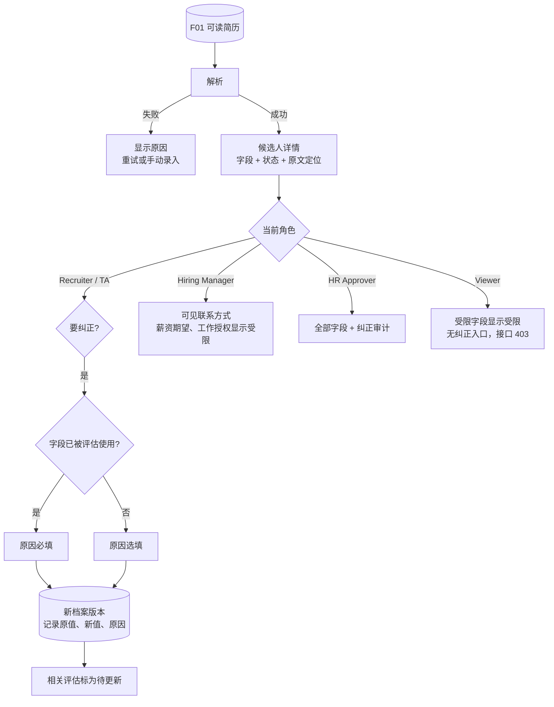

# F02 User Journey：简历解析与候选人档案（P1）

| 项 | 内容 |
|---|---|
| 模块 | F02（对应测试脚本 J3、J4） |
| 版本 / 日期 | v1.0 / 2026-10-14（草稿，待评审） |
| 同目录文档 | [产品文档](PRD.md) · [输入输出闭环](Loop_IO.md) · [User Cases](User_Cases.md) |
| 来源 | [用户旅程与测试脚本 v0.2](../../user-journeys/Resume_Screening_User_Journeys_v0.2.md) J3、J4；角色见 [README 角色与权限](../README.md#角色与权限) |

## 角色与权限（本模块）

| 角色 | 在本模块的目的 | 可以做 | 不能做 |
|---|---|---|---|
| Recruiter / TA | 确认解析结果准确，必要时纠正 | 查看全部字段（含受限字段）；纠正档案；查看版本和岗位关系 | 改写简历原文或旧版本 |
| Hiring Manager | 了解所负责岗位候选人的背景 | 查看所负责岗位候选人的档案和联系方式 | 纠正档案；看到薪资期望和工作授权 |
| HR Approver | 合规核查 | 查看全部字段和纠正审计 | 纠正档案 |
| Viewer | 只读 | 查看档案中的非受限字段 | 纠正档案；看到联系方式、薪资期望、工作授权（接口也不下发） |

# 旅程

**主角色**：Recruiter / TA；Hiring Manager、HR Approver、Viewer 验证受限字段的可见范围
**登录目的**：简历进来后，想快速看清这个人的结构化信息，确认系统没读错；读错了能改，而且改动有记录。
**入口**：简历库 → 候选人详情（`#/candidates/:id`）

## 输入

| 类型 | 内容 |
|---|---|
| 前置数据 | F01 产出的可读简历；纠正场景用 S_linked（Nina 已有有效评估） |
| 用户数据 | 完整英文简历（含重叠的工作经历、到岗时间、薪资）；中文简历（`35-45K·14 薪`）；资料稀少的简历；写明性别、出生日期、国籍并附照片的简历；写明工作授权的简历；纠正的字段新值和原因 |
| 外部依赖 | 简历解析模型 |

## 流程

## 步骤

| # | 角色 | 用户意图与操作 | 系统反馈 | 用户需要判断 |
|---|---|---|---|---|
| 1 | Recruiter | 打开完整简历候选人的详情 | 姓名、联系方式、所在地（国家 + 城市）、工作经历、教育（学校 / 学历 / 专业 / 时间）、技能、语言、证书、项目、薪资期望、到岗时间都有；每个字段显示状态，点击可跳到原文 | 解析是否准确 |
| 2 | Recruiter | 查看总工作年限 | 标为推导值；两段重叠的经历没有重复计算 | — |
| 3 | Recruiter | 打开中文简历候选人 | 薪资为月薪 35000～45000 CNY，「14 薪」不影响数值 | — |
| 4 | Recruiter | 打开资料稀少的候选人 | 大多数字段显示未提供，没有编造的经历、数字或薪资 | 是否需要补资料 |
| 5 | Recruiter | 打开写明性别、出生日期、国籍的候选人 | 这些信息没有出现在档案里；照片不显示 | — |
| 6 | Recruiter | 查看工作授权 | 简历写明时显示原文并带受限标记；没写时为空，**不出现在缺失字段里** | — |
| 7 | Recruiter | 修改 Nina 的所在地（已被评估使用），不填原因 | 不能保存，提示原因必填；选「其他」时必须写说明 | 纠正原因 |
| 8 | Recruiter | 填写原因后保存 | 档案版本 +1；纠正记录显示原值、新值、纠正人、时间、原因；Nina 的评估显示待更新，原评估没有被改写 | 是否重新评估 |
| 9 | Recruiter | 修改项目描述（未被使用），不填原因 | 可以保存 | — |
| 10 | Recruiter | 查看简历版本和岗位关系 | 列出全部简历版本、来源、上传时间，以及推荐中 / 已关联 / 已拒绝提案的岗位 | — |
| 11 | Hiring Manager | 打开所负责岗位候选人的档案 | 可见联系方式；薪资期望、工作授权显示受限；没有纠正入口，调用纠正接口返回 403 | — |
| 12 | HR Approver | 打开 Nina 的档案和纠正记录 | 全部字段可见；能看到步骤 8 的纠正审计；没有纠正入口 | — |
| 13 | Viewer | 打开档案并查看 Network 响应 | 联系方式、薪资期望、工作授权显示受限，响应中也没有这些值；纠正接口返回 403 | — |

## 输出与交接

- 持久化：CandidateProfile（版本、字段、状态与证据位置、解析器版本、缺失字段、纠正记录）；ResumeVersion；纠正审计。
- 交接：档案 → F03 身份信号、F04 简历库、F06 岗位匹配、F08 筛选评估；档案更新使相关推荐和评估待更新。

**禁止副作用**：编造简历没写的信息；提取受保护属性；纠正改写原文或旧版本；新版本或纠正改写已有评估；只在前端隐藏受限字段。

**成功标准**：字段完整且可追溯到原文；纠正可审计；受限字段的可见范围与四类角色一致，并由服务端保证。

**测试映射**：Loop_IO P1～P11；用户旅程 v0.2 J4 步骤 1～3。

**待确认**：Hiring Manager 能否查看薪资期望（权限矩阵中标 * 的默认值）；解析耗时阈值。
