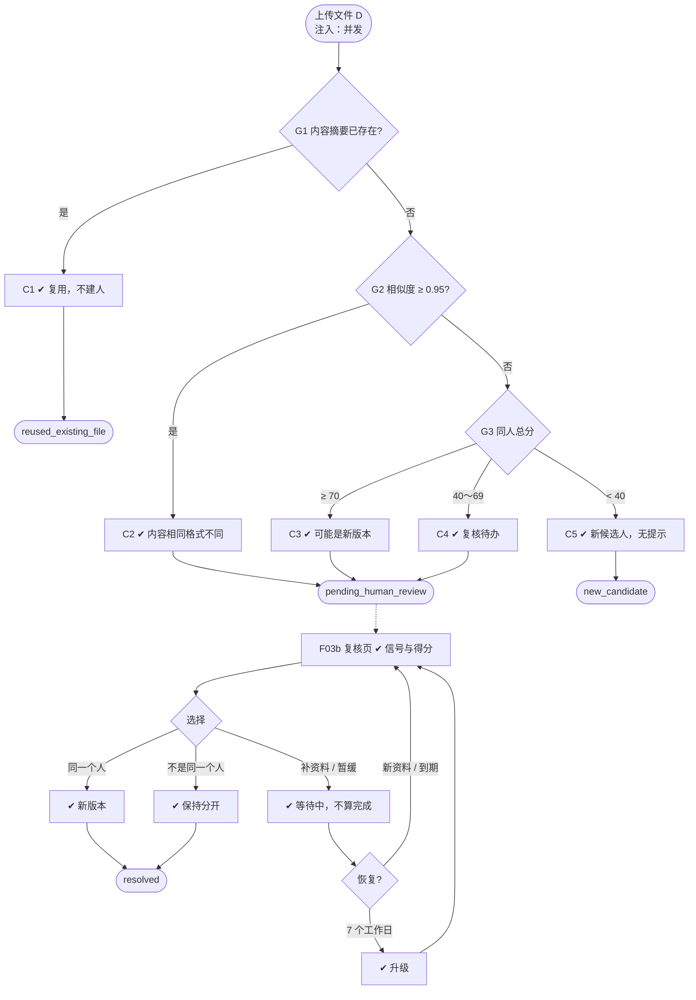

# F03 输入输出闭环：重复识别与身份复核

| 项 | 内容 |
|---|---|
| 模块 | F03 |
| 版本 / 日期 | v1.0 / 2026-10-14（草稿，待评审） |
| 同目录文档 | [产品文档](PRD.md) · [User Journey](User_Journey.md) · [User Cases](User_Cases.md) |
| 格式说明 | 见 [模块索引 README](../README.md#闭环文档格式) |

## 1. 输入与输出

| 部分 | 内容 |
|---|---|
| **输入·身份** | recruiter_a（上传、复核）；recruiter_other_scope（上传者无权查看已有记录）；approver_a（受限复核队列） |
| **输入·前置状态** | S_lib_nina（已有 Nina）；S_lib_nina_restricted |
| **输入·用户数据** | 新上传的简历文件；复核选择：同一个人 / 不是同一个人 / 补资料（需要什么资料）/ 暂缓（原因 + 复查时间） |
| **输入·外部依赖桩** | 时钟（推进 3 个、7 个工作日，验证提醒与升级）；通知（站内提醒） |
| **输出·UI** | 上传结果分类：完全相同文件 / 内容相同格式不同 / 可能是新版本 / 身份不确定（生成复核待办）/ 新候选人；复核页并排展示新旧记录、差异、命中信号与得分；未完成检查时显示「未完成重复检查」 |
| **输出·API / 数据** | DuplicateCheck（检测类型、算法 / 策略版本、相似度、命中信号及得分、总分、候选重复记录、状态）；DuplicateResolution（结果、操作人、时间、备注）；HumanTask（duplicate_review，等待原因、复查时间、路由队列）；确认同一人时新增 ResumeVersion |
| **输出·事件 / 审计** | 每次处理、纠正、拆分写审计；提醒与升级记录 |
| **输出·禁止副作用** | 任何分数下自动合并；只有姓名相近就提示或生成复核待办；完全相同文件重复建 Candidate / Application / 任务；向上传者提示无权查看的记录（包括「存在无法查看的重复」）；跨租户识别；补资料或暂缓被算作完成 |
| **输出·交给下游** | 确认后的身份 → F04 简历库；新简历版本 → F02；未处理的复核 → F07 确认关联时提示 |

## 2. 结构化规格

```yaml
flow_id: F03a  # 上传时识别
actor: recruiter_a
seed: S_lib_nina
entry: F03a.N1
max_loop: 1
external: []

nodes:
  - {id: F03a.N1, type: action, do: "上传文件 D", inject: [concurrent]}
  - {id: F03a.G1, type: decision, on: "文件内容摘要是否已存在"}
  - {id: F03a.C1, type: check, expect: {ui: "提示该文件已存在，指向已有候选人", db: "Candidate 数不变；新增 CandidateSource；无新任务"}}
  - {id: F03a.G2, type: decision, on: "规范化文本相似度（≥ 200 字符时）"}
  - {id: F03a.C2, type: check, expect: {ui: "提示内容相同、格式不同，展示依据", db: "DuplicateCheck 类型为内容重复"}}
  - {id: F03a.G3, type: decision, on: "同人判断总分"}
  - {id: F03a.C3, type: check, expect: {ui: "提示可能是同一人的新版本，需人工确认", db: "未合并；DuplicateCheck 含命中信号和得分"}}
  - {id: F03a.C4, type: check, expect: {ui: "生成重复复核待办", db: "HumanTask.type=duplicate_review；未合并"}}
  - {id: F03a.C5, type: check, expect: {ui: "作为新候选人入库，无重复提示", db: "新 Candidate；无 duplicate_review 任务"}}
  - {id: F03a.T1, type: terminal, state: reused_existing_file}
  - {id: F03a.T2, type: terminal, state: pending_human_review}
  - {id: F03a.T3, type: terminal, state: new_candidate}

edges:
  - [F03a.N1, F03a.G1]
  - [F03a.G1, F03a.C1, {when: "D 属于 dup_exact / dup_exact_renamed"}]
  - [F03a.C1, F03a.T1]
  - [F03a.G1, F03a.G2, {when: "不存在"}]
  - [F03a.G2, F03a.C2, {when: "D 属于 dup_format（相似度 ≥ 0.95）"}]
  - [F03a.C2, F03a.T2]
  - [F03a.G2, F03a.G3, {when: "< 0.95"}]
  - [F03a.G3, F03a.C3, {when: "D 属于 dup_new_version（≥ 70）"}]
  - [F03a.C3, F03a.T2]
  - [F03a.G3, F03a.C4, {when: "D 属于 dup_uncertain（40～69）"}]
  - [F03a.C4, F03a.T2]
  - [F03a.G3, F03a.C5, {when: "D 属于 dup_name_only（< 40）"}]
  - [F03a.C5, F03a.T3]
---
flow_id: F03b  # 人工复核
actor: recruiter_a
seed: S_lib_nina
entry: F03b.N1
max_loop: 2
external: [clock, notify]

nodes:
  - {id: F03b.N1, type: action, do: "打开重复复核待办"}
  - {id: F03b.C1, type: check, expect: {ui: "并排展示新旧记录、差异、命中信号与得分"}}
  - {id: F03b.G1, type: decision, on: "复核选择"}
  - {id: F03b.N2, type: action, do: "选择同一个人并二次确认", inject: [double_click, concurrent]}
  - {id: F03b.C2, type: check, expect: {db: "新 ResumeVersion；旧版保留；任务 completed", record: "审计"}}
  - {id: F03b.N3, type: action, do: "选择不是同一个人并二次确认"}
  - {id: F03b.C3, type: check, expect: {db: "两条记录保持分开；任务 completed", record: "审计"}}
  - {id: F03b.N4, type: action, do: "选择补资料，填写需要的资料"}
  - {id: F03b.N5, type: action, do: "选择暂缓，填写原因和复查时间（默认 3 天）"}
  - {id: F03b.C4, type: check, expect: {ui: "任务为等待中，显示等待原因", db: "HumanTask.status=waiting；DuplicateCheck 未处理；未合并"}}
  - {id: F03b.G2, type: decision, on: "恢复条件"}
  - {id: F03b.C5, type: check, expect: {ui: "任务回到待处理，负责人收到提醒"}}
  - {id: F03b.C6, type: check, expect: {ui: "7 个工作日未处理，队列管理者收到升级提醒；提醒合并为摘要"}}
  - {id: F03b.T1, type: terminal, state: resolved}

edges:
  - [F03b.N1, F03b.C1]
  - [F03b.C1, F03b.G1]
  - [F03b.G1, F03b.N2, {when: "同一个人"}]
  - [F03b.N2, F03b.C2]
  - [F03b.C2, F03b.T1]
  - [F03b.G1, F03b.N3, {when: "不是同一个人"}]
  - [F03b.N3, F03b.C3]
  - [F03b.C3, F03b.T1]
  - [F03b.G1, F03b.N4, {when: "补资料"}]
  - [F03b.G1, F03b.N5, {when: "暂缓"}]
  - [F03b.N4, F03b.C4]
  - [F03b.N5, F03b.C4]
  - [F03b.C4, F03b.G2]
  - [F03b.G2, F03b.C5, {when: "任一方出现新简历版本 / 到复查时间 / 手动恢复"}]
  - [F03b.G2, F03b.C6, {when: "clock 推进 7 个工作日"}]
  - [F03b.C5, F03b.C1]
  - [F03b.C6, F03b.C1]
---
flow_id: F03c  # 无权查看的可能重复
actor: recruiter_other_scope
seed: S_lib_nina_restricted
entry: F03c.N1
max_loop: 1
external: []

nodes:
  - {id: F03c.N1, type: action, do: "上传与 Nina 同名同邮箱的简历"}
  - {id: F03c.C1, type: check, expect: {ui: "正常入库，无任何重复提示", api: "上传响应中不含 Nina 的任何信息或重复标记"}}
  - {id: F03c.C2, type: check, expect: {db: "duplicate_review 任务路由到有权限的队列（approver_a 可见），recruiter_other_scope 的任务列表中没有"}}
  - {id: F03c.T1, type: terminal, state: pending_restricted_review}

edges:
  - [F03c.N1, F03c.C1]
  - [F03c.C1, F03c.C2]
  - [F03c.C2, F03c.T1]
```

## 3. 测试数据

| 名称 | 内容 | 预期得分 / 判定 |
|---|---|---|
| dup_exact | 与 Nina 已有简历完全相同的文件 | 完全相同文件 |
| dup_exact_renamed | 同 dup_exact，改名为 `cv_final.pdf` | 完全相同文件 |
| dup_format | Nina 已有简历另存为 DOCX | 内容相同、格式不同 |
| dup_new_version | 同名同邮箱，内容略有更新（相似度 0.80～0.95） | 15 + 40 + 15 = 70，可能是新版本 |
| dup_uncertain | 同名同邮箱，但工作经历和技能完全不同 | 15 + 40 = 55，生成复核待办 |
| dup_name_only | 姓名多一个字母，邮箱不同（`nina_torress_resume.pdf`） | 8，新候选人 |
| dup_conflict | 同名，邮箱和电话都与 Nina 不同 | 15 − 30 < 40，新候选人 |
| dup_short | 规范化后少于 200 字符的文本 | 不做相似比较 |
| dup_parse_failed | 扫描件 PDF | 显示未完成重复检查 |

## 4. 路径清单

| 路径 | 节点序列 | 数据 / 注入 | 终态 | 对应 AC |
|---|---|---|---|---|
| P1 完全相同 | F03a.N1 → G1 → C1 | dup_exact、dup_exact_renamed | reused_existing_file | AC-1 |
| P2 并发上传 | 同 P1 | dup_exact + concurrent | 只保留一条 | AC-1 |
| P3 内容相同格式不同 | F03a.N1 → G1 → G2 → C2 | dup_format | pending_human_review | AC-2、AC-8 |
| P4 可能是新版本 | … → G3 → C3 | dup_new_version | pending_human_review | AC-2、AC-9 |
| P5 身份不确定 | … → G3 → C4 | dup_uncertain | pending_human_review | AC-9 |
| P6 只有姓名相近 | … → G3 → C5 | dup_name_only、dup_conflict | new_candidate | AC-3、AC-9 |
| P7 短文本 | F03a.N1 → G1 → G2 | dup_short | 不做相似比较 | AC-8 |
| P8 解析失败 | F03a.N1 | dup_parse_failed | 显示未完成检查 | AC-5 |
| P9 确认同一人 | F03b.N1 → C1 → G1 → N2 → C2 | P5 生成的待办 | resolved | AC-2 |
| P10 确认不同人 | F03b.N1 → C1 → G1 → N3 → C3 | P5 生成的待办 | resolved | AC-4 |
| P11 补资料后恢复 | F03b … → N4 → C4 → G2 → C5 | 上传 Nina 新版本 | 回到待处理 | AC-11 |
| P12 暂缓到期 | F03b … → N5 → C4 → G2 → C5 | clock +3 天 | 回到待处理 | AC-11 |
| P13 升级 | F03b … → C4 → G2 → C6 | clock +7 个工作日 | 升级提醒 | AC-11 |
| P14 无权查看 | F03c.N1 → C1 → C2 | recruiter_other_scope | pending_restricted_review | AC-7、AC-10 |
| P15 错误合并拆分 | P9 之后执行拆分 | — | 两条记录恢复，历史证据保留 | AC-6 |

## 5. 流程图（由规格生成）



## 6. 待确认

- 错误合并拆分的入口位置（复核记录页还是候选人详情页）。
