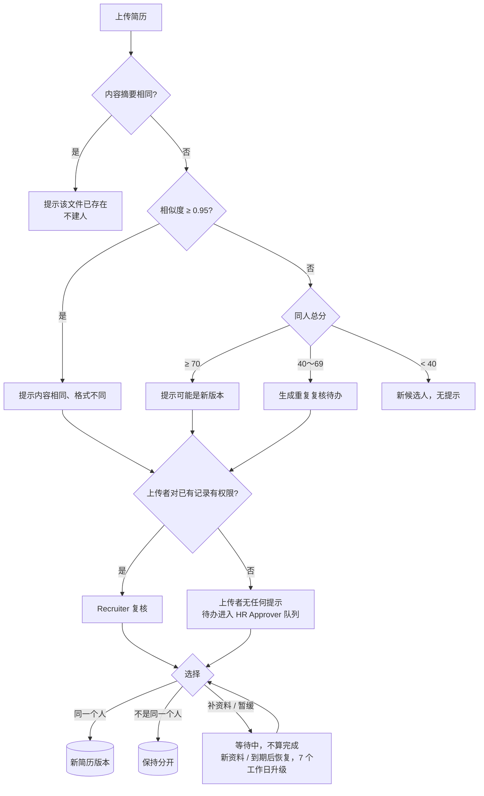

# F03 User Journey：重复识别与身份复核（P0）

| 项 | 内容 |
|---|---|
| 模块 | F03（对应测试脚本 J3） |
| 版本 / 日期 | v1.0 / 2026-10-14（草稿，待评审） |
| 同目录文档 | [产品文档](PRD.md) · [输入输出闭环](Loop_IO.md) · [User Cases](User_Cases.md) |
| 来源 | [用户旅程与测试脚本 v0.2](../../user-journeys/Resume_Screening_User_Journeys_v0.2.md) J3；角色见 [README 角色与权限](../README.md#角色与权限) |

## 角色与权限（本模块）

| 角色 | 在本模块的目的 | 可以做 | 不能做 |
|---|---|---|---|
| Recruiter / TA | 避免重复建人，判断是不是同一个人 | 看到上传时的重复提示；处理自己有权限的复核待办（同一个人 / 不是同一个人 / 补资料 / 暂缓） | 看到无权查看的已有记录（连「存在重复」也看不到） |
| Hiring Manager | 不负责复核 | — | 处理复核待办 |
| HR Approver | 处理上传者无权查看的那部分复核 | 处理受限复核队列；拆分错误合并；查看复核审计 | — |
| Viewer | 只读 | 查看候选人（不含受限字段） | 处理复核；接口返回 403 |

# 旅程

**主角色**：Recruiter / TA；HR Approver 处理受限复核；Hiring Manager、Viewer 验证不能复核
**登录目的**：同一个人的简历经常从多个渠道进来，想让系统帮我认出来，但合不合并由我决定，不能让系统合错。
**入口**：上传结果中的重复提示；任务中的「重复复核」待办（`#/duplicates/:id`）

## 输入

| 类型 | 内容 |
|---|---|
| 前置数据 | 简历库已有 `[UJ-TEST] Nina Torres`（S_lib_nina）；受限场景用 S_lib_nina_restricted |
| 用户数据 | 与 Nina 完全相同的文件（含改名）；另存为 DOCX；同名同邮箱、内容略有更新；同名同邮箱、履历完全不同；姓名多一个字母、邮箱不同；扫描件；复核选择 |
| 外部依赖 | 时钟（验证 3 天复查和 7 个工作日升级）；站内提醒 |

## 流程

## 步骤

| # | 角色 | 用户意图与操作 | 系统反馈 | 用户需要判断 |
|---|---|---|---|---|
| 1 | Recruiter | 再次上传 Nina 已有的文件（改名为 `cv_final.pdf`） | 提示该文件已存在，指向 Nina；不新建候选人、不建任务 | — |
| 2 | Recruiter | 上传 Nina 简历的 DOCX 版本 | 提示内容相同、格式不同，显示依据；不自动合并 | 是不是同一份简历 |
| 3 | Recruiter | 上传同名同邮箱、内容略有更新的简历 | 提示可能是同一人的新版本，显示命中的信号与得分（姓名 +15、邮箱 +40、内容相似 +15） | 是否存为新版本 |
| 4 | Recruiter | 上传 `nina_torress_resume.pdf`（姓名多一个字母、邮箱不同） | 作为新候选人入库；**不提示重复、不生成复核待办** | — |
| 5 | Recruiter | 上传 `nina_torres_other.pdf`（同名同邮箱、履历完全不同） | 生成一条重复复核待办 | — |
| 6 | Recruiter | 打开复核待办 | 并排展示新旧记录的来源、上传时间、版本、差异，以及命中的信号和得分 | 是不是同一个人 |
| 7 | Recruiter | 选择不是同一个人，二次确认 | 两条记录保持分开；待办完成；留下复核记录 | — |
| 8 | Recruiter | 对另一条复核选择补资料，写明需要什么 | 待办变为等待中，不算完成；两条记录不合并 | 需要哪些资料 |
| 9 | Recruiter | 上传该候选人的新简历 | 待办自动回到待处理，负责人收到提醒 | — |
| 10 | Recruiter | 选择暂缓，复查时间 3 天；时钟推进到期 | 到期回到待处理并提醒；7 个工作日仍未处理时，队列管理者收到升级提醒，提醒合并成摘要 | — |
| 11 | Recruiter（无权查看 Nina） | 上传与 Nina 同名同邮箱的简历 | 正常入库，**没有任何重复提示**；接口响应里也没有 Nina 的信息 | — |
| 12 | HR Approver | 打开受限复核队列 | 看到步骤 11 生成的待办；可以正常复核 | 是不是同一个人 |
| 13 | HR Approver | 对一次错误的合并执行拆分 | 两条记录恢复；历史证据保留；提示受影响的岗位关联需要复核 | 哪些关联要复核 |
| 14 | Hiring Manager | 打开复核待办链接，直接调用复核接口 | 没有处理入口；接口返回 403 | — |
| 15 | Viewer | 同上 | 同上 | — |

## 输出与交接

- 持久化：DuplicateCheck（类型、算法版本、相似度、命中信号及得分）；DuplicateResolution；HumanTask（duplicate_review，等待原因、复查时间、路由队列）；新简历版本。
- 交接：确认后的身份 → F04 简历库；新版本 → F02；未处理的复核 → F07 确认关联时提示。

**禁止副作用**：任何分数下自动合并；只有姓名相近就提示；完全相同文件重复建人；向上传者透露无权查看的记录；补资料或暂缓被算作完成；Hiring Manager、Viewer 能通过接口复核。

**成功标准**：完全相同的文件不重复建人；疑似重复全部交给有权限的人工判断；无权查看的记录不泄露；复核权限只属于 Recruiter / TA 和 HR Approver。

**测试映射**：Loop_IO P1～P15；用户旅程 v0.2 J3 步骤 3～5、11～12。

**待确认**：错误合并拆分的入口位置。
