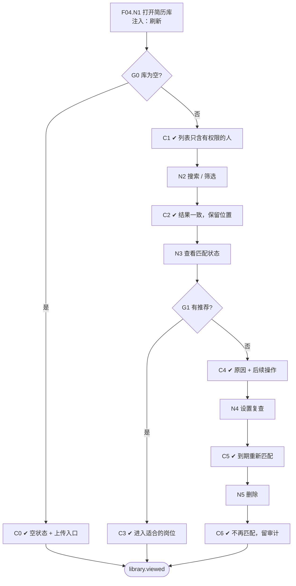

# F04 输入输出闭环：简历库

| 项 | 内容 |
|---|---|
| 模块 | F04 |
| 版本 / 日期 | v1.0 / 2026-10-14（草稿，待评审） |
| 同目录文档 | [产品文档](PRD.md) · [User Journey](User_Journey.md) · [User Cases](User_Cases.md) |
| 格式说明 | 见 [模块索引 README](../README.md#闭环文档格式) |

## 1. 输入与输出

| 部分 | 内容 |
|---|---|
| **输入·身份** | recruiter_a；recruiter_other_scope（检查列表只显示有权限的候选人） |
| **输入·前置状态** | S0_empty（空库）；S_dataset（有候选人、有推荐）；S_linked（有已关联候选人） |
| **输入·用户数据** | 搜索关键词；筛选条件（标签、来源、负责人、匹配状态、入库时间）；标签和负责人修改；无推荐时的后续操作（人工搜索岗位、补资料、设置复查时间、重新匹配） |
| **输入·外部依赖桩** | F06 匹配结果（各种匹配状态）；时钟（复查到期） |
| **输出·UI** | 候选人列表（候选人、标签、最近来源、负责人、匹配状态、最近匹配时间、关联岗位数）、「N of M candidates」；匹配状态及原因；无推荐时的操作入口；空状态和上传入口 |
| **输出·API / 数据** | LibraryEntry（负责人、标签、来源、保留状态、入库时间、最近匹配时间；job / application 可为空）；删除写入审计 |
| **输出·事件 / 审计** | 标签、负责人修改和删除写审计；重新匹配触发 F06 运行 |
| **输出·禁止副作用** | 上传要求选岗位；无岗位时创建虚拟岗位或虚拟 Application；已关联的候选人从库中消失；把「暂无合适岗位」显示为不合格；没有可处理的问题却反复生成待办；列表或接口返回无权查看的候选人；已删除的候选人继续被自动匹配 |
| **输出·交给下游** | 候选人 → F06 匹配；从详情进入 F07 关联 |

## 2. 结构化规格

```yaml
flow_id: F04
actor: recruiter_a
seed: S_dataset
entry: F04.N1
max_loop: 2
external: [discovery.status, clock]

nodes:
  - {id: F04.N1, type: action, do: "打开简历库", inject: [refresh]}
  - {id: F04.G0, type: decision, on: "库是否为空"}
  - {id: F04.C0, type: check, expect: {ui: "空状态，显示上传入口"}}
  - {id: F04.C1, type: check, expect: {ui: "说明文字；列表列齐全；N of M candidates", api: "只返回有权限的候选人"}}
  - {id: F04.N2, type: action, do: "按条件 Q 搜索或筛选"}
  - {id: F04.C2, type: check, expect: {ui: "结果与 Q 一致；返回后保留筛选条件和滚动位置"}}
  - {id: F04.N3, type: action, do: "查看某候选人的匹配状态 M"}
  - {id: F04.G1, type: decision, on: "M 是否有推荐"}
  - {id: F04.C3, type: check, expect: {ui: "显示推荐数，可进入适合的岗位（F06 / F07）"}}
  - {id: F04.C4, type: check, expect: {ui: "显示具体原因（no_match / no_open_jobs / insufficient_data / failed）；提供人工搜索岗位、补资料、设置复查、重新匹配；no_match 不显示为不合格"}}
  - {id: F04.N4, type: action, do: "设置复查时间"}
  - {id: F04.C5, type: check, expect: {db: "复查时间保存；到期后触发重新匹配"}}
  - {id: F04.N5, type: action, do: "删除候选人并确认", inject: [double_click]}
  - {id: F04.C6, type: check, expect: {db: "LibraryEntry 删除或标记；不再参与自动匹配", record: "审计"}}
  - {id: F04.T1, type: terminal, state: library.viewed}

edges:
  - [F04.N1, F04.G0]
  - [F04.G0, F04.C0, {when: "seed = S0_empty"}]
  - [F04.C0, F04.T1]
  - [F04.G0, F04.C1, {when: "非空"}]
  - [F04.C1, F04.N2]
  - [F04.N2, F04.C2]
  - [F04.C2, F04.N3]
  - [F04.N3, F04.G1]
  - [F04.G1, F04.C3, {when: "M = recommendations_ready"}]
  - [F04.C3, F04.T1]
  - [F04.G1, F04.C4, {when: "M 属于 no_match / no_open_jobs / insufficient_data / failed"}]
  - [F04.C4, F04.N4]
  - [F04.N4, F04.C5]
  - [F04.C5, F04.N5]
  - [F04.N5, F04.C6]
  - [F04.C6, F04.T1]
```

## 3. 测试数据

| 名称 | 内容 |
|---|---|
| q_tag | 标签 `Backend` |
| q_status | 匹配状态 = 暂无合适岗位 |
| q_source | 来源 = CSV |
| cand_linked | `[UJ-TEST] Nina Torres`（已关联岗位，S_linked） |
| cand_no_match | 方向为 `Quality Engineering` 的候选人（no_match） |
| cand_sparse | `[UJ-TEST] Minh Vo`（insufficient_data） |
| cand_ai_failed | 匹配时注入 llm_fail 的候选人（failed） |

## 4. 路径清单

| 路径 | 节点序列 | 数据 / 注入 | 终态 | 对应 AC |
|---|---|---|---|---|
| P1 空库 | F04.N1 → G0 → C0 | S0_empty | library.viewed | AC-1 |
| P2 列表与搜索 | F04.N1 → G0 → C1 → N2 → C2 | q_tag、q_status、q_source | library.viewed | — |
| P3 有推荐 | … → N3 → G1 → C3 | 有推荐的候选人 | library.viewed | — |
| P4 四种无推荐状态 | … → N3 → G1 → C4 | S0_empty 上传后（no_open_jobs）、cand_no_match、cand_sparse、cand_ai_failed | 各自显示原因 | AC-2、AC-4 |
| P5 设置复查 | … → C4 → N4 → C5 | cand_no_match + clock 到期 | 重新匹配 | AC-4 |
| P6 已关联仍在库 | F04.N1 → C1 | S_linked、cand_linked | 列表中可见，关联岗位数 = 1 | AC-3 |
| P7 权限过滤 | F04.N1 → C1（recruiter_other_scope） | S_dataset | 接口不返回无权限候选人 | AC-5 |
| P8 删除 | … → N5 → C6 | 任一候选人 | 不再被自动匹配 | — |
| P9 持久化 | P2 后刷新 | refresh | 数据保持 | AC-6 |

## 5. 流程图（由规格生成）



## 6. 待确认

- 复查时间的可选项，到期后是重新匹配还是生成任务（见 PRD 待确认 1）。
- 删除为软删除还是按保留策略硬删除（见 PRD 待确认 2）。
