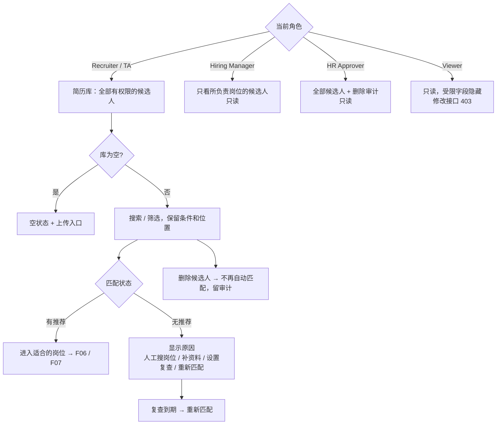

# F04 User Journey：简历库（P1）

| 项 | 内容 |
|---|---|
| 模块 | F04（对应测试脚本 J3） |
| 版本 / 日期 | v1.0 / 2026-10-14（草稿，待评审） |
| 同目录文档 | [产品文档](PRD.md) · [输入输出闭环](Loop_IO.md) · [User Cases](User_Cases.md) |
| 来源 | [用户旅程与测试脚本 v0.2](../../user-journeys/Resume_Screening_User_Journeys_v0.2.md) J3、J10 E1；角色见 [README 角色与权限](../README.md#角色与权限) |

## 角色与权限（本模块）

| 角色 | 在本模块的目的 | 可以做 | 不能做 |
|---|---|---|---|
| Recruiter / TA | 管理全部候选人，让暂时没有岗位的人不丢失 | 查看、搜索、筛选；修改标签和负责人；处理无推荐（人工搜岗位、补资料、设置复查、重新匹配）；删除 | 看到无权限的候选人 |
| Hiring Manager | 找到所负责岗位相关的候选人 | 查看所负责岗位的候选人 | 修改标签、负责人；删除；对未关联的候选人触发匹配 |
| HR Approver | 合规核查 | 查看全部候选人和删除审计 | 修改、删除 |
| Viewer | 只读 | 查看列表（不含受限字段） | 所有修改类操作；接口返回 403 |

# 旅程

**主角色**：Recruiter / TA；其他三类角色验证列表范围和只读限制
**登录目的**：简历常常比岗位先到，想把所有候选人放在一个地方；有新岗位时能重新找出来，暂时没岗位的人也不会被当成不合格。
**入口**：侧栏 Resume Library（`#/library`）

## 输入

| 类型 | 内容 |
|---|---|
| 前置数据 | S0_empty（空库）；S_dataset（有候选人和推荐）；S_linked（有已关联候选人） |
| 用户数据 | 搜索词；筛选条件（标签 Backend、匹配状态、来源 CSV）；标签和负责人修改；复查时间；删除确认 |
| 外部依赖 | F06 匹配状态；时钟（复查到期） |

## 流程

## 步骤

| # | 角色 | 用户意图与操作 | 系统反馈 | 用户需要判断 |
|---|---|---|---|---|
| 1 | Recruiter | 在空库中打开简历库 | 空状态和上传入口 | — |
| 2 | Recruiter | 在 S_dataset 中打开简历库 | 说明「候选人无论是否关联岗位都保留在这里」；列：候选人、标签、最近来源、负责人、匹配状态、最近匹配、关联岗位数；显示「N of M candidates」 | — |
| 3 | Recruiter | 按标签 Backend、匹配状态、来源筛选，打开一个候选人后返回 | 结果正确；返回后筛选条件和滚动位置都在 | — |
| 4 | Recruiter | 查看 Nina（已关联岗位） | Nina 仍在库中，关联岗位数为 1 | — |
| 5 | Recruiter | 查看四种无推荐的候选人 | 分别显示没有开放岗位 / 暂无合适岗位 / 资料不足 / 匹配失败；「暂无合适岗位」不显示为不合格 | 下一步怎么处理 |
| 6 | Recruiter | 对暂无合适岗位的候选人设置 3 天后复查 | 保存复查时间；到期后自动重新匹配 | 复查时间 |
| 7 | Recruiter | 修改 Pia 的标签和负责人 | 保存成功，留下修改记录 | — |
| 8 | Recruiter | 删除一个测试候选人，确认 | 从列表消失；之后不再参与自动匹配；留审计 | 是否确认删除 |
| 9 | Recruiter（无测试候选人权限） | 打开简历库 | 列表和接口都不包含测试候选人 | — |
| 10 | Hiring Manager | 打开简历库 | 只看到所负责岗位的候选人；没有修改标签、负责人、删除的入口；直接调用接口返回 403 | — |
| 11 | HR Approver | 打开简历库，查看步骤 8 的删除审计 | 全部候选人可见，只读；审计中有删除人、时间 | — |
| 12 | Viewer | 打开简历库并查看 Network 响应 | 只读列表；联系方式等受限字段不在响应中；修改接口返回 403 | — |
| 13 | Recruiter | 刷新页面 | 数据保持 | — |

## 输出与交接

- 持久化：LibraryEntry（负责人、标签、来源、保留状态、入库时间、最近匹配时间）；修改与删除审计；复查时间。
- 交接：候选人 → F06 匹配；从详情进入 F07 关联。

**禁止副作用**：没有岗位时创建虚拟岗位或 Application；已关联候选人从库中消失；「暂无合适岗位」显示为不合格；反复生成无意义的待办；返回无权限的候选人；已删除的候选人继续被匹配。

**成功标准**：候选人与岗位解耦，任何状态都可见、可处理；不同角色看到的范围和可做的操作与权限矩阵一致。

**测试映射**：Loop_IO P1～P9；用户旅程 v0.2 J3 步骤 1、13，J10 E1。

**待确认**：Hiring Manager 的可见范围是否限于所负责岗位（权限矩阵中标 * 的默认值）；复查到期后是重新匹配还是生成任务；删除为软删除还是硬删除。
