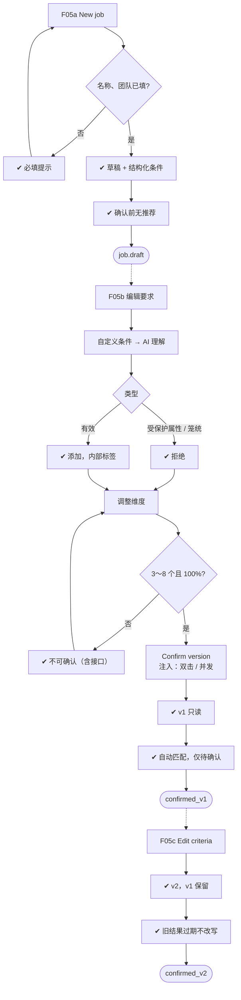

# F05 输入输出闭环：岗位与评分标准

| 项 | 内容 |
|---|---|
| 模块 | F05 |
| 版本 / 日期 | v1.0 / 2026-10-14（草稿，待评审） |
| 同目录文档 | [产品文档](PRD.md) · [User Journey](User_Journey.md) · [User Cases](User_Cases.md) |
| 格式说明 | 见 [模块索引 README](../README.md#闭环文档格式) |

## 1. 输入与输出

| 部分 | 内容 |
|---|---|
| **输入·身份** | recruiter_a（岗位标准负责人）；hm_a（非标准负责人）、approver_a、viewer_a（检查无编辑权限） |
| **输入·前置状态** | S0_empty（新建岗位）；S_job_draft（配置标准）；S_job_confirmed / S_linked（修改已确认标准） |
| **输入·用户数据** | 岗位名称、团队 / 职能、粘贴的 JD；基础要求（工作年限、工作地点、学历、语言、证书、排除职称、薪酬范围）；业务要求及优先级（Must-have / Preferred）；自定义条件文本；评分维度与权重；确认操作 |
| **输入·外部依赖桩** | llm.jd_extract（从 JD 提取条件）、llm.criteria_understand（自定义条件「查看 AI 理解」）；JD Management 快照（可选导入） |
| **输出·UI** | 标准页五部分（AI 如何筛选、基础要求、业务要求、自定义条件、评分维度）；校验提示；确认时的默认维度警示；版本号与只读状态；岗位列表中「开放中」与「标准未确认」区分；旧结果的「过期，可刷新」 |
| **输出·API / 数据** | Job（名称、团队、状态、标准状态、负责人）；JobCriteriaVersion（版本号、draft / confirmed、各部分条件、维度与权重、确认人、确认时间） |
| **输出·事件 / 审计** | 标准确认事件（首次确认触发 F06 自动匹配；新版本确认使已有推荐和评估过期）；AiRun（提取与理解）；审计 |
| **输出·禁止副作用** | 标准未确认就匹配候选人；已确认版本被就地改写；权重 ≠ 100% 或维度数不合格仍能确认（含绕过前端直接调接口）；受保护属性条件被添加；出现工作授权或招聘预算字段；新版本确认后自动重跑或改写旧评估；修改回写 JD Management |
| **输出·交给下游** | 已确认的 JobCriteriaVersion → F06 匹配、F08 评估；版本变化 → F06、F08、F10 标过期 |

## 2. 结构化规格

```yaml
flow_id: F05a  # 新建岗位
actor: recruiter_a
seed: S0_empty
entry: F05a.N1
max_loop: 3
external: [llm.jd_extract]

nodes:
  - {id: F05a.N1, type: action, do: "点击 New job，填写表单 J 并点 Create draft job", inject: [double_click, llm_fail]}
  - {id: F05a.G1, type: decision, on: "岗位名称、团队是否已填"}
  - {id: F05a.CE1, type: check, expect: {ui: "提示必填（团队说明用于方向匹配）", db: "无新 Job"}}
  - {id: F05a.C1, type: check, expect: {ui: "跳转标准页；状态为草稿；五个部分可见", db: "Job + JobCriteriaVersion(status=draft)；只创建 1 个"}}
  - {id: F05a.C2, type: check, expect: {ui: "基础要求为结构化字段；Must-have / Preferred 分组正确；无工作授权字段；维度提示尚未调整"}}
  - {id: F05a.C3, type: check, expect: {db: "确认前该岗位没有任何推荐"}}
  - {id: F05a.T1, type: terminal, state: job.draft}

edges:
  - [F05a.N1, F05a.G1]
  - [F05a.G1, F05a.CE1, {when: "J 属于 job_no_title / job_no_team"}]
  - [F05a.CE1, F05a.N1]
  - [F05a.G1, F05a.C1, {when: "J 属于 job_ok"}]
  - [F05a.C1, F05a.C2]
  - [F05a.C2, F05a.C3]
  - [F05a.C3, F05a.T1]
---
flow_id: F05b  # 配置并确认标准
actor: recruiter_a
seed: S_job_draft
entry: F05b.N1
max_loop: 3
external: [llm.criteria_understand]

nodes:
  - {id: F05b.N1, type: action, do: "编辑基础要求与业务要求"}
  - {id: F05b.C1, type: check, expect: {ui: "添加下拉只列未启用字段；地点为国家 + 城市，换国家清空城市；薪酬显示敏感标签；薪酬最小值 > 最大值时拦截", api: "服务端同样拒绝非法区间"}}
  - {id: F05b.N2, type: action, do: "输入自定义条件 K，点查看 AI 理解", inject: [llm_fail]}
  - {id: F05b.G1, type: decision, on: "K 的类型"}
  - {id: F05b.CE1, type: check, expect: {ui: "拒绝：不支持受保护属性，建议替代写法", db: "未添加"}}
  - {id: F05b.CE2, type: check, expect: {ui: "提示过于笼统，要求可验证的事实", db: "未添加"}}
  - {id: F05b.C2, type: check, expect: {ui: "显示 AI 理解预览；添加后带内部标签，计数 n / 10"}}
  - {id: F05b.N3, type: action, do: "调整评分维度 W"}
  - {id: F05b.G2, type: decision, on: "维度 3～8 个、不重复、权重合计 100%"}
  - {id: F05b.CE3, type: check, expect: {ui: "Confirm criteria 不可点并说明原因", api: "绕过前端提交返回 4xx（WEIGHTS_NOT_100 等）"}}
  - {id: F05b.N4, type: action, do: "点 Confirm criteria → Confirm version", inject: [double_click, concurrent]}
  - {id: F05b.C3, type: check, expect: {ui: "维度为默认值时先警示；确认后版本号 v1，页面只读", db: "JobCriteriaVersion.status=confirmed；只确认一个版本"}}
  - {id: F05b.C4, type: check, expect: {ui: "出现自动匹配完成提示", db: "F06 推荐均为 proposed；无 Application"}}
  - {id: F05b.T1, type: terminal, state: criteria.confirmed_v1}

edges:
  - [F05b.N1, F05b.C1]
  - [F05b.C1, F05b.N2]
  - [F05b.N2, F05b.G1]
  - [F05b.G1, F05b.CE1, {when: "K 属于 cc_protected"}]
  - [F05b.G1, F05b.CE2, {when: "K 属于 cc_vague"}]
  - [F05b.G1, F05b.C2, {when: "K 属于 cc_ok"}]
  - [F05b.CE1, F05b.N3]
  - [F05b.CE2, F05b.N3]
  - [F05b.C2, F05b.N3]
  - [F05b.N3, F05b.G2]
  - [F05b.G2, F05b.CE3, {when: "W 属于 w_not_100 / w_too_few / w_too_many / w_duplicate"}]
  - [F05b.CE3, F05b.N3]
  - [F05b.G2, F05b.N4, {when: "W 属于 w_ok"}]
  - [F05b.N4, F05b.C3]
  - [F05b.C3, F05b.C4]
  - [F05b.C4, F05b.T1]
---
flow_id: F05c  # 修改已确认标准
actor: recruiter_a
seed: S_linked
entry: F05c.N1
max_loop: 2
external: []

nodes:
  - {id: F05c.N1, type: action, do: "点 Edit criteria"}
  - {id: F05c.C1, type: check, expect: {ui: "生成下一版本草稿；v1 仍只读", db: "v1 内容不变"}}
  - {id: F05c.N2, type: action, do: "工作年限最少改为 7，确认版本"}
  - {id: F05c.C2, type: check, expect: {db: "v2 confirmed；v1 保留"}}
  - {id: F05c.C3, type: check, expect: {ui: "已有推荐、评估、对比显示过期，可刷新", db: "旧评估引用 v1，未被改写，未自动重跑"}}
  - {id: F05c.T1, type: terminal, state: criteria.confirmed_v2}

edges:
  - [F05c.N1, F05c.C1]
  - [F05c.C1, F05c.N2]
  - [F05c.N2, F05c.C2]
  - [F05c.C2, F05c.C3]
  - [F05c.C3, F05c.T1]
---
flow_id: F05d  # 编辑权限
actor: hm_a
seed: S_job_confirmed
entry: F05d.N1
max_loop: 1
external: []

nodes:
  - {id: F05d.N1, type: action, do: "以 hm_a（非标准负责人）、approver_a、viewer_a 分别打开标准页并尝试编辑"}
  - {id: F05d.C1, type: check, expect: {ui: "编辑入口不可用并说明原因", api: "直接调用编辑 / 确认接口返回 403"}}
  - {id: F05d.T1, type: terminal, state: no_change}

edges:
  - [F05d.N1, F05d.C1]
  - [F05d.C1, F05d.T1]
```

## 3. 测试数据

| 名称 | 内容 |
|---|---|
| job_ok | 名称 `[UJ-TEST] Senior Backend Engineer II`；团队 `Platform Engineering`；JD 用用户旅程 §3.2 英文 JD |
| job_no_title / job_no_team | 缺岗位名称 / 缺团队 |
| cc_ok | `Has payments or billing system experience` |
| cc_protected | `限男性 35岁以下`、`Male only, under 35`、`age under 30` |
| cc_vague | `Great person` |
| cc_full | 已有 10 条自定义条件时再添加 |
| w_ok | 4 个维度，权重 25% × 4 |
| w_not_100 | 合计 90% |
| w_too_few / w_too_many | 2 个维度 / 9 个维度 |
| w_duplicate | 同一维度添加两次 |
| salary_inverted | 最小值 72000、最大值 54000 |

## 4. 路径清单

| 路径 | 节点序列 | 数据 / 注入 | 终态 | 对应 AC |
|---|---|---|---|---|
| P1 只用 JD 建岗位 | F05a.N1 → G1 → C1 → C2 → C3 | job_ok | job.draft | AC-1、AC-2 |
| P2 必填校验 | F05a.N1 → G1 → CE1 | job_no_title、job_no_team | 不创建 | — |
| P3 有效自定义条件 | F05b.N2 → G1 → C2 | cc_ok | 添加成功 | — |
| P4 受保护属性 / 笼统 | F05b.N2 → G1 → CE1 / CE2 | cc_protected、cc_vague | 未添加 | AC-3 |
| P5 维度校验 | F05b.N3 → G2 → CE3 | w_not_100、w_too_few、w_too_many、w_duplicate | 不可确认（含接口） | AC-4 |
| P6 确认并触发匹配 | F05b 全程 | w_ok | criteria.confirmed_v1 | AC-5 |
| P7 薪酬区间 | F05b.N1 → C1 | salary_inverted | 前后端都拦截 | — |
| P8 新版本与过期 | F05c 全程 | — | criteria.confirmed_v2 | AC-6 |
| P9 标准未确认不可匹配 | S_job_draft 下查看岗位列表与 F06 | — | 显示标准未确认，无推荐 | AC-7 |
| P10 无编辑权限 | F05d 全程 | hm_a、approver_a、viewer_a | no_change（接口 403） | AC-8 |
| P11 并发确认 | F05b.N4 两个会话 | concurrent | 只确认一个版本 | — |

## 5. 流程图（由规格生成）



## 6. 待确认

- 与 PRD 待确认一致：Patch 1 补入仓库、默认维度清单、内部招聘备注的对外可见范围。
