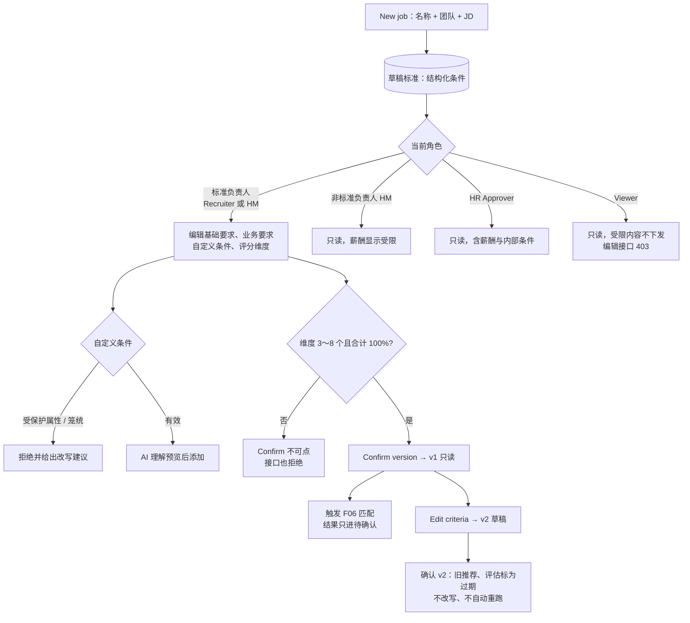

# F05 User Journey：岗位与评分标准（P0）

| 项 | 内容 |
|---|---|
| 模块 | F05（对应测试脚本 J1、J2、J7） |
| 版本 / 日期 | v1.0 / 2026-10-14（草稿，待评审） |
| 同目录文档 | [产品文档](PRD.md) · [输入输出闭环](Loop_IO.md) · [User Cases](User_Cases.md) |
| 来源 | [用户旅程与测试脚本 v0.2](../../user-journeys/Resume_Screening_User_Journeys_v0.2.md) J1、J2、J7、J10；角色见 [README 角色与权限](../README.md#角色与权限) |

## 角色与权限（本模块）

| 角色 | 在本模块的目的 | 可以做 | 不能做 |
|---|---|---|---|
| Recruiter / TA | 把 JD 变成可确认的筛选标准 | 新建岗位；担任岗位标准负责人时编辑和确认标准、生成新版本 | 非标准负责人时编辑；添加受保护属性条件；绕过维度校验 |
| Hiring Manager | 确认岗位真正需要什么 | 担任岗位标准负责人时编辑和确认；否则查看标准（含 AI 如何筛选） | 非标准负责人时编辑；看到薪酬范围 |
| HR Approver | 了解例外审批时的岗位底线 | 查看全部标准（含薪酬范围、内部自定义条件）和版本历史 | 编辑、确认标准 |
| Viewer | 只读 | 查看标准中的非受限内容 | 编辑、确认；看到薪酬范围和内部条件；接口返回 403 |

# 旅程

**主角色**：Recruiter / TA（本旅程中为岗位标准负责人）；Hiring Manager、HR Approver、Viewer 验证编辑权限和可见内容
**登录目的**：有一份 JD，想让系统按我确认过的标准去找人和筛人；标准改了以后，旧结论不能被悄悄改掉。
**入口**：Jobs → New job；岗位详情 → Requirements & rubric（`#/jobs/:id/criteria`）

## 输入

| 类型 | 内容 |
|---|---|
| 前置数据 | S0_empty（新建）；S_job_draft（配置）；S_linked（修改已确认标准） |
| 用户数据 | 岗位名称 `[UJ-TEST] Senior Backend Engineer II`、团队 `Platform Engineering`、英文 JD；工作地点、年限、薪酬范围；Must-have / Preferred；自定义条件（有效 / 受保护属性 / 笼统）；评分维度和权重 |
| 外部依赖 | JD 条件提取模型；自定义条件理解模型；JD Management 快照（可选） |

## 流程

## 步骤

| # | 角色 | 用户意图与操作 | 系统反馈 | 用户需要判断 |
|---|---|---|---|---|
| 1 | Recruiter | 点 New job，什么都不填直接创建 | 提示岗位名称必填；只填名称时提示团队必填（用于方向匹配） | — |
| 2 | Recruiter | 填写名称、团队并粘贴 JD，创建 | 进入标准页，状态为草稿；有 AI 如何筛选、基础要求、业务要求、自定义条件、评分维度五部分 | — |
| 3 | Recruiter | 查看提取结果 | 基础要求是结构化字段（年限 5 年以上、地点越南河内混合、本科）；Go / K8s / PostgreSQL 为 Must-have，Kafka / Redis 为 Preferred；**没有工作授权字段**；维度提示尚未针对岗位调整 | 提取是否准确 |
| 4 | Recruiter | 回到岗位列表 | 岗位显示标准未确认；没有任何候选人被匹配 | — |
| 5 | Recruiter | 添加工作地点：选国家，再选城市；切换国家 | 城市列表跟随国家；切换国家后已选城市被清空 | — |
| 6 | Recruiter | 填薪酬：最小值大于最大值 | 被拦截；改正后显示 `$54,000–$72,000/yr (gross)` 和敏感标签 | — |
| 7 | Recruiter | 自定义条件输入「限男性 35岁以下」「Great person」 | 前者被拒绝并建议改用年限或地点；后者提示过于笼统 | 怎么改写 |
| 8 | Recruiter | 输入「Has payments or billing system experience」，查看 AI 理解后添加 | 显示评估对象、判断规则、未满足和未知的处理；添加后带内部标签，计数 1 / 10 | 理解是否正确 |
| 9 | Recruiter | 把权重改成合计 90%；删到 2 个维度；加到 9 个 | Confirm criteria 不可点并说明原因；绕过前端直接提交，接口返回错误 | — |
| 10 | Recruiter | 点平均分配，确认版本 | 维度仍是默认值时先警示；确认后版本 v1、页面只读；稍后提示自动匹配完成，匹配结果都是待确认 | 是否接受默认维度 |
| 11 | Recruiter | 点 Edit criteria，把年限改为 7 年，确认 | 生成 v2；v1 保留；已有推荐、评估、对比标为过期，可刷新，没有被改写或自动重跑 | 是否刷新评估 |
| 12 | Hiring Manager（非标准负责人） | 打开标准页并尝试编辑 | 编辑入口不可用并说明原因；薪酬范围显示受限；直接调用编辑接口返回 403 | — |
| 13 | Hiring Manager（标准负责人） | 在另一个由 HM 负责标准的岗位上编辑并确认 | 与 Recruiter 一样可以编辑、确认 | — |
| 14 | HR Approver | 打开标准页和版本历史 | 能看到薪酬范围和内部自定义条件；没有编辑和确认入口；接口返回 403 | — |
| 15 | Viewer | 打开标准页并查看 Network 响应 | 只读；薪酬范围和内部自定义条件不在响应中；编辑接口返回 403 | — |
| 16 | Recruiter | 两个标签页同时确认同一版本；双击确认 | 只确认一个版本，另一方看到冲突提示 | — |

## 输出与交接

- 持久化：Job；JobCriteriaVersion（版本、draft / confirmed、条件、维度与权重、确认人、时间）；AiRun；审计。
- 交接：已确认标准 → F06 匹配、F08 评估；新版本 → F06、F08、F10 标过期。

**禁止副作用**：标准未确认就匹配；已确认版本被就地改写；校验只在前端；受保护属性条件被添加；出现工作授权或招聘预算字段；修改回写 JD Management；非标准负责人能通过接口编辑。

**成功标准**：只有标准负责人能确认标准，且只有确认后的标准参与匹配；修改生成新版本，旧结论可追溯；敏感内容按角色可见。

**测试映射**：Loop_IO P1～P11；用户旅程 v0.2 J1 步骤 1～11、J2 步骤 1～19、J7 步骤 1～8、J10 E2～E5、E12。

**待确认**：Patch 1「Admin 可编辑任意岗位标准」在四类角色下是否需要对应角色；Hiring Manager 能否查看薪酬范围；HR Approver 是否需要编辑权限（均为权限矩阵中标 * 的默认值）。
