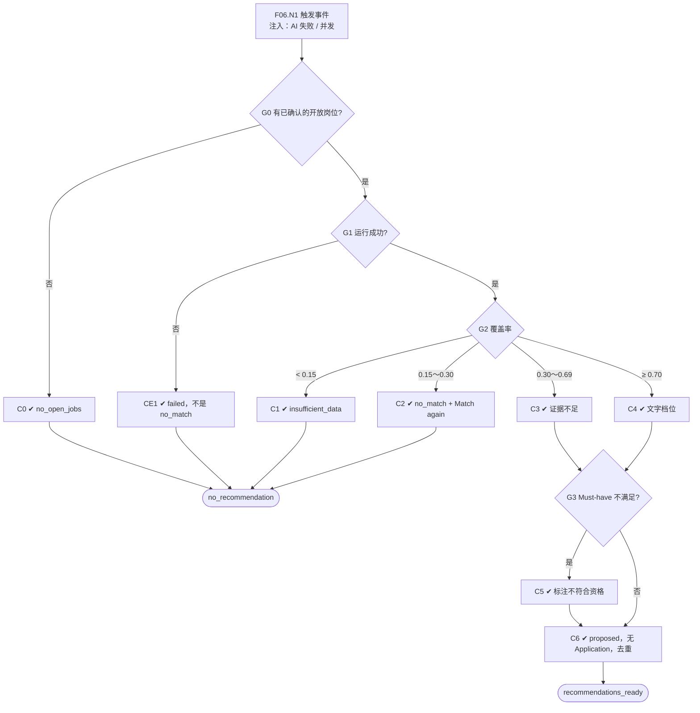

# F06 输入输出闭环：AI 岗位发现与推荐

| 项 | 内容 |
|---|---|
| 模块 | F06 |
| 版本 / 日期 | v1.0 / 2026-10-14（草稿，待评审） |
| 同目录文档 | [产品文档](PRD.md) · [User Journey](User_Journey.md) · [User Cases](User_Cases.md) |
| 格式说明 | 见 [模块索引 README](../README.md#闭环文档格式) |

## 1. 输入与输出

| 部分 | 内容 |
|---|---|
| **输入·身份** | 系统自动运行；recruiter_a 查看结果、手动重新匹配；recruiter_other_scope（检查只在可访问岗位中匹配） |
| **输入·前置状态** | S_job_confirmed（岗位已确认，简历库为空）；S_dataset；S_job_closed |
| **输入·用户数据** | 触发匹配的事件：新简历入库、岗位标准首次确认 / 更新、岗位新增或重开、候选人资料更新、手动 Match again |
| **输入·外部依赖桩** | llm.job_match：成功 / 失败 / 超时；返回的覆盖率（用于验证 0.15 / 0.30 / 0.70 门槛） |
| **输出·UI** | 候选人「适合的岗位」页和岗位「AI Suggested candidates」：每条推荐的理由、关键缺口、证据、置信度档位（Strong / Some / Limited match signal，或「证据不足」）；不符合资格的推荐带标注且不显示置信度；无推荐时的原因和 Match again；待确认推荐与已关联候选人分开计数 |
| **输出·API / 数据** | JobDiscoveryRun（资料版本、岗位集合快照、规则 / 模型版本、状态、无推荐原因）；PreLinkMatchEvaluation（逐维结果、证据、缺口，无 application_id）；CandidateJobRecommendation（status=proposed） |
| **输出·事件 / 审计** | AiRun；新的有效推荐生成岗位关联确认任务（link_confirmation，按候选人 × 岗位去重） |
| **输出·禁止副作用** | 推荐产生 Application 或自动关联；AI 失败记为 no_match；在未确认标准、已关闭或无权访问的岗位中匹配；不同岗位分数混排；显示百分比置信度或录用概率；不符合资格的推荐被隐藏；同一候选人 × 岗位出现两条待确认推荐；理由引用简历中不存在的内容 |
| **输出·交给下游** | proposed 推荐 → F07 人工关联；匹配状态 → F04 简历库显示 |

## 2. 结构化规格

```yaml
flow_id: F06
actor: system
seed: S_job_confirmed
entry: F06.N1
max_loop: 2
external: [llm.job_match]

nodes:
  - {id: F06.N1, type: action, do: "触发事件 E", inject: [llm_fail, concurrent]}
  - {id: F06.G0, type: decision, on: "是否有可访问、开放且标准已确认的岗位"}
  - {id: F06.C0, type: check, expect: {ui: "状态 no_open_jobs，候选人留在库中", db: "JobDiscoveryRun.status=no_open_jobs；无推荐"}}
  - {id: F06.G1, type: decision, on: "匹配运行结果"}
  - {id: F06.CE1, type: check, expect: {ui: "状态 failed，可重试", db: "JobDiscoveryRun.status=failed（不是 no_match）"}}
  - {id: F06.G2, type: decision, on: "覆盖率"}
  - {id: F06.C1, type: check, expect: {ui: "状态 insufficient_data，提示补资料", db: "无推荐"}}
  - {id: F06.C2, type: check, expect: {ui: "不生成推荐，状态 no_match，提供 Match again；不显示为不合格", db: "无推荐"}}
  - {id: F06.C3, type: check, expect: {ui: "推荐显示「证据不足，无法估算置信度」"}}
  - {id: F06.C4, type: check, expect: {ui: "推荐显示文字档位，不显示百分比；理由引用简历真实内容"}}
  - {id: F06.G3, type: decision, on: "硬性条件"}
  - {id: F06.C5, type: check, expect: {ui: "推荐仍显示，标注不符合资格，不显示置信度"}}
  - {id: F06.C6, type: check, expect: {db: "CandidateJobRecommendation.status=proposed；Application 数不变；每个候选人 × 岗位只有 1 条有效推荐；生成 1 个 link_confirmation 任务", record: "AiRun、输入版本"}}
  - {id: F06.T1, type: terminal, state: recommendations_ready}
  - {id: F06.T2, type: terminal, state: no_recommendation}

edges:
  - [F06.N1, F06.G0]
  - [F06.G0, F06.C0, {when: "seed 无确认岗位，或岗位全部关闭"}]
  - [F06.C0, F06.T2]
  - [F06.G0, F06.G1, {when: "有"}]
  - [F06.G1, F06.CE1, {when: "注入 llm_fail"}]
  - [F06.CE1, F06.T2]
  - [F06.G1, F06.G2, {when: "成功"}]
  - [F06.G2, F06.C1, {when: "< 0.15"}]
  - [F06.C1, F06.T2]
  - [F06.G2, F06.C2, {when: "0.15～0.30"}]
  - [F06.C2, F06.T2]
  - [F06.G2, F06.C3, {when: "0.30～0.69"}]
  - [F06.G2, F06.C4, {when: "≥ 0.70"}]
  - [F06.C3, F06.G3]
  - [F06.C4, F06.G3]
  - [F06.G3, F06.C5, {when: "有明确不满足的 Must-have"}]
  - [F06.G3, F06.C6, {when: "无"}]
  - [F06.C5, F06.C6]
  - [F06.C6, F06.T1]
```

## 3. 测试数据

| 名称 | 内容 |
|---|---|
| E_resume_in | 用户旅程 §3.4 的 5 名候选人逐个入库（S_job_confirmed） |
| E_criteria_confirm | 简历库已有 5 名候选人，岗位标准首次确认 |
| E_criteria_update | S_dataset 下岗位标准 v2 确认 |
| E_profile_update | Nina 的档案纠正后保存 |
| E_manual | 手动 Match again |
| E_repeat | 同一候选人 × 岗位触发两次匹配 |
| cand_nina / cand_hoa | 预期 Strong 或 Some 档位，符合资格 |
| cand_ben | 新加坡、不能搬迁：不符合资格 |
| cand_minh | 资料过少：insufficient_data 或证据不足 |
| cand_qa | 方向为 `Quality Engineering`：no_match |

## 4. 路径清单

| 路径 | 节点序列 | 数据 / 注入 | 终态 | 对应 AC |
|---|---|---|---|---|
| P1 没有开放岗位 | F06.N1 → G0 → C0 | S0_empty 上传简历 | no_recommendation（no_open_jobs） | AC-1 |
| P2 有推荐 | F06.N1 → G0 → G1 → G2 → C4 → G3 → C6 | E_resume_in、cand_nina | recommendations_ready | AC-2、AC-4、AC-5 |
| P3 不符合资格 | … → G3 → C5 → C6 | cand_ben | recommendations_ready（标注不符合资格） | AC-4 |
| P4 证据不足 | … → G2 → C3 / C1 | cand_minh | 证据不足或 insufficient_data | AC-1、AC-4 |
| P5 无匹配 | … → G2 → C2 | cand_qa | no_recommendation（no_match） | AC-1 |
| P6 AI 失败 | … → G1 → CE1 | llm_fail | no_recommendation（failed） | AC-1 |
| P7 确认标准触发 | 同 P2 | E_criteria_confirm | 5 人中合适者为 proposed | AC-3 |
| P8 重新匹配去重 | 同 P2 两次 | E_repeat、E_manual | 只有 1 条待确认推荐、1 个任务 | AC-3 |
| P9 已关闭岗位 | F06.N1 → G0 | S_job_closed | 不参与匹配；已有推荐不能确认 | AC-7 |
| P10 不混排 | 两个岗位分别推荐同一候选人 | E_resume_in | 推荐按岗位分开展示 | AC-6 |
| P11 权限 | F06.N1（recruiter_other_scope 上传） | 无权访问测试岗位 | 不出现该岗位的推荐 | — |

## 5. 流程图（由规格生成）



## 6. 待确认

- 0.15 / 0.30 / 0.70 门槛以 Patch 1 为准还是以当前实现为准（同 PRD 待确认 1）；本闭环按 Patch 1 编写。
