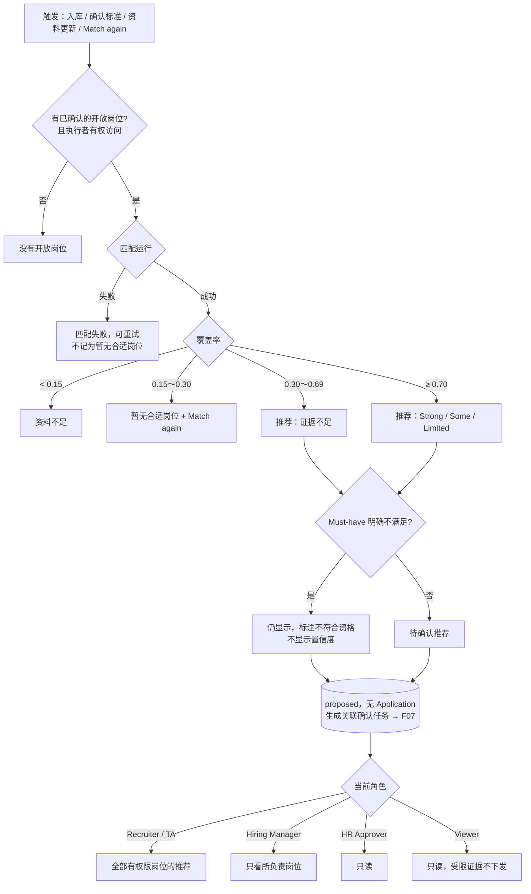

# F06 User Journey：AI 岗位发现与推荐（P0）

| 项 | 内容 |
|---|---|
| 模块 | F06（对应测试脚本 J2、J5） |
| 版本 / 日期 | v1.0 / 2026-10-14（草稿，待评审） |
| 同目录文档 | [产品文档](PRD.md) · [输入输出闭环](Loop_IO.md) · [User Cases](User_Cases.md) |
| 来源 | [用户旅程与测试脚本 v0.2](../../user-journeys/Resume_Screening_User_Journeys_v0.2.md) J2、J5、J10 E1、E8、E9；角色见 [README 角色与权限](../README.md#角色与权限) |

## 角色与权限（本模块）

| 角色 | 在本模块的目的 | 可以做 | 不能做 |
|---|---|---|---|
| Recruiter / TA | 让系统主动找出可能合适的岗位或候选人 | 查看推荐、理由、置信度；手动 Match again；人工搜索岗位 | 看到无权访问岗位的推荐 |
| Hiring Manager | 看到自己岗位的 AI 推荐 | 查看所负责岗位的推荐；在自己岗位上 Match again | 看到其他岗位的推荐 |
| HR Approver | 了解推荐依据 | 查看推荐和理由 | 触发匹配 |
| Viewer | 只读 | 查看推荐的结论（不含受限证据） | 触发匹配；接口返回 403 |

匹配本身由系统自动运行，推荐对所有角色都只是提案，任何角色都不能把推荐当成关联。

# 旅程

**主角色**：Recruiter / TA；其他三类角色验证可见范围
**登录目的**：简历入库或岗位确认后，希望系统告诉我谁可能适合哪个岗位、为什么；没有合适的也要说清楚原因。
**入口**：候选人详情 → 适合的岗位（`#/candidates/:id/jobs`）；岗位详情 → AI Suggested candidates

## 输入

| 类型 | 内容 |
|---|---|
| 前置数据 | S_job_confirmed（岗位已确认）；S_dataset；S_job_closed |
| 用户数据 | 触发事件：新简历入库、标准首次确认或更新、资料纠正、手动 Match again；用户旅程 §3.4 的 5 名候选人；方向不符的岗位 `Quality Engineering` |
| 外部依赖 | 岗位匹配模型（成功 / 失败；不同覆盖率） |

## 流程

## 步骤

| # | 角色 | 用户意图与操作 | 系统反馈 | 用户需要判断 |
|---|---|---|---|---|
| 1 | Recruiter | 没有任何岗位时上传简历 | 候选人留在库中，状态为没有开放岗位 | — |
| 2 | Recruiter | 确认岗位标准后查看 AI Suggested candidates | 方向相符的候选人出现，都是待确认；Application 数为 0 | — |
| 3 | Recruiter | 查看 Nina 的推荐 | 理由引用简历中真实存在的内容；置信度为文字档位，**不显示百分比** | 推荐是否合理 |
| 4 | Recruiter | 查看 Ben（新加坡、不能搬迁） | 推荐**仍然显示**，标注不符合资格，不显示置信度 | — |
| 5 | Recruiter | 查看 Minh（资料过少） | 显示证据不足，无法估算置信度；或状态为资料不足 | 是否补资料 |
| 6 | Recruiter | 新建团队为 Quality Engineering 的岗位并确认 | 没有匹配到候选人，显示暂无待处理推荐和 Match again；不报错 | — |
| 7 | Recruiter | 匹配时模型失败 | 状态为匹配失败，可重试；**不显示为暂无合适岗位** | — |
| 8 | Recruiter | 对 Nina 连续点两次 Match again | 只有一条待确认推荐、一个关联确认任务 | — |
| 9 | Recruiter | 把一个岗位标准更新为 v2 | 基于 v1 的推荐标为过期；生成新的待确认推荐，不自动关联 | — |
| 10 | Recruiter | 查看同一候选人在两个岗位的推荐 | 按岗位分开展示，不按分数混排 | — |
| 11 | Recruiter | 关闭一个岗位后查看它的推荐 | 推荐可看，但不能确认，说明岗位已关闭；新的匹配不再包含该岗位 | — |
| 12 | Recruiter（无测试岗位权限） | 上传简历 | 推荐里没有测试岗位 | — |
| 13 | Hiring Manager | 查看推荐 | 只看到所负责岗位的推荐；可在自己岗位上 Match again | — |
| 14 | HR Approver | 查看推荐 | 只读；没有 Match again | — |
| 15 | Viewer | 查看推荐，调用 Match again 接口 | 只读，受限证据不在响应中；接口返回 403 | — |

## 输出与交接

- 持久化：JobDiscoveryRun；PreLinkMatchEvaluation；CandidateJobRecommendation（proposed）；AiRun。
- 交接：待确认推荐 → F07 人工关联；匹配状态 → F04 简历库。

**禁止副作用**：推荐产生 Application；AI 失败记为暂无合适岗位；在未确认、已关闭或无权访问的岗位中匹配；跨岗位按分数混排；显示百分比或录用概率；隐藏不符合资格的推荐；重复推荐。

**成功标准**：推荐只是提案，理由可追溯；无推荐时原因明确；每个角色只看到有权限的推荐。

**测试映射**：Loop_IO P1～P11；用户旅程 v0.2 J2 步骤 17～18、J5 步骤 1～2、J10 E1、E8、E9。

**待确认**：0.15 / 0.30 / 0.70 门槛以 Patch 1 为准还是以当前实现为准；Hiring Manager 能否触发匹配（权限矩阵中标 * 的默认值）。
