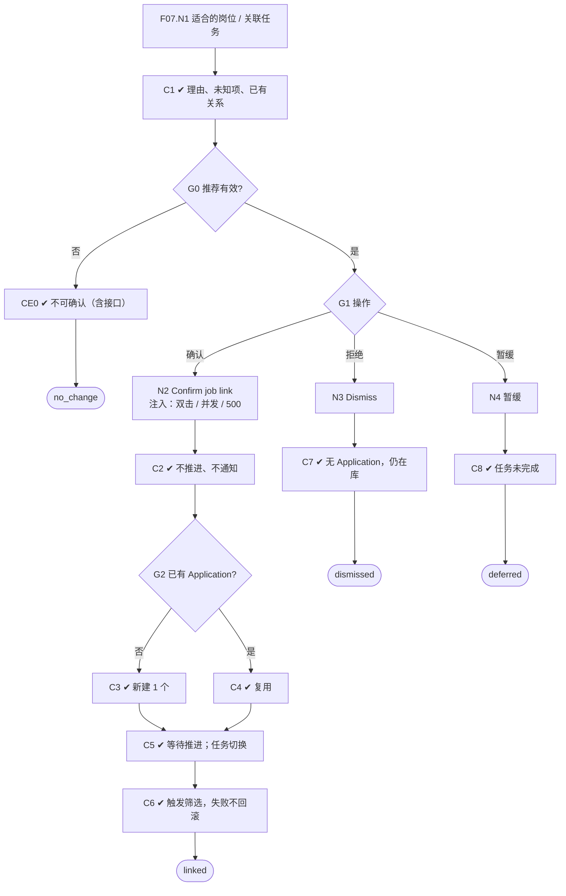

# F07 输入输出闭环：人工岗位关联

| 项 | 内容 |
|---|---|
| 模块 | F07 |
| 版本 / 日期 | v1.0 / 2026-10-14（草稿，待评审） |
| 同目录文档 | [产品文档](PRD.md) · [User Journey](User_Journey.md) · [User Cases](User_Cases.md) |
| 格式说明 | 见 [模块索引 README](../README.md#闭环文档格式) |

## 1. 输入与输出

| 部分 | 内容 |
|---|---|
| **输入·身份** | recruiter_a（岗位负责人）；hm_a（岗位负责人，验证 HM 也可确认）；recruiter_other_scope（无权限） |
| **输入·前置状态** | S_dataset（推荐均为 proposed）；S_job_closed；S_linked（已有关联，检查复用） |
| **输入·用户数据** | 对每条推荐的处理：Confirm job link（原因可选）/ Dismiss recommendation / 暂缓；人工另选岗位；一次确认多个岗位 |
| **输入·外部依赖桩** | 通知（检查确认关联时不发任何候选人通知）；F08 自动筛选（成功 / 失败） |
| **输出·UI** | 确认弹窗：写明「不推进、不邀请、不发送通知」，列出候选人、岗位及标准版本、是否已有申请、确认人与时间；确认后提示已关联，候选人出现在 Linked candidates，人工状态为「等待推进」；拒绝后从待确认列表移除；过期推荐提示刷新 |
| **输出·API / 数据** | LinkDecision（结果、候选人 / 岗位 / 推荐引用、确认人、时间、理由、expected_version、application 引用）；Application（确认时创建或复用，按 workspace + 候选人 + 岗位 + 招聘周期唯一）；推荐状态 confirmed / dismissed / deferred |
| **输出·事件 / 审计** | 关闭 link_confirmation 任务、生成 screening_review 任务；关联与下一步分别审计；确认后触发 F08 自动筛选 |
| **输出·交给下游** | Application → F08 评估、F09 工作台；screening_review 任务 → 任务管理（功能拆分 F13） |
| **输出·禁止副作用** | 确认关联的同时推进、邀请或通知候选人；dismiss / defer 产生 Application；同一周期重复或并发确认产生两个 Application；拒绝推荐删除候选人；人工状态显示为「已推进」；岗位已关闭或无权限仍能确认；自动筛选失败回滚关联 |

## 2. 结构化规格

```yaml
flow_id: F07
actor: recruiter_a
seed: S_dataset
entry: F07.N1
max_loop: 2
external: [notify, screening.auto_run]

nodes:
  - {id: F07.N1, type: action, do: "打开候选人「适合的岗位」页或关联确认任务"}
  - {id: F07.C1, type: check, expect: {ui: "显示候选人、岗位、AI 理由、关键未知项、是否已有正式关系"}}
  - {id: F07.G0, type: decision, on: "推荐是否仍有效（岗位开放、资料与标准未更新、有权限）"}
  - {id: F07.CE0, type: check, expect: {ui: "确认按钮不可点并说明原因（岗位已关闭 / 已过期需刷新 / 无权限）", api: "直接调用确认接口返回 4xx"}}
  - {id: F07.G1, type: decision, on: "用户操作"}
  - {id: F07.N2, type: action, do: "点 Confirm job link，填写可选原因并确认", inject: [double_click, concurrent, http_500]}
  - {id: F07.C2, type: check, expect: {ui: "弹窗写明不推进、不邀请、不通知；列出是否已有申请"}}
  - {id: F07.G2, type: decision, on: "同一周期是否已有 Application"}
  - {id: F07.C3, type: check, expect: {db: "新建 1 个 Application；LinkDecision=confirm；推荐 confirmed", ext: "无候选人通知"}}
  - {id: F07.C4, type: check, expect: {db: "复用已有 Application，数量不变；不重复要求确认"}}
  - {id: F07.C5, type: check, expect: {ui: "候选人出现在 Linked candidates，人工状态为等待推进", db: "link_confirmation 任务 completed；生成 1 个 screening_review 任务", record: "关联审计"}}
  - {id: F07.C6, type: check, expect: {db: "触发 F08；若 screening.auto_run 失败，关联仍保留"}}
  - {id: F07.N3, type: action, do: "点 Dismiss recommendation"}
  - {id: F07.C7, type: check, expect: {ui: "推荐从待确认列表移除", db: "推荐 dismissed；无 Application；候选人仍在简历库"}}
  - {id: F07.N4, type: action, do: "选择暂缓"}
  - {id: F07.C8, type: check, expect: {db: "推荐 deferred；任务未完成（waiting）；无 Application"}}
  - {id: F07.T1, type: terminal, state: linked}
  - {id: F07.T2, type: terminal, state: dismissed}
  - {id: F07.T3, type: terminal, state: deferred}
  - {id: F07.T4, type: terminal, state: no_change}

edges:
  - [F07.N1, F07.C1]
  - [F07.C1, F07.G0]
  - [F07.G0, F07.CE0, {when: "seed = S_job_closed / 推荐已过期 / actor = recruiter_other_scope"}]
  - [F07.CE0, F07.T4]
  - [F07.G0, F07.G1, {when: "有效"}]
  - [F07.G1, F07.N2, {when: "确认"}]
  - [F07.N2, F07.C2]
  - [F07.C2, F07.G2]
  - [F07.G2, F07.C3, {when: "无"}]
  - [F07.G2, F07.C4, {when: "有（seed = S_linked）"}]
  - [F07.C3, F07.C5]
  - [F07.C4, F07.C5]
  - [F07.C5, F07.C6]
  - [F07.C6, F07.T1]
  - [F07.G1, F07.N3, {when: "拒绝"}]
  - [F07.N3, F07.C7]
  - [F07.C7, F07.T2]
  - [F07.G1, F07.N4, {when: "暂缓"}]
  - [F07.N4, F07.C8]
  - [F07.C8, F07.T3]
```

## 3. 测试数据

| 名称 | 内容 |
|---|---|
| rec_nina | Nina → `[UJ-TEST] Senior Backend Engineer II` 的推荐 |
| rec_lan | Lan Pham 的推荐（用于拒绝） |
| rec_hoa | Hoa Tran 的推荐（用于暂缓） |
| rec_stale | Nina 档案纠正后仍未刷新的旧推荐 |
| job_second | 第二个已确认岗位，用于一次确认多个岗位 |

## 4. 路径清单

| 路径 | 节点序列 | 数据 / 注入 | 终态 | 对应 AC |
|---|---|---|---|---|
| P1 确认关联 | F07.N1 → C1 → G0 → G1 → N2 → C2 → G2 → C3 → C5 → C6 | rec_nina | linked | AC-1、AC-2、AC-4 |
| P2 HM 确认 | 同 P1，actor = hm_a | rec_hoa | linked | — |
| P3 多个岗位 | 同 P1，分别确认两个岗位 | rec_nina + job_second | 两个独立 Application，逐项审计 | AC-1、AC-6 |
| P4 拒绝 | F07.N1 → C1 → G0 → G1 → N3 → C7 | rec_lan | dismissed | AC-2 |
| P5 暂缓 | F07.N1 → C1 → G0 → G1 → N4 → C8 | rec_hoa | deferred | AC-2 |
| P6 重复确认 | P1 后再次确认 | S_linked | linked（复用） | AC-3、AC-5 |
| P7 并发确认 | F07.N2 两个会话 | concurrent | 只有 1 个 Application | AC-3 |
| P8 岗位关闭 | F07.N1 → C1 → G0 → CE0 | S_job_closed | no_change | AC-3 |
| P9 推荐过期 | F07.N1 → C1 → G0 → CE0 | rec_stale | no_change，提示刷新 | AC-3 |
| P10 无权限 | F07.N1 → C1 → G0 → CE0 | recruiter_other_scope | no_change（接口 4xx） | — |
| P11 自动筛选失败 | P1，screening.auto_run 失败 | — | linked，关联不回滚 | — |
| P12 双击确认 | P1 + double_click | — | 只有 1 个 Application | AC-3 |

## 5. 流程图（由规格生成）



## 6. 待确认

- 人工另选岗位的入口和可选范围（同 PRD 待确认 1），确定后补一条路径。
- 新招聘周期的开启方式（同 PRD 待确认 2）。
