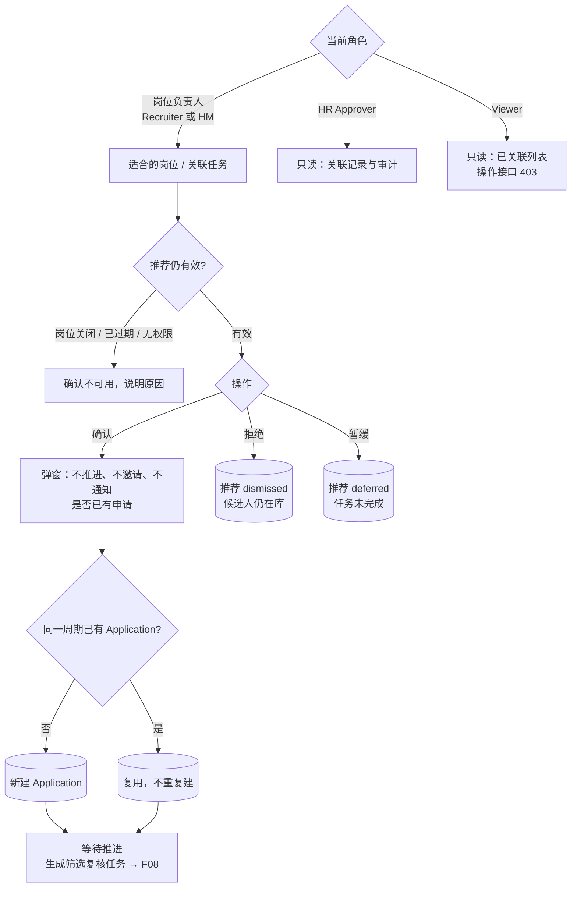

# F07 User Journey：人工岗位关联（P0）

| 项 | 内容 |
|---|---|
| 模块 | F07（对应测试脚本 J5） |
| 版本 / 日期 | v1.0 / 2026-10-14（草稿，待评审） |
| 同目录文档 | [产品文档](PRD.md) · [输入输出闭环](Loop_IO.md) · [User Cases](User_Cases.md) |
| 来源 | [用户旅程与测试脚本 v0.2](../../user-journeys/Resume_Screening_User_Journeys_v0.2.md) J5、J10 E4、E9；角色见 [README 角色与权限](../README.md#角色与权限) |

## 角色与权限（本模块）

| 角色 | 在本模块的目的 | 可以做 | 不能做 |
|---|---|---|---|
| Recruiter / TA | 决定把哪些候选人纳入岗位考虑 | 担任岗位负责人时确认、拒绝、暂缓推荐；人工另选岗位 | 非负责人时确认；确认的同时推进或通知候选人 |
| Hiring Manager | 决定自己的岗位考虑哪些人 | 担任岗位负责人时与 Recruiter 相同 | 非负责人时确认 |
| HR Approver | 了解关联情况 | 查看关联记录和审计 | 确认、拒绝、暂缓 |
| Viewer | 只读 | 查看已关联候选人列表 | 所有关联操作；接口返回 403 |

# 旅程

**主角色**：Recruiter / TA（岗位负责人）；Hiring Manager 验证也能确认；HR Approver、Viewer 验证不能操作
**登录目的**：AI 推荐了一些人，我想亲自决定把谁纳入这个岗位；纳入不等于推进，不能让候选人收到任何通知。
**入口**：候选人「适合的岗位」页；任务中的「确认岗位关联」待办

## 输入

| 类型 | 内容 |
|---|---|
| 前置数据 | S_dataset（推荐均为待确认）；S_linked（已有关联）；S_job_closed |
| 用户数据 | 对 Nina 确认关联（原因可选）；对 Lan 拒绝；对 Hoa 暂缓；把 Nina 同时关联到第二个岗位 |
| 外部依赖 | 通知（验证没有发出）；关联后的自动筛选（成功 / 失败） |

## 流程

## 步骤

| # | 角色 | 用户意图与操作 | 系统反馈 | 用户需要判断 |
|---|---|---|---|---|
| 1 | Recruiter | 打开 Nina 的适合的岗位页 | 列出推荐岗位，每条有理由、置信度、Confirm job link、Dismiss recommendation；显示是否已有正式关系 | 是否纳入考虑 |
| 2 | Recruiter | 点 Confirm job link | 弹窗写明「应把 Nina 考虑用于该岗位」，**不会推进、不会邀请、不会发送通知**；列出岗位及标准版本、是否已有申请、确认人与时间；原因可选 | — |
| 3 | Recruiter | 确认 | 提示已关联；Nina 出现在 Linked candidates，人工状态为**等待推进**；生成「复核初筛并选择下一步」待办；Nina 没有收到任何通知 | — |
| 4 | Recruiter | 把 Nina 也关联到第二个岗位 | 两个岗位各有一个独立的 Application，评分和权限互不影响 | — |
| 5 | Recruiter | 对 Lan 点 Dismiss | 推荐从待确认列表移除；不产生申请；Lan 仍在简历库 | — |
| 6 | Recruiter | 对 Hoa 选择暂缓 | 推荐为暂缓，待办未完成；不产生申请 | 什么时候再看 |
| 7 | Recruiter | 再次确认 Nina 与同一岗位的关联；双击确认 | 复用已有申请，Linked candidates 里仍只有一行 | — |
| 8 | Recruiter | 两个会话同时确认同一推荐 | 只有一个 Application；另一方看到已关联 | — |
| 9 | Recruiter | 在已关闭岗位上确认推荐 | 确认按钮不可用，说明岗位已关闭；接口也拒绝 | — |
| 10 | Recruiter | Nina 档案纠正后，确认旧推荐 | 提示推荐已过期，需要刷新后再确认 | 是否刷新 |
| 11 | Recruiter | 关联后自动筛选失败 | 关联保留，不回滚；筛选显示失败可重试 | — |
| 12 | Hiring Manager（岗位负责人） | 确认 Hoa 的推荐 | 与 Recruiter 相同，可以确认 | — |
| 13 | Hiring Manager（非岗位负责人） | 打开另一个岗位的推荐并调用确认接口 | 没有确认入口；接口返回 403 | — |
| 14 | HR Approver | 打开 Nina 的关联记录 | 看到确认人、时间、原因、标准版本；没有确认、拒绝、暂缓入口 | — |
| 15 | Viewer | 查看已关联列表，调用确认接口 | 只读；接口返回 403 | — |

## 输出与交接

- 持久化：LinkDecision；Application（按候选人 + 岗位 + 招聘周期唯一）；推荐状态；任务切换（关联确认完成、筛选复核新建）；关联审计。
- 交接：Application → F08 评估、F09 工作台。

**禁止副作用**：确认关联时推进、邀请或通知候选人；拒绝或暂缓产生 Application；重复或并发确认产生两个 Application；拒绝推荐删除候选人；人工状态显示为已推进；非岗位负责人能通过接口确认；自动筛选失败回滚关联。

**成功标准**：只有岗位负责人的显式确认才产生 Application；关联与下一步彻底分开；其他角色只能查看。

**测试映射**：Loop_IO P1～P12；用户旅程 v0.2 J5 步骤 3～10、J10 E4、E9。

**待确认**：人工另选岗位的入口和可选范围；新招聘周期的开启方式；暂缓的提醒时间。
