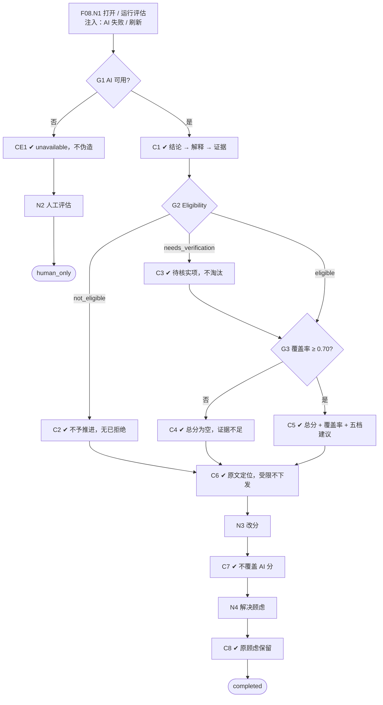

# F08 输入输出闭环：AI 岗位筛选评估

| 项 | 内容 |
|---|---|
| 模块 | F08 |
| 版本 / 日期 | v1.0 / 2026-10-14（草稿，待评审） |
| 同目录文档 | [产品文档](PRD.md) · [User Journey](User_Journey.md) · [User Cases](User_Cases.md) |
| 格式说明 | 见 [模块索引 README](../README.md#闭环文档格式) |

## 1. 输入与输出

| 部分 | 内容 |
|---|---|
| **输入·身份** | recruiter_a、hm_a（查看、改分、处理顾虑和待核实项）；viewer_a（查看受限证据） |
| **输入·前置状态** | S_linked（Nina、Ben、Hoa 已关联）；S_linked_stale（标准 v2 已确认）；Minh 关联后用于证据不足场景 |
| **输入·用户数据** | 运行 / 刷新评估；人工改分（分数 + 理由）；解决顾虑（说明 + 结果证据）；关闭待核实项；AI 不可用时的人工评估 |
| **输入·外部依赖桩** | llm.screening_eval：成功 / 失败 / 超时；同一输入重复运行 3 次 |
| **输出·UI** | 评估页三层：结论（Eligibility、总分 / 覆盖率、AI 建议、人工状态、前三项优势和顾虑、下一步）→ 解释（多维分数、评分标准、缺失信息、待核实项）→ 证据（原文定位、时间线、材料版本、支持 / 反证）；覆盖率 < 0.70 时总分为空并标证据不足；AI 不可用时显示 unavailable；过期时显示可刷新 |
| **输出·API / 数据** | ScreeningEvaluation（状态、总分、覆盖率、eligibility、建议、模型版本、输入清单、过期标记）；DimensionScore；EvidenceItem；ScreeningConcern；VerificationItem；HumanAssessment |
| **输出·事件 / 审计** | AiRun（模型供应方 / 版本、prompt、参数、rubric、偏好版本、输入摘要、起止时间、错误）；改分、解决顾虑写审计 |
| **输出·禁止副作用** | 未知条件判为不满足或自动淘汰；不符合资格显示为「已拒绝」；覆盖不足仍给出总分；缺失信息写成 0 分；改分覆盖 AI 分数；AI 失败时伪造模型结果；出现工作授权要求；因公司规模扣分；受限证据下发给无权限角色；标准更新后旧评估被改写或自动重跑 |
| **输出·交给下游** | ScreeningEvaluation → F09 排序、F10 对比、F11 决定；待核实项 → 任务 / 面试；改分和反馈 → 偏好学习（功能拆分 F16） |

## 2. 结构化规格

```yaml
flow_id: F08
actor: recruiter_a
seed: S_linked
entry: F08.N1
max_loop: 3
external: [llm.screening_eval]

nodes:
  - {id: F08.N1, type: action, do: "打开候选人 A 的评估页（或运行 / 刷新评估）", inject: [llm_fail, refresh]}
  - {id: F08.G1, type: decision, on: "AI 评估是否可用"}
  - {id: F08.CE1, type: check, expect: {ui: "AI 状态 unavailable；提供人工评估入口", db: "无伪造的 AI 分数", record: "AiRun 记录错误"}}
  - {id: F08.N2, type: action, do: "基于证据完成人工评估"}
  - {id: F08.C1, type: check, expect: {ui: "三层结构：结论 → 解释 → 证据；无工作授权要求", record: "AiRun 完整"}}
  - {id: F08.G2, type: decision, on: "Eligibility"}
  - {id: F08.C2, type: check, expect: {ui: "not_eligible：说明不满足的 Must-have；AI 建议为不予推进；页面无「已拒绝」"}}
  - {id: F08.C3, type: check, expect: {ui: "needs_verification：列出未知条件并生成待核实项；不自动淘汰"}}
  - {id: F08.G3, type: decision, on: "覆盖率"}
  - {id: F08.C4, type: check, expect: {ui: "总分为空，标证据不足；建议为待复核", db: "overall=null；未知维度 score=null"}}
  - {id: F08.C5, type: check, expect: {ui: "总分与覆盖率同时显示，不显示百分号；建议按五档阈值与前置门槛"}}
  - {id: F08.C6, type: check, expect: {ui: "点击分数或顾虑跳到原文页码 / 段落；原文不可用显示 unavailable", api: "viewer_a 的响应中不含受限证据原文"}}
  - {id: F08.N3, type: action, do: "人工改分（分数 + 理由）", inject: [double_click]}
  - {id: F08.C7, type: check, expect: {ui: "人工分与 AI 分并列显示", db: "新增 HumanAssessment；DimensionScore 未被改写"}}
  - {id: F08.N4, type: action, do: "解决一条顾虑（说明 + 证据）"}
  - {id: F08.C8, type: check, expect: {db: "顾虑状态更新；原顾虑与处理记录保留"}}
  - {id: F08.T1, type: terminal, state: evaluation.completed}
  - {id: F08.T2, type: terminal, state: evaluation.human_only}

edges:
  - [F08.N1, F08.G1]
  - [F08.G1, F08.CE1, {when: "注入 llm_fail"}]
  - [F08.CE1, F08.N2]
  - [F08.N2, F08.T2]
  - [F08.G1, F08.C1, {when: "可用"}]
  - [F08.C1, F08.G2]
  - [F08.G2, F08.C2, {when: "A = cand_ben"}]
  - [F08.G2, F08.C3, {when: "A = cand_unknown_location"}]
  - [F08.G2, F08.G3, {when: "eligible / likely_eligible"}]
  - [F08.C2, F08.C6]
  - [F08.C3, F08.G3]
  - [F08.G3, F08.C4, {when: "< 0.70（A = cand_minh）"}]
  - [F08.G3, F08.C5, {when: "≥ 0.70"}]
  - [F08.C4, F08.C6]
  - [F08.C5, F08.C6]
  - [F08.C6, F08.N3]
  - [F08.N3, F08.C7]
  - [F08.C7, F08.N4]
  - [F08.N4, F08.C8]
  - [F08.C8, F08.T1]
---
flow_id: F08s  # 标准更新后的过期与刷新
actor: recruiter_a
seed: S_linked_stale
entry: F08s.N1
max_loop: 1
external: [llm.screening_eval]

nodes:
  - {id: F08s.N1, type: action, do: "打开 Nina 的评估页"}
  - {id: F08s.C1, type: check, expect: {ui: "显示过期，可刷新", db: "旧评估引用 v1，未被改写，未自动重跑"}}
  - {id: F08s.N2, type: action, do: "点击刷新"}
  - {id: F08s.C2, type: check, expect: {db: "新评估引用 v2；旧评估保留可追溯"}}
  - {id: F08s.T1, type: terminal, state: evaluation.refreshed}

edges:
  - [F08s.N1, F08s.C1]
  - [F08s.C1, F08s.N2]
  - [F08s.N2, F08s.C2]
  - [F08s.C2, F08s.T1]
```

## 3. 测试数据

| 名称 | 内容 | 判定条件 |
|---|---|---|
| cand_nina | 河内、6 年、Go / K8s / PostgreSQL、负责过支付服务 | eligible；建议推进或强烈推进；理由引用简历内容 |
| cand_hoa | 胡志明市、7 年、带过 5 人团队 | eligible |
| cand_ben | 新加坡、不能搬迁 | not_eligible（工作地点）；建议不予推进；无「已拒绝」 |
| cand_lan | 3 年 Java | 年限不满足 |
| cand_minh | 只有「Software engineer.」 | 覆盖率 < 0.70，总分为空，建议待复核 |
| cand_unknown_location | 简历未写所在地 | needs_verification，生成待核实项 |
| cand_big_company | 只在大公司工作过 | 不因公司规模扣分；最多生成待验证问题 |
| cand_high_concern | 分数高但有未解决的高严重度顾虑 | 建议最高为待复核 |

## 4. 路径清单

| 路径 | 节点序列 | 数据 / 注入 | 终态 | 对应 AC |
|---|---|---|---|---|
| P1 合格候选人 | F08.N1 → G1 → C1 → G2 → G3 → C5 → C6 | cand_nina（跑 3 次） | evaluation.completed；每次理由都引用真实内容 | AC-2、AC-8、AC-9 |
| P2 不符合资格 | … → G2 → C2 → C6 | cand_ben | evaluation.completed；无「已拒绝」 | AC-6 |
| P3 未知条件 | … → G2 → C3 → G3 | cand_unknown_location | needs_verification，不淘汰 | AC-1 |
| P4 证据不足 | … → G3 → C4 → C6 | cand_minh | 总分为空 | AC-5 |
| P5 公司背景 | 同 P1 | cand_big_company | 无公司规模扣分 | AC-4 |
| P6 高严重度顾虑 | 同 P1 | cand_high_concern | 建议 ≤ 待复核 | — |
| P7 AI 不可用 | F08.N1 → G1 → CE1 → N2 | llm_fail | evaluation.human_only | AC-3 |
| P8 改分 | … → N3 → C7 | cand_nina | AI 分保留 | AC-7 |
| P9 解决顾虑 | … → N4 → C8 | cand_hoa | 原顾虑保留 | — |
| P10 受限证据 | … → C6（viewer_a） | cand_nina | 接口不含受限原文 | — |
| P11 过期与刷新 | F08s 全程 | S_linked_stale | evaluation.refreshed | AC-2 |

## 5. 流程图（由规格生成）



## 6. 待确认

- 五档阈值与前置门槛以 Patch 1 为准还是以当前实现为准（同 PRD 待确认 1）；本闭环按 Patch 1 编写。
