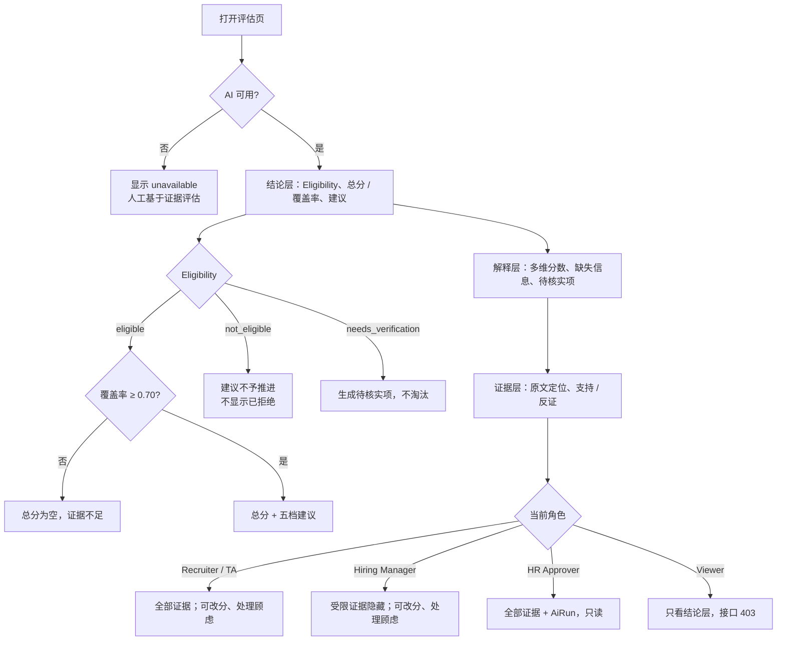

# F08 User Journey：AI 岗位筛选评估（P0）

| 项 | 内容 |
|---|---|
| 模块 | F08（对应测试脚本 J6、J7） |
| 版本 / 日期 | v1.0 / 2026-10-14（草稿，待评审） |
| 同目录文档 | [产品文档](PRD.md) · [输入输出闭环](Loop_IO.md) · [User Cases](User_Cases.md) |
| 来源 | [用户旅程与测试脚本 v0.2](../../user-journeys/Resume_Screening_User_Journeys_v0.2.md) J6、J7、J10 E7、E12；角色见 [README 角色与权限](../README.md#角色与权限) |

## 角色与权限（本模块）

| 角色 | 在本模块的目的 | 可以做 | 不能做 |
|---|---|---|---|
| Recruiter / TA | 快速判断候选人是否满足岗位、哪里需要核实 | 查看完整评估和受限证据；运行 / 刷新评估；改分；处理顾虑和待核实项 | 覆盖 AI 分数；让 AI 结论直接生效 |
| Hiring Manager | 从业务角度复核候选人 | 查看评估和证据（受限证据除外）；改分；处理顾虑和待核实项 | 看到薪资期望、工作授权等受限证据 |
| HR Approver | 例外审批前核对评估依据 | 查看完整评估、受限证据和 AiRun 记录 | 改分、处理顾虑、运行评估 |
| Viewer | 只读 | 查看评估结论层（Eligibility、建议、非受限的优势和顾虑） | 改分、处理顾虑；看到受限证据；接口返回 403 |

# 旅程

**主角色**：Recruiter / TA → Hiring Manager（复核）；HR Approver、Viewer 验证可见范围
**登录目的**：想知道这个候选人是否满足岗位底线、强在哪里、哪些需要核实，每个结论都要能找到出处；证据不够时不要给我编一个分数。
**入口**：岗位工作台 → Linked candidates → Open（`#/applications/:id`）

## 输入

| 类型 | 内容 |
|---|---|
| 前置数据 | S_linked（Nina、Ben、Hoa 已关联）；S_linked_stale（标准 v2 已确认）；Minh 已关联 |
| 用户数据 | 改分（分数 + 理由）；解决顾虑（说明 + 证据）；关闭待核实项；刷新评估 |
| 外部依赖 | 筛选评估模型（成功 / 失败；同一输入跑 3 次） |

## 流程

## 步骤

| # | 角色 | 用户意图与操作 | 系统反馈 | 用户需要判断 |
|---|---|---|---|---|
| 1 | Recruiter | 打开 Nina 的评估 | 顶部是结论，下面是解释，最后是证据；Eligibility 为符合，硬性要求是工作年限和工作地点，**没有工作授权** | — |
| 2 | Recruiter | 查看多维评分 | 每个维度有分数、置信度、理由；总分和覆盖率同时显示，不带百分号 | 分数是否合理 |
| 3 | Recruiter | 点一条理由的证据 | 跳到简历原文的页码 / 段落，显示原文而不是 AI 转述 | 证据是否支持结论 |
| 4 | Recruiter | 对 Nina 重新运行评估 3 次 | 每次理由都引用简历中真实的内容，没有编造 | — |
| 5 | Recruiter | 打开 Ben（新加坡） | Eligibility 为不符合，原因是工作地点；建议为不予推进；**页面任何地方都没有「已拒绝」** | — |
| 6 | Recruiter | 打开简历未写所在地的候选人 | needs_verification，生成待核实项；没有被淘汰 | 怎么核实 |
| 7 | Recruiter | 打开 Minh（资料过少） | 覆盖率不足 70%，总分为空，标证据不足；建议为待复核；缺失的维度不是 0 分 | 是否补资料 |
| 8 | Recruiter | 打开只在大公司工作过的候选人 | 没有因为公司规模扣分；最多生成一条待验证的问题 | — |
| 9 | Recruiter | 模型不可用时打开评估 | AI 状态 unavailable；可以人工基于证据评估；没有伪造的分数 | — |
| 10 | Hiring Manager | 打开 Nina 的评估 | 能看到评估和证据；薪资期望相关的证据显示受限 | — |
| 11 | Hiring Manager | 把一个维度改分并写理由 | 人工分与 AI 分并列显示，AI 分没有被覆盖 | 改多少 |
| 12 | Hiring Manager | 解决 Hoa 的一条顾虑，附说明和证据 | 顾虑状态更新，原顾虑和处理记录都保留 | — |
| 13 | Recruiter | 岗位标准更新为 v2 后打开 Nina | 显示过期，可刷新；旧评估仍引用 v1；点刷新后生成基于 v2 的新评估，旧评估保留 | 是否刷新 |
| 14 | HR Approver | 打开 Ben 的评估 | 全部证据（含受限）和 AiRun 记录可见；没有改分、处理顾虑入口 | — |
| 15 | Viewer | 打开 Nina 的评估并查看 Network 响应 | 只看到结论层；受限证据不在响应中；改分接口返回 403 | — |

## 输出与交接

- 持久化：ScreeningEvaluation；DimensionScore；EvidenceItem；ScreeningConcern；VerificationItem；HumanAssessment；AiRun；审计。
- 交接：评估 → F09 排序、F10 对比、F11 决定；待核实项 → 任务 / 面试。

**禁止副作用**：未知判为不满足或自动淘汰；显示「已拒绝」；覆盖不足仍给总分；缺失写成 0；改分覆盖 AI 分数；AI 失败时伪造结果；出现工作授权要求；因公司规模扣分；受限证据下发给无权限角色；标准更新后旧评估被改写。

**成功标准**：每个结论可追溯；证据不足时如实说明；AI 只给建议；四类角色看到的证据范围与权限矩阵一致。

**测试映射**：Loop_IO P1～P11；用户旅程 v0.2 J6 步骤 1～7、12、J7 步骤 4～5、J10 E7、E12。

**待确认**：五档阈值与前置门槛以 Patch 1 为准还是以当前实现为准；Hiring Manager 能否查看薪资相关证据（权限矩阵中标 * 的默认值）。
