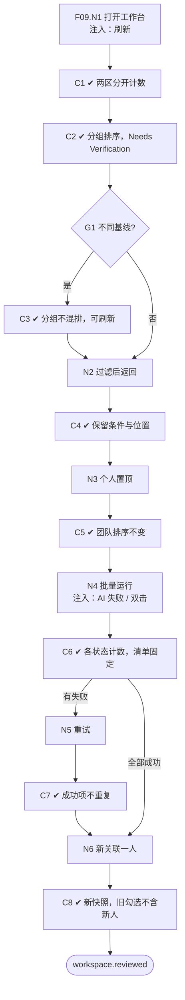

# F09 输入输出闭环：筛选工作台、排序与批量筛选

| 项 | 内容 |
|---|---|
| 模块 | F09 |
| 版本 / 日期 | v1.0 / 2026-10-14（草稿，待评审） |
| 同目录文档 | [产品文档](PRD.md) · [User Journey](User_Journey.md) · [User Cases](User_Cases.md) |
| 格式说明 | 见 [模块索引 README](../README.md#闭环文档格式) |

## 1. 输入与输出

| 部分 | 内容 |
|---|---|
| **输入·身份** | recruiter_a、hm_a；recruiter_other_scope（检查只显示有权限的候选人） |
| **输入·前置状态** | S_dataset（有待确认推荐）；S_linked（有已关联候选人和评估）；S_linked_stale（部分评估过期） |
| **输入·用户数据** | 过滤条件（Eligibility、状态、维度、来源、负责人、覆盖率）；个人置顶；勾选候选人（进入对比或批量决定）；批量运行 / 重试 / 取消；刷新过期评估 |
| **输入·外部依赖桩** | llm.screening_eval（批量运行时部分失败）；时钟 |
| **输出·UI** | 顶部岗位、标准版本、人数、排序基线；「待确认推荐」与「已关联候选人」分区并分别计数；已关联列表的 Eligibility、总分、覆盖率、AI 建议、人工状态（结论信息突出）；按 Eligibility 分组排序；Needs Verification 分组；批量运行的各状态数量；过期候选人的 Refresh available |
| **输出·API / 数据** | RankingSnapshot（cohort 成员、结果版本、排序算法、生成时间、排除原因）；批量运行记录（批次、各状态计数、逐条状态、错误）；个人置顶（只存在个人视图） |
| **输出·事件 / 审计** | 新增候选人时生成新的排序快照；批量运行与重试记录 |
| **输出·禁止副作用** | 不同标准版本的结果混排；没有总分的候选人排在最后一名；个人置顶改变团队排序；来源参与加权；重试重复分析成功项或重复建 Application；「选择全部」包含之后新增的候选人；待确认推荐计入已关联人数；只用红绿颜色表达含义 |
| **输出·交给下游** | 勾选的候选人 → F10 对比、F11 批量决定 |

## 2. 结构化规格

```yaml
flow_id: F09
actor: recruiter_a
seed: S_linked
entry: F09.N1
max_loop: 2
external: [llm.screening_eval]

nodes:
  - {id: F09.N1, type: action, do: "打开岗位工作台", inject: [refresh]}
  - {id: F09.C1, type: check, expect: {ui: "顶部显示岗位、标准版本、人数、排序基线；待确认推荐与已关联候选人分区，计数分开", api: "只返回有权限的候选人"}}
  - {id: F09.C2, type: check, expect: {ui: "已关联列表按 Eligibility 分组，组内总分降序、覆盖率降序；同分同名次；无总分者在 Needs Verification", db: "RankingSnapshot 记录成员、版本、算法、排除原因"}}
  - {id: F09.G1, type: decision, on: "是否存在不同基线的结果"}
  - {id: F09.C3, type: check, expect: {ui: "不同标准版本分组显示，不混排；过期者显示 Refresh available"}}
  - {id: F09.N2, type: action, do: "设置过滤条件 Q；离开后返回"}
  - {id: F09.C4, type: check, expect: {ui: "结果与 Q 一致；返回后保留过滤条件和滚动位置"}}
  - {id: F09.N3, type: action, do: "个人置顶候选人 X"}
  - {id: F09.C5, type: check, expect: {ui: "X 在自己的视图中置顶", db: "团队 RankingSnapshot 不变；其他用户看不到置顶"}}
  - {id: F09.N4, type: action, do: "勾选全部候选人，批量运行筛选", inject: [llm_fail, double_click]}
  - {id: F09.C6, type: check, expect: {ui: "显示 queued / running / completed / failed / cancelled 数量", db: "勾选清单固定为当时的成员"}}
  - {id: F09.N5, type: action, do: "重试失败条目"}
  - {id: F09.C7, type: check, expect: {db: "只重新处理失败条目；成功项不重复分析；Application 数不变"}}
  - {id: F09.N6, type: action, do: "新关联一名候选人"}
  - {id: F09.C8, type: check, expect: {db: "生成新的 RankingSnapshot；历史快照不变；之前的勾选清单不包含新候选人"}}
  - {id: F09.T1, type: terminal, state: workspace.reviewed}

edges:
  - [F09.N1, F09.C1]
  - [F09.C1, F09.C2]
  - [F09.C2, F09.G1]
  - [F09.G1, F09.C3, {when: "seed = S_linked_stale"}]
  - [F09.G1, F09.N2, {when: "否"}]
  - [F09.C3, F09.N2]
  - [F09.N2, F09.C4]
  - [F09.C4, F09.N3]
  - [F09.N3, F09.C5]
  - [F09.C5, F09.N4]
  - [F09.N4, F09.C6]
  - [F09.C6, F09.N5, {when: "存在失败"}]
  - [F09.C6, F09.N6, {when: "全部成功"}]
  - [F09.N5, F09.C7]
  - [F09.C7, F09.N6]
  - [F09.N6, F09.C8]
  - [F09.C8, F09.T1]
```

## 3. 测试数据

| 名称 | 内容 |
|---|---|
| q_eligibility | Eligibility = Needs verification |
| q_coverage | 覆盖率 < 0.70 |
| q_source | 来源 = CSV |
| pin_hoa | 置顶 Hoa Tran |
| batch_fail_one | 批量运行时对 Hoa 注入 llm_fail |
| cand_new | 新关联的 `[UJ-TEST] Pia Nguyen` |

## 4. 路径清单

| 路径 | 节点序列 | 数据 / 注入 | 终态 | 对应 AC |
|---|---|---|---|---|
| P1 分区与计数 | F09.N1 → C1 | S_dataset + S_linked | 两区人数分开 | AC-1 |
| P2 排序规则 | F09.N1 → C1 → C2 | S_linked + Minh 已关联 | Minh 在 Needs Verification | AC-3、AC-7 |
| P3 不混排 | … → G1 → C3 | S_linked_stale | 按版本分组 | AC-2 |
| P4 过滤保留 | … → N2 → C4 | q_eligibility、q_coverage、q_source | 条件和滚动位置保留 | AC-6 |
| P5 个人置顶 | … → N3 → C5 | pin_hoa（recruiter_a 置顶，hm_a 查看） | 团队排序不变 | AC-5 |
| P6 批量运行与重试 | … → N4 → C6 → N5 → C7 | batch_fail_one | 成功项不重复 | AC-4 |
| P7 新增候选人 | … → N6 → C8 | cand_new | 新快照；旧勾选不含新人 | — |
| P8 权限 | F09.N1 → C1（recruiter_other_scope） | S_linked | 接口不返回无权限候选人 | — |

## 5. 流程图（由规格生成）



## 6. 待确认

- 岗位排序快照是否独立于对比快照生成（同 PRD 待确认 1），影响 C2 的 db 断言位置。
