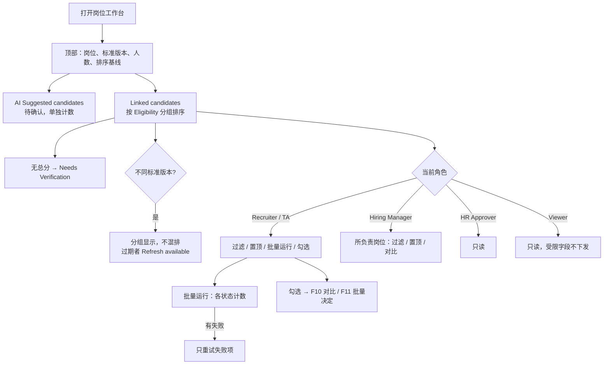

# F09 User Journey：筛选工作台、排序与批量筛选（P1）

| 项 | 内容 |
|---|---|
| 模块 | F09（对应测试脚本 J5、J6） |
| 版本 / 日期 | v1.0 / 2026-10-14（草稿，待评审） |
| 同目录文档 | [产品文档](PRD.md) · [输入输出闭环](Loop_IO.md) · [User Cases](User_Cases.md) |
| 来源 | [用户旅程与测试脚本 v0.2](../../user-journeys/Resume_Screening_User_Journeys_v0.2.md) J5、J6、J9；角色见 [README 角色与权限](../README.md#角色与权限) |

## 角色与权限（本模块）

| 角色 | 在本模块的目的 | 可以做 | 不能做 |
|---|---|---|---|
| Recruiter / TA | 在一个岗位下集中审阅全部候选人，决定先看谁 | 查看、过滤、个人置顶；批量运行 / 重试 / 取消；勾选进入对比或批量决定 | 改变团队排序；让「选择全部」包含之后新增的人 |
| Hiring Manager | 审阅自己岗位的候选人 | 查看所负责岗位的工作台；过滤、个人置顶；勾选进入对比；担任岗位负责人时批量决定 | 批量运行筛选 |
| HR Approver | 了解岗位整体情况 | 只读查看工作台 | 批量运行、置顶、批量决定 |
| Viewer | 只读 | 查看列表的结论信息（不含受限字段） | 所有操作；接口返回 403 |

# 旅程

**主角色**：Recruiter / TA；Hiring Manager 协作审阅；HR Approver、Viewer 验证只读
**登录目的**：一个岗位有很多候选人，想先看最值得看的；需要核实的人要单独列出来；批量运行出错时只重跑失败的。
**入口**：岗位详情（`#/jobs/:id/screening`）

## 输入

| 类型 | 内容 |
|---|---|
| 前置数据 | S_dataset（有待确认推荐）；S_linked（有已关联候选人和评估）；S_linked_stale（部分评估过期） |
| 用户数据 | 过滤条件（Eligibility、覆盖率、来源）；个人置顶 Hoa；勾选全部候选人；批量运行、重试、取消；新关联一名候选人 |
| 外部依赖 | 筛选评估模型（批量时让 Hoa 失败） |

## 流程

## 步骤

| # | 角色 | 用户意图与操作 | 系统反馈 | 用户需要判断 |
|---|---|---|---|---|
| 1 | Recruiter | 打开岗位工作台 | 顶部显示岗位、标准版本、人数、排序基线；待确认推荐与已关联候选人分区，人数分开统计 | — |
| 2 | Recruiter | 查看已关联列表 | Eligibility、总分、覆盖率、AI 建议、人工状态；结论信息突出，不是平均排布；按 Eligibility 分组，组内总分、覆盖率降序 | 先看谁 |
| 3 | Recruiter | 查看 Minh | 在 Needs Verification 分组，没有被排到最后一名 | — |
| 4 | Recruiter | 标准更新为 v2 后打开工作台 | 新旧版本的结果分组显示，不混排；过期的候选人显示 Refresh available | 是否刷新 |
| 5 | Recruiter | 按 Eligibility = Needs verification 过滤，打开一人后返回 | 结果正确；返回后过滤条件和滚动位置保留 | — |
| 6 | Recruiter | 置顶 Hoa | Hoa 在自己的视图中置顶；团队排序不变 | — |
| 7 | Recruiter | 勾选全部，批量运行筛选（Hoa 失败） | 显示排队 / 运行 / 完成 / 失败数量；Hoa 失败可重试 | — |
| 8 | Recruiter | 重试失败项 | 只重新处理 Hoa；其他人不重复分析；Application 数不变 | — |
| 9 | Recruiter | 新关联 Pia 后查看 | 生成新的排序快照，历史快照不变；之前的勾选清单不包含 Pia | — |
| 10 | Recruiter | 勾选 Nina、Hoa、Ben | 可以进入对比（F10）或批量决定（F11） | 进入哪一步 |
| 11 | Hiring Manager | 打开同一工作台 | 看不到 Recruiter 的置顶；可以过滤、自己置顶、勾选进入对比；没有批量运行入口 | — |
| 12 | HR Approver | 打开工作台 | 只读；没有置顶、批量运行、批量决定入口 | — |
| 13 | Viewer | 打开工作台并查看 Network 响应 | 只读；受限字段不在响应中；批量运行接口返回 403 | — |
| 14 | Recruiter（无测试岗位权限） | 打开测试岗位工作台 | 无法访问；接口不返回候选人 | — |
| 15 | Recruiter | 切换到 1024 宽 | 列合理收起，没有横向滚动；表格行可用键盘操作 | — |

## 输出与交接

- 持久化：RankingSnapshot；批量运行记录；个人置顶（只属于个人视图）。
- 交接：勾选的候选人 → F10 对比、F11 批量决定。

**禁止副作用**：不同标准版本混排；无总分者排在最后一名；个人置顶改变团队排序；来源参与加权；重试重复分析成功项；「选择全部」包含之后新增的人；待确认推荐计入已关联人数；只靠红绿颜色表达含义。

**成功标准**：排序只在同一基线内比较；批量失败可单独恢复；每个角色的操作范围与权限矩阵一致。

**测试映射**：Loop_IO P1～P8；用户旅程 v0.2 J5 步骤 6、9，J9 步骤 8；Issue #25、#27。

**待确认**：岗位排序快照是否独立于对比快照生成；Hiring Manager 能否批量运行筛选（权限矩阵外的默认值）。
