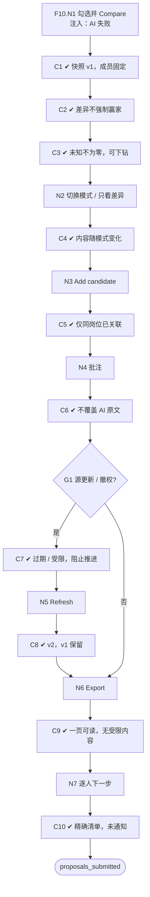

# F10 输入输出闭环：候选人对比

| 项 | 内容 |
|---|---|
| 模块 | F10 |
| 版本 / 日期 | v1.0 / 2026-10-14（草稿，待评审） |
| 同目录文档 | [产品文档](PRD.md) · [User Journey](User_Journey.md) · [User Cases](User_Cases.md) |
| 格式说明 | 见 [模块索引 README](../README.md#闭环文档格式) |

## 1. 输入与输出

| 部分 | 内容 |
|---|---|
| **输入·身份** | recruiter_a、hm_a（批注协作）；viewer_a（导出与受限证据） |
| **输入·前置状态** | S_linked（Nina、Hoa、Ben 已关联并有评估）；S_compare（已有对比集合和快照 v1） |
| **输入·用户数据** | 从工作台勾选的候选人；模式（Same stage / Current summary / Changes since last round）；视图选项（只看差异、显示未知、关键维度、保存个人视图）；Add candidate；Refresh；批注；Export（格式、成员子集）；逐人下一步提案 |
| **输入·外部依赖桩** | llm.compare_summary：成功 / 失败；源评估更新或权限撤销事件 |
| **输出·UI** | 顶部岗位、名单、模式、时间 / 版本、刷新状态；AI Key Differences（可为「暂无明显全面领先者」）；候选人为列、维度为行的矩阵；单元格下钻证据；批注列表；快照下拉及过期 / 受限标记；导出确认；逐人下一步与提交前清单 |
| **输出·API / 数据** | ComparisonSet / ComparisonMember；ComparisonSnapshot（版本、成员结果版本、标准、模式、证据状态、生成时间、新鲜度）；ComparisonAnnotation；NextStepProposal；导出文件 |
| **输出·事件 / 审计** | 读取、刷新、改成员、批注、导出、提交下一步均写审计；AiRun（差异摘要） |
| **输出·禁止副作用** | 生成对比或导出时通知候选人；强制指定赢家或给出录用概率；跨岗位或添加未关联的候选人；缺失的薪资、语言写成 0；未参加笔试判为能力低；刷新覆盖旧快照；批注覆盖 AI 原文；导出包含受限证据或联系方式，或静默漏人；用过期 / 受限快照直接发起新的推进 |
| **输出·交给下游** | NextStepProposal → F11 人工决定 |

## 2. 结构化规格

```yaml
flow_id: F10
actor: recruiter_a
seed: S_linked
entry: F10.N1
max_loop: 2
external: [llm.compare_summary]

nodes:
  - {id: F10.N1, type: action, do: "在工作台勾选 Nina、Hoa、Ben，点 Compare candidates", inject: [llm_fail]}
  - {id: F10.C1, type: check, expect: {ui: "面包屑 Jobs › 岗位 › Compare；Add candidate / Refresh / Export；默认 Current summary", db: "ComparisonSet 成员固定；ComparisonSnapshot v1"}}
  - {id: F10.C2, type: check, expect: {ui: "Key Differences 只描述差异和取舍，不强制赢家；每条差异关联要求和证据；AI 失败时显示摘要不可用，矩阵仍可用"}}
  - {id: F10.C3, type: check, expect: {ui: "矩阵：缺失薪资显示未提供；薪资不可比时说明原因；未参加的阶段显示未评估；单元格可下钻到材料版本"}}
  - {id: F10.N2, type: action, do: "切换模式 M，勾选只看差异"}
  - {id: F10.C4, type: check, expect: {ui: "内容随模式变化；只看差异时隐藏相同行"}}
  - {id: F10.N3, type: action, do: "Add candidate"}
  - {id: F10.C5, type: check, expect: {ui: "只能选择同岗位已关联的候选人", api: "添加其他岗位或未关联候选人返回 4xx"}}
  - {id: F10.N4, type: action, do: "添加批注", inject: [double_click]}
  - {id: F10.C6, type: check, expect: {ui: "批注带作者和时间", db: "ComparisonAnnotation 新增 1 条；AI 原文不变"}}
  - {id: F10.G1, type: decision, on: "源评估是否更新或权限是否被撤销"}
  - {id: F10.C7, type: check, expect: {ui: "快照标过期 / 受限；下一步提交被阻止，要求刷新并复核"}}
  - {id: F10.N5, type: action, do: "点 Refresh"}
  - {id: F10.C8, type: check, expect: {db: "ComparisonSnapshot v2；v1 保留；Changes since last round 显示变化原因"}}
  - {id: F10.N6, type: action, do: "Export，选择格式和成员"}
  - {id: F10.C9, type: check, expect: {ui: "先确认；成员过多时要求选子集或分页", ext: "一页图含岗位、时点、成员、关键差异、证据状态、限制；不含联系方式和受限证据"}}
  - {id: F10.N7, type: action, do: "逐人选择下一步（Nina 面试、Hoa 笔试、Ben 暂缓），提交"}
  - {id: F10.C10, type: check, expect: {ui: "提交前列出精确名单、动作、路由、待满足条件和所需批准", db: "NextStepProposal 每人一条，交给 F11", ext: "此时无候选人通知"}}
  - {id: F10.T1, type: terminal, state: proposals_submitted}

edges:
  - [F10.N1, F10.C1]
  - [F10.C1, F10.C2]
  - [F10.C2, F10.C3]
  - [F10.C3, F10.N2]
  - [F10.N2, F10.C4]
  - [F10.C4, F10.N3]
  - [F10.N3, F10.C5]
  - [F10.C5, F10.N4]
  - [F10.N4, F10.C6]
  - [F10.C6, F10.G1]
  - [F10.G1, F10.C7, {when: "源评估更新 / 权限撤销"}]
  - [F10.C7, F10.N5]
  - [F10.G1, F10.N6, {when: "否"}]
  - [F10.N5, F10.C8]
  - [F10.C8, F10.N6]
  - [F10.N6, F10.C9]
  - [F10.C9, F10.N7]
  - [F10.N7, F10.C10]
  - [F10.C10, F10.T1]
```

## 3. 测试数据

| 名称 | 内容 |
|---|---|
| members_3 | Nina、Hoa、Ben（同岗位已关联） |
| cand_other_job | 另一个岗位的已关联候选人 |
| cand_unlinked | Lan Pham（推荐已拒绝，未关联） |
| salary_mixed | Nina 期望 USD 年薪税前，Hoa 期望 VND 月薪税后，Ben 未提供 |
| stage_mixed | Nina 已完成笔试（来自下游回流的模拟数据），Hoa 未参加 |
| concern_resolved | 对比生成后，Hoa 的一条顾虑被解决（用于触发过期） |
| members_many | 同岗位 12 名已关联候选人（用于导出分页） |

## 4. 路径清单

| 路径 | 节点序列 | 数据 / 注入 | 终态 | 对应 AC |
|---|---|---|---|---|
| P1 主流程 | F10.N1 → C1 → C2 → C3 → … → N7 → C10 | members_3 | proposals_submitted | AC-1、AC-3 |
| P2 无明确赢家 | F10.N1 → C2 | members_3（Nina、Hoa 各有所长） | 摘要不强制第一名 | AC-1 |
| P3 阶段不同 | … → C3 | stage_mixed | Hoa 显示未评估 | AC-2 |
| P4 薪资不可比 / 缺失 | … → C3 | salary_mixed | 说明不可比原因；Ben 显示未提供 | AC-6 |
| P5 三种模式 | … → N2 → C4 | M 取三种模式 | 内容随模式变化 | AC-10 |
| P6 添加限制 | … → N3 → C5 | cand_other_job、cand_unlinked | 不能添加（接口 4xx） | AC-9 |
| P7 批注 | … → N4 → C6 | — | AI 原文不变 | AC-8 |
| P8 过期与刷新 | … → G1 → C7 → N5 → C8 | concern_resolved | v2 生成，v1 保留 | AC-5、AC-8 |
| P9 权限撤销 | … → G1 → C7 | 撤销 recruiter_a 对 Ben 证据的权限 | 不能用旧快照推进 | AC-8 |
| P10 导出 | … → N6 → C9 | members_3；members_many；viewer_a | 一页可读，超量分页，无受限内容 | AC-7 |
| P11 跳过必需笔试 | … → N7（Nina 直接面试，工作流要求笔试） | — | 提交前提示需要有效例外，交 F11 | AC-4 |
| P12 摘要生成失败 | F10.N1 + llm_fail | — | 矩阵可用，摘要不可用 | — |

## 5. 流程图（由规格生成）



## 6. 待确认

- Same stage 与历轮变化在只有简历筛选一个阶段时的展示（同 PRD 待确认 2），影响 P5 的预期。
- stage_mixed 需要下游笔试结果回流的模拟数据，当前没有接口，P3 先标为 known gap。
