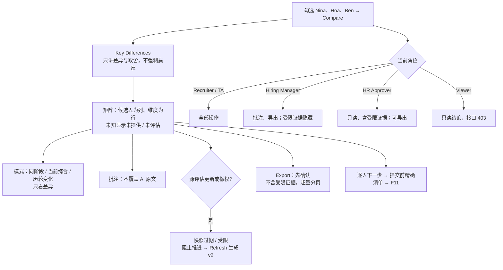

# F10 User Journey：候选人对比（P1）

| 项 | 内容 |
|---|---|
| 模块 | F10（对应测试脚本 J8） |
| 版本 / 日期 | v1.0 / 2026-10-14（草稿，待评审） |
| 同目录文档 | [产品文档](PRD.md) · [输入输出闭环](Loop_IO.md) · [User Cases](User_Cases.md) |
| 来源 | [用户旅程与测试脚本 v0.2](../../user-journeys/Resume_Screening_User_Journeys_v0.2.md) J8；角色见 [README 角色与权限](../README.md#角色与权限) |

## 角色与权限（本模块）

| 角色 | 在本模块的目的 | 可以做 | 不能做 |
|---|---|---|---|
| Recruiter / TA | 把几个人放在一起，看清差异和取舍，决定各自的下一步 | 创建对比、切换模式、加人、刷新、批注、导出、逐人提出下一步 | 加入其他岗位或未关联的候选人；用过期快照直接推进 |
| Hiring Manager | 从业务角度比较候选人 | 查看所负责岗位的对比；批注；导出；担任岗位负责人时提出下一步 | 看到受限证据（薪资期望等） |
| HR Approver | 例外审批时参考对比 | 查看对比（含受限证据）和快照历史；导出 | 批注、改成员、提出下一步 |
| Viewer | 只读 | 查看对比的结论（不含受限证据） | 批注、导出、改成员、提出下一步；接口返回 403 |

# 旅程

**主角色**：Recruiter / TA；Hiring Manager 协作批注；HR Approver、Viewer 验证可见范围
**登录目的**：几个候选人都不错，想看清他们之间到底差在哪里、各自还缺什么证据，再分别决定谁去笔试、谁直接面试、谁暂缓；系统不要替我选人。
**入口**：岗位工作台 → 勾选候选人 → Compare candidates（`#/comparisons/:id`）

## 输入

| 类型 | 内容 |
|---|---|
| 前置数据 | S_linked（Nina、Hoa、Ben 已关联并有评估）；S_compare（已有快照 v1） |
| 用户数据 | 勾选的候选人；模式切换；只看差异；Add candidate；批注；Refresh；Export；逐人下一步（Nina 面试、Hoa 笔试、Ben 暂缓） |
| 外部依赖 | 差异摘要模型（成功 / 失败）；源评估更新、权限撤销事件 |

## 流程

## 步骤

| # | 角色 | 用户意图与操作 | 系统反馈 | 用户需要判断 |
|---|---|---|---|---|
| 1 | Recruiter | 勾选 Nina、Hoa、Ben，点 Compare candidates | 面包屑 Jobs › 岗位 › Compare；有 Add candidate / Refresh / Export；默认 Current summary | — |
| 2 | Recruiter | 看 Key Differences | 只描述差异、对岗位的意义和证据局限；Nina 和 Hoa 各有所长时写「暂无明显全面领先者」并用条件表达取舍 | 更看重哪一点 |
| 3 | Recruiter | 看矩阵的薪资和地点行 | 币种周期不同时说明不可直接比较；Ben 的薪资显示未提供，不是 0 | — |
| 4 | Recruiter | 看笔试行 | 未参加笔试的人显示未评估，不判为能力低 | — |
| 5 | Recruiter | 切换三种模式，勾选只看差异 | 内容随模式变化；相同的行被隐藏 | — |
| 6 | Recruiter | Add candidate | 只能选同一岗位已关联的人；加入其他岗位或未关联的人被拒绝 | 加谁 |
| 7 | Hiring Manager | 打开同一对比，添加批注 | 批注带作者和时间，AI 原文不变；薪资期望相关单元格显示受限 | — |
| 8 | Recruiter | 解决 Hoa 的一条顾虑后回到对比 | 快照标为过期；提交下一步被阻止，提示先刷新 | — |
| 9 | Recruiter | 点 Refresh | 生成 v2，v1 保留；历轮变化显示已解决的顾虑和结论变化原因 | — |
| 10 | Recruiter | Export | 先确认；一页图包含岗位、时点、成员、关键差异、证据状态和限制；不含联系方式和受限证据；成员 12 人时要求选子集或分页 | 导出哪些人 |
| 11 | Recruiter | 逐人选择：Nina 面试、Hoa 笔试、Ben 暂缓，提交 | 提交前列出精确名单、动作、路由、待满足条件和所需批准；Nina 跳过必需笔试时提示需要例外；提交后交给 F11；**此时没有任何候选人通知** | 每个人的下一步 |
| 12 | HR Approver | 打开对比和快照历史 | 只读，受限证据可见；可以导出；没有批注、加人、下一步入口 | — |
| 13 | Viewer | 打开对比并查看 Network 响应 | 只看到结论；受限证据不在响应中；批注、导出、下一步接口返回 403 | — |
| 14 | Recruiter | 差异摘要模型失败时打开对比 | 矩阵正常可用，摘要显示不可用 | — |

## 输出与交接

- 持久化：ComparisonSet / ComparisonMember；ComparisonSnapshot（版本、新鲜度）；ComparisonAnnotation；NextStepProposal；导出记录；审计。
- 交接：逐人下一步提案 → F11 人工决定。

**禁止副作用**：生成对比或导出时通知候选人；强制指定赢家或给录用概率；跨岗位或加入未关联的人；缺失写成 0；未参加笔试判为能力低；刷新覆盖旧快照；批注覆盖 AI 原文；导出含受限内容或静默漏人；用过期快照直接推进。

**成功标准**：对比只呈现差异和证据，不替人选择；快照可追溯；每个角色能看到的证据和能做的操作与权限矩阵一致。

**测试映射**：Loop_IO P1～P12；用户旅程 v0.2 J8 步骤 1～10。

**待确认**：只有简历筛选一个阶段时，同阶段和历轮变化模式如何展示；笔试结果回流的接口（P3 为 known gap）；Viewer 能否导出（权限矩阵中为不能）。
