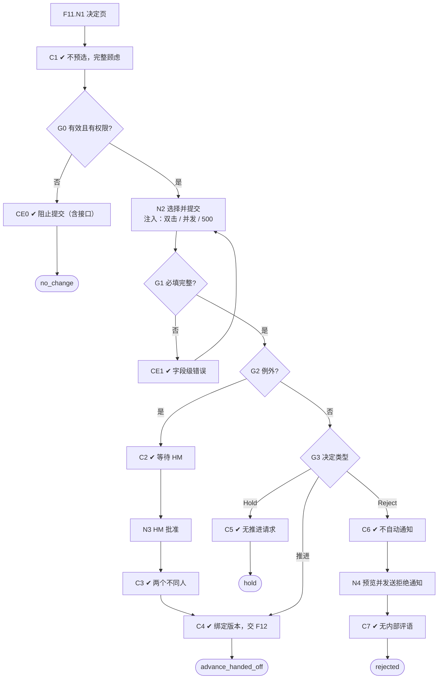

# F11 输入输出闭环：人工决定与例外审批

| 项 | 内容 |
|---|---|
| 模块 | F11 |
| 版本 / 日期 | v1.0 / 2026-10-14（草稿，待评审） |
| 同目录文档 | [产品文档](PRD.md) · [User Journey](User_Journey.md) · [User Cases](User_Cases.md) |
| 格式说明 | 见 [模块索引 README](../README.md#闭环文档格式) |

## 1. 输入与输出

| 部分 | 内容 |
|---|---|
| **输入·身份** | recruiter_a（岗位筛选负责人，发起例外）；hm_a（例外审批 HM 方）；approver_a（例外审批 HR 方）；viewer_a、recruiter_other_scope（无决定权限） |
| **输入·前置状态** | S_linked（Nina、Ben、Hoa 有有效评估）；S_linked_stale（评估已过期） |
| **输入·用户数据** | 决定选项（Strong Advance / Advance / Hold / Reject / Request Information / Assign Review）；推进类的下一步（Send Assessment / Move to Interview / 仅记录）；理由；例外审批意见；批量决定的候选人清单；撤销决定；拒绝通知的预览与确认 |
| **输入·外部依赖桩** | 通知 / 邮件（拒绝通知）；下游交接（F12：成功 / 失败）；工作流配置（笔试 required / optional / not_required、是否需要双人确认） |
| **输出·UI** | 决定页：AI 建议仅作参考、不预选；完整展示未解决的顾虑和待核实项；字段级校验；过期提示；例外审批状态（等待第二人）；Reject 后出现 Send candidate decline notice；批量决定的精确清单与逐项结果；待审批提案与已推进分开显示 |
| **输出·API / 数据** | ScreeningDecision（结果、下一步、理由、决定人、时间、绑定的评估版本、expected_version、状态）；DecisionExceptionApproval（角色、批准人、理由、时间、绑定的决定版本）；WorkflowTransition（交给 F12）；FeedbackEvent |
| **输出·事件 / 审计** | 决定、审批、撤销写审计；screening_review 与下一步任务在业务写入成功后完成；Reject 后取消未执行的推进与提醒；撤销已交接的决定向下游发更正 |
| **输出·禁止副作用** | AI 建议自动执行或预选；AI 推进、人工 Hold 时仍创建推进请求；基于过期评估直接推进；同一人充当例外审批的两个批准人；并发提交互相覆盖；Reject 后自动发送拒绝通知；拒绝通知含内部评语或排序；跳过 required 笔试而没有有效例外；未安装 Assessment 时生成虚假豁免；批量决定包含清单之外的候选人 |
| **输出·交给下游** | WorkflowTransition → F12 交接与投递；FeedbackEvent → 偏好学习（功能拆分 F16） |

## 2. 结构化规格

```yaml
flow_id: F11
actor: recruiter_a
seed: S_linked
entry: F11.N1
max_loop: 2
external: [notify, handoff.downstream, workflow.policy]

nodes:
  - {id: F11.N1, type: action, do: "打开候选人 A 的决定页"}
  - {id: F11.C1, type: check, expect: {ui: "AI 建议显示为参考，无预选项；完整列出未解决的顾虑和待核实项"}}
  - {id: F11.G0, type: decision, on: "评估是否过期、执行者是否有权限"}
  - {id: F11.CE0, type: check, expect: {ui: "过期：提示重评后再决定，推进不可提交；无权限：不可提交", api: "直接提交返回 4xx"}}
  - {id: F11.N2, type: action, do: "选择决定 D、下一步 X，填写理由并提交", inject: [double_click, concurrent, http_500]}
  - {id: F11.G1, type: decision, on: "必填项是否完整"}
  - {id: F11.CE1, type: check, expect: {ui: "字段旁显示错误；已填内容不丢", db: "无决定"}}
  - {id: F11.G2, type: decision, on: "是否越过岗位底线（例外）"}
  - {id: F11.C2, type: check, expect: {ui: "进入例外审批，等待 HM 方和 HR 方批准", db: "DecisionExceptionApproval 0 条；未生成 WorkflowTransition"}}
  - {id: F11.N3, type: action, do: "hm_a 与 approver_a 分别批准例外"}
  - {id: F11.C3, type: check, expect: {db: "两条批准分别来自 hm_a（HM 方）和 approver_a（HR 方），绑定同一决定版本", api: "recruiter_a 批准自己发起的例外、hm_a 重复批准都返回 4xx"}}
  - {id: F11.G3, type: decision, on: "决定类型"}
  - {id: F11.C4, type: check, expect: {db: "ScreeningDecision 绑定评估版本；生成 WorkflowTransition 交给 F12；screening_review 任务 completed", record: "审计"}}
  - {id: F11.C5, type: check, expect: {db: "只保存 Hold；不生成 WorkflowTransition；补资料任务不关闭"}}
  - {id: F11.C6, type: check, expect: {ui: "出现 Send candidate decline notice；未自动发送", db: "取消未执行的推进和提醒", ext: "无通知"}}
  - {id: F11.N4, type: action, do: "点 Send candidate decline notice，预览后确认"}
  - {id: F11.C7, type: check, expect: {ext: "测试候选人收到 1 条通知，不含内部评语和排序", db: "通知记录与决定分开"}}
  - {id: F11.T1, type: terminal, state: decision.advance_handed_off}
  - {id: F11.T2, type: terminal, state: decision.hold}
  - {id: F11.T3, type: terminal, state: decision.rejected}
  - {id: F11.T4, type: terminal, state: no_change}

edges:
  - [F11.N1, F11.C1]
  - [F11.C1, F11.G0]
  - [F11.G0, F11.CE0, {when: "seed = S_linked_stale 或 actor 属于 recruiter_other_scope / viewer_a"}]
  - [F11.CE0, F11.T4]
  - [F11.G0, F11.N2, {when: "有效"}]
  - [F11.N2, F11.G1]
  - [F11.G1, F11.CE1, {when: "D 属于 decision_no_reason"}]
  - [F11.CE1, F11.N2]
  - [F11.G1, F11.G2, {when: "完整"}]
  - [F11.G2, F11.C2, {when: "A = cand_ben 且 D = advance，或跳过 required 笔试"}]
  - [F11.C2, F11.N3]
  - [F11.N3, F11.C3]
  - [F11.C3, F11.C4]
  - [F11.G2, F11.G3, {when: "否"}]
  - [F11.G3, F11.C4, {when: "D = advance / strong_advance"}]
  - [F11.G3, F11.C5, {when: "D = hold"}]
  - [F11.G3, F11.C6, {when: "D = reject"}]
  - [F11.C4, F11.T1]
  - [F11.C5, F11.T2]
  - [F11.C6, F11.N4]
  - [F11.N4, F11.C7]
  - [F11.C7, F11.T3]
---
flow_id: F11b  # 批量决定
actor: recruiter_a
seed: S_linked
entry: F11b.N1
max_loop: 1
external: [handoff.downstream]

nodes:
  - {id: F11b.N1, type: action, do: "在工作台勾选 Nina、Hoa，选择批量 Advance → Move to Interview"}
  - {id: F11b.C1, type: check, expect: {ui: "提交前列出精确候选人清单、当前版本、动作、理由和例外"}}
  - {id: F11b.N2, type: action, do: "确认提交；对 Hoa 注入交接失败"}
  - {id: F11b.C2, type: check, expect: {ui: "逐项显示结果：Nina 成功，Hoa 失败可重试", db: "只包含清单中的 2 人；成功项不因失败回滚"}}
  - {id: F11b.T1, type: terminal, state: batch.partial_success}

edges:
  - [F11b.N1, F11b.C1]
  - [F11b.C1, F11b.N2]
  - [F11b.N2, F11b.C2]
  - [F11b.C2, F11b.T1]
---
flow_id: F11c  # 撤销已交接的决定
actor: recruiter_a
seed: S_linked
entry: F11c.N1
max_loop: 1
external: [handoff.downstream]

nodes:
  - {id: F11c.N1, type: action, do: "撤销 Nina 已交接的 Move to Interview 决定，填写原因"}
  - {id: F11c.C1, type: check, expect: {db: "决定状态为已撤销；向下游发送更正；不直接取消下游已安排的面试", record: "审计"}}
  - {id: F11c.T1, type: terminal, state: decision.revoked}

edges:
  - [F11c.N1, F11c.C1]
  - [F11c.C1, F11c.T1]
```

## 3. 测试数据

| 名称 | 内容 |
|---|---|
| cand_nina | eligible，AI 建议推进 |
| cand_ben | not_eligible（工作地点），AI 建议不予推进 |
| cand_hoa | eligible，有 1 条未解决顾虑 |
| decision_no_reason | 选择 Advance 但不填理由 |
| ai_advance_human_hold | Nina：AI 建议推进，人工选 Hold |
| policy_test_required | 工作流要求笔试（required） |
| policy_test_optional | 笔试为 optional / 未安装 Assessment |

## 4. 路径清单

| 路径 | 节点序列 | 数据 / 注入 | 终态 | 对应 AC |
|---|---|---|---|---|
| P1 推进并交接 | F11.N1 → C1 → G0 → N2 → G1 → G2 → G3 → C4 | cand_nina，Advance → Move to Interview | decision.advance_handed_off | AC-4 |
| P2 AI 推进、人工 Hold | … → G3 → C5 | ai_advance_human_hold | decision.hold；无推进请求 | AC-1 |
| P3 不予推进与拒绝通知 | … → G3 → C6 → N4 → C7 | cand_ben，Reject | decision.rejected；通知需单独确认 | AC-4 |
| P4 过期评估 | F11.N1 → C1 → G0 → CE0 | S_linked_stale | no_change | AC-2 |
| P5 例外双人审批 | … → G2 → C2 → N3 → C3 → C4 | cand_ben，Advance | 两个不同人批准后才交接 | AC-5 |
| P6 发起人批准 / 重复批准 | … → N3（recruiter_a 批准、hm_a 批准两次） | — | 被拒绝 | AC-5 |
| P7 跳过必需笔试 | … → G2 → C2 | policy_test_required，Nina 直接面试 | 需要有效例外 | AC-3 |
| P8 笔试非必需 | … → G2 → G3 → C4 | policy_test_optional | 直接交接，无虚假豁免 | AC-3 |
| P9 字段校验 | … → G1 → CE1 | decision_no_reason | 错误在字段旁，内容不丢 | — |
| P10 并发提交 | F11.N2 两个会话 | concurrent | 后提交者看到已有决定，不覆盖 | AC-6 |
| P11 完整展示顾虑 | F11.N1 → C1 | cand_hoa | 顾虑内容完整列出，不只是数量 | AC-8 |
| P12 批量决定 | F11b 全程 | Nina + Hoa | batch.partial_success | AC-7 |
| P13 撤销 | F11c 全程 | — | decision.revoked | — |
| P14 无权限 | F11.N1 → C1 → G0 → CE0 | recruiter_other_scope、viewer_a、approver_a（普通决定） | no_change（接口 4xx） | — |

## 5. 流程图（由规格生成）



## 6. 待确认

- Assign Review 归属（同 PRD 待确认 1）；确定后补一条路径。
- 按策略批准使用旧依据的审批人（同 PRD 待确认 3），影响 P4 的分支。
