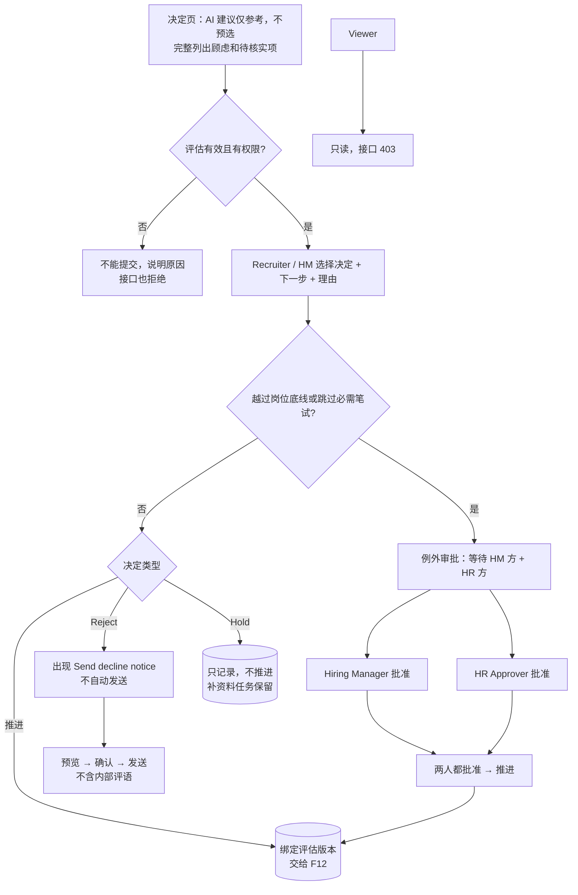

# F11 User Journey：人工决定与例外审批（P0）

| 项 | 内容 |
|---|---|
| 模块 | F11（对应测试脚本 J6） |
| 版本 / 日期 | v1.0 / 2026-10-14（草稿，待评审） |
| 同目录文档 | [产品文档](PRD.md) · [输入输出闭环](Loop_IO.md) · [User Cases](User_Cases.md) |
| 来源 | [用户旅程与测试脚本 v0.2](../../user-journeys/Resume_Screening_User_Journeys_v0.2.md) J6；角色见 [README 角色与权限](../README.md#角色与权限) |

## 角色与权限（本模块）

| 角色 | 在本模块的目的 | 可以做 | 不能做 |
|---|---|---|---|
| Recruiter / TA | 对候选人作出有依据、可追溯的决定 | 担任岗位负责人时提交决定（含批量）；发起例外审批；撤销决定；发送拒绝通知 | 批准自己发起的例外；基于过期评估直接推进 |
| Hiring Manager | 参与决定，对越过底线的推进负业务责任 | 担任岗位负责人时提交决定；例外审批中的 HM 方批准 | 批准同一例外两次；发送拒绝通知 |
| HR Approver | 确认例外推进合规 | 例外审批中的 HR 方批准；查看决定和审批审计 | 提交普通决定；批准自己发起的例外 |
| Viewer | 只读 | 查看已作出的决定 | 提交决定、审批、撤销、发送通知；接口返回 403 |

# 旅程

**主角色**：Recruiter / TA（岗位负责人，发起）；Hiring Manager、HR Approver（例外审批）；Viewer 验证只读
**登录目的**：看完评估和对比，要正式决定谁推进、谁暂缓、谁不推进；AI 只是参考，决定由我作出并留痕；越过岗位底线时必须有 HM 和 HR Approver 两个人批准。
**入口**：评估页 → 决定（`#/applications/:id/decision`）；对比页的下一步提交；工作台批量决定；待我审批的例外

## 输入

| 类型 | 内容 |
|---|---|
| 前置数据 | S_linked（Nina、Ben、Hoa 有有效评估）；S_linked_stale（评估已过期）；工作流配置（笔试 required / optional） |
| 用户数据 | 决定选项、下一步、理由；例外审批意见；批量决定的清单；撤销原因；拒绝通知预览与确认 |
| 外部依赖 | 下游交接（F12：成功 / 失败）；通知 / 邮件 |

## 流程

## 步骤

| # | 角色 | 用户意图与操作 | 系统反馈 | 用户需要判断 |
|---|---|---|---|---|
| 1 | Recruiter | 打开 Nina 的决定页 | AI 建议显示为参考，**没有预选**；未解决的顾虑和待核实项完整列出，不只是数量 | 推进还是暂缓 |
| 2 | Recruiter | 选 Advance → Move to Interview，不填理由提交 | 理由字段旁显示错误；已选内容不丢 | — |
| 3 | Recruiter | 填写理由后提交 | 记录决定人和时间；交给交接投递；筛选复核任务完成 | — |
| 4 | Recruiter | AI 建议推进，但对另一人选 Hold | 只保存 Hold，不产生推进请求；补资料任务保留 | — |
| 5 | Recruiter | 对 Ben 选 Reject 并提交 | 状态为已决定；出现 Send candidate decline notice，**没有自动发送** | 是否通知候选人 |
| 6 | Recruiter | 点 Send candidate decline notice | 先预览再确认；确认后产生一条通知记录，内容不含内部评语和排序 | — |
| 7 | Recruiter | 标准更新为 v2 后打开 Nina 的决定页 | 提示评估已过期，推进不可提交，需要先重评 | — |
| 8 | Recruiter | 对 Ben（不符合资格）选 Advance 提交 | 进入例外审批，等待 HM 方和 HR 方批准；暂不交接 | — |
| 9 | Recruiter | 尝试自己批准这个例外 | 被拒绝，提示发起人不能批准 | — |
| 10 | Hiring Manager | 从待我审批进入，批准；再点一次批准 | 第一次记录 HM 方批准；第二次被拒绝 | 是否同意越过底线 |
| 11 | HR Approver | 从待我审批进入，查看评估和对比后批准 | 记录 HR 方批准；两条批准绑定同一决定版本；随后交给交接投递 | 是否合规 |
| 12 | Recruiter | 工作流要求笔试，Nina 直接面试 | 需要走例外审批；笔试为 optional 或未安装 Assessment 时直接交接，不生成虚假豁免 | — |
| 13 | Recruiter | 两个会话同时对 Nina 提交不同的决定 | 后提交的一方看到已有决定，不覆盖 | — |
| 14 | Recruiter | 批量对 Nina、Hoa 选 Advance → Move to Interview（Hoa 交接失败） | 提交前列出精确清单；逐项显示结果，Nina 成功，Hoa 可重试；只包含这两人 | — |
| 15 | Recruiter | 撤销 Nina 已交接的决定，填写原因 | 状态为已撤销；向下游发送更正；不直接取消下游已安排的面试 | — |
| 16 | HR Approver | 尝试对 Hoa 提交普通决定 | 没有决定入口；接口返回 403 | — |
| 17 | Viewer | 查看决定记录，调用提交和审批接口 | 只读；接口都返回 403 | — |

## 输出与交接

- 持久化：ScreeningDecision（结果、下一步、理由、决定人、评估版本、expected_version、状态）；DecisionExceptionApproval（HM 方、HR 方各一条）；WorkflowTransition；FeedbackEvent；通知记录；审计。
- 交接：推进请求 → 交接与投递（功能拆分 F12）；反馈 → 偏好学习（功能拆分 F16）。

**禁止副作用**：AI 建议自动执行或预选；人工 Hold 时仍产生推进请求；基于过期评估推进；发起人或同一人充当两个批准人；并发提交互相覆盖；Reject 后自动发送通知；通知含内部评语或排序；跳过必需笔试没有有效例外；未安装 Assessment 时生成虚假豁免；批量决定包含清单外的人；非负责人能通过接口决定。

**成功标准**：每个决定都由有权限的人显式作出并绑定评估版本；例外推进必须有 Hiring Manager 和 HR Approver 两个不同的人批准；拒绝与通知分开。

**测试映射**：Loop_IO P1～P14；用户旅程 v0.2 J6 步骤 8～13；Issue #20、#26、#27。

**待确认**：例外审批的 HR 方由 HR Approver 担任，是按四类角色推断的（PRD §2 原文为「HR 与 HM」），需要确认；Assign Review 的归属；按策略批准使用旧依据时由谁批准；Hiring Manager 能否发送拒绝通知。
