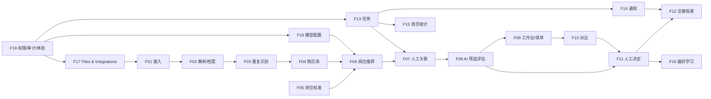

# Resume Screening 功能拆分

| 属性 | 内容 |
|---|---|
| 依据 | [Resume_Screening_PRD_v1.3.md](../../../hireos-screening/docs/Resume_Screening_PRD_v1.3.md)、[原型 v2](../../design/Resume_Screening/HireOS-Resume-Screening-Prototype-v2.html) |
| 日期 | 2026-10-14 |
| 用途 | 把简历筛选模块拆成可独立立项、实现和验收的功能单元，作为后续创建 Issue 的底稿 |

> 拆分原则：PRD v1.3 要求全功能交付、不做功能分期。本文的顺序只表示工程依赖，不表示删减或延后范围。
> 「现状」一栏只按代码目录、路由和接口做了初步核对，**没有逐项验证 AC**，立项时需要重新确认。

## 1. 总览

主流程：资料接入 → 重复识别 → 简历库 → AI 岗位推荐 → 人工关联 → AI 岗位筛选 → 排序与对比 → 人工决定 → 交接下游。任务、通知、偏好、文件与集成、模型配置、权限审计是贯穿主流程的支撑能力。

| 编号 | 功能 | 类别 | PRD | 原型路由 | 后端模块 | 前端页面 | 验收 |
|---|---|---|---|---|---|---|---|
| F01 | 资料接入与导入批次 | 主流程 | §4、§7 | `#/imports/new`（并入简历库） | `intake`、`profiles` | `LibraryPage`、`features/imports` | SCR-06、23 |
| F02 | 简历解析与候选人档案 | 主流程 | §4、§4.4 | `#/candidates/:id` | `profiles`、`library` | `CandidateProfilePage` | SCR-03 |
| F03 | 重复识别与身份复核 | 主流程 | §4.1 | `#/duplicates/:id` | `duplicates` | `DuplicateDetailPage` | SCR-23、24 |
| F04 | 简历库 | 主流程 | §4.2 | `#/library` | `library` | `LibraryPage` | SCR-25 |
| F05 | 岗位与评分标准 | 主流程 | §3.2、§5.2 | `#/jobs`、`#/jobs/:id/criteria` | `jobs` | `JobsListPage`、`JobCriteriaPage` | SCR-01、07 |
| F06 | AI 岗位发现与推荐 | 主流程 | §4.2、§5.1 | `#/candidates/:id/jobs` | `discovery` | `JobRecommendationsPage` | SCR-25、29 |
| F07 | 人工岗位关联 | 主流程 | §4.3、§4.4 | 同上 + 任务 | `linking` | `JobRecommendationsPage` | SCR-26、27、28 |
| F08 | AI 岗位筛选评估 | 主流程 | §5.1–5.5 | `#/applications/:id` | `screening` | `ScreeningDetailPage` | SCR-02、03、10、13 |
| F09 | 筛选工作台、排序与批量筛选 | 主流程 | §5.5、§7、§8.1–8.2 | `#/jobs/:id/screening` | `screening` | `ScreeningWorkspacePage` | SCR-06、20 |
| F10 | 候选人对比 | 主流程 | §5.6–5.10、§8.5 | `#/comparisons/:id` | `comparisons` | `ComparePage` | SCR-15–22 |
| F11 | 人工决定与例外审批 | 主流程 | §6.1、§7 | `#/applications/:id/decision` | `decisions` | `DecisionPage` | SCR-05、07、18 |
| F12 | 交接与投递 | 主流程 | §3.3、§3.7、§8.4 | `#/deliveries`、`#/deliveries/:id` | `deliveries`、`decisions` | `DeliveriesListPage`、`DeliveryDetailPage` | SCR-08、09、12 |
| F13 | 任务管理与我的任务 | 支撑（SHARED-09） | §8.6 | `#/tasks` | `tasks` | **缺失** | SCR-30–32、34 |
| F14 | 通知与提醒 | 支撑（SHARED-09） | §8.4、§8.6.4 | 顶栏通知 | `settings/mail` | — | SCR-33 |
| F15 | 首页统计与指标 | 支撑（SHARED-08） | §8.1、§10、§13.3 | `#/tasks`（Overview） | — | **缺失** | §10 指标 |
| F16 | 偏好与学习 | 支撑 | §6.2、§6.3 | `#/settings/preferences` | **缺失** | **缺失** | SCR-11 |
| F17 | Files & Integrations | 支撑（SHARED-04/05/07） | §13.4 | `#/files` | `intake`（files）、`settings`（connections、activity、mailbox） | 仅设置页「企业邮箱」 | §13.8 / 12.2 |
| F18 | 模型配置与路由 | 支撑（SHARED-11） | §13.5 | `#/settings/ai-models` | **缺失**（仅 `shared/ai-json-client`） | **缺失** | §13.8 / 12.4 |
| F19 | 账号权限、审计、主题字号与可访问性 | 支撑（SHARED-01–03、10） | §2、§3.8、§8.3、§13.3、§13.7 | 顶栏、`#/settings` | `auth`、`settings`（audit） | `SettingsPage`、`AppShell` | SCR-14、22 |

## 2. 功能明细

### F01 资料接入与导入批次

- **目标**：多来源简历进入系统，坏文件不阻断整批。
- **范围**：PDF/DOCX 上传、粘贴文本、CSV 批量、授权邮箱读取（不支持 API 接入和文件夹导入/监控）；保存来源与 `source_record_id`；文件安全扫描失败进入隔离、不送 AI；批次状态 received/parsed/needs_mapping/queued/running/completed/failed/cancelled，结果允许 `partial_success`；失败重试不重复处理成功项；取消只停未完成项。
- **数据**：Material、ImportBatch、ImportItem、IngestionOperation、IngestionAttempt、CandidateSource。
- **依赖**：F17（文件存储、邮箱读取）。
- **相关 Issue**：#11（已关闭，文件夹导入；该方式已不在产品范围内，已上线的代码暂不下线）。

### F02 简历解析与候选人档案

- **目标**：把简历变成有版本的结构化 Profile，原文可追溯。
- **范围**：解析为 CandidateProfile；人工纠正生成新版本，不覆盖原文；禁止 AI 补造薪资、签证、离职原因、公司规模；材料中的指令视为内容；履历时间线、材料版本、多份 ResumeVersion；候选人详情页展示该人的全部岗位关系。
- **数据**：Candidate、CandidateProfile、ResumeVersion、ProcessingJob。
- **依赖**：F01。

### F03 重复识别与身份复核

- **目标**：同一份简历不重复建人，同名不同人不被误合并。
- **范围**：四层检测——完全相同文件（内容摘要）、内容相同格式不同、同人不同版本、身份相似但不确定；覆盖同批次和已有库；并发上传原子去重；不确定时生成重复复核任务（同一人 / 不同人 / 补资料 / 暂缓）；解析失败显示「未完成检查」而不是「无重复」；错误合并可审计地拆分纠正；只展示有权限的已有记录。
- **数据**：DuplicateCheck、DuplicateResolution。
- **依赖**：F01、F02、F13（复核任务）。

### F04 简历库

- **目标**：没有岗位也能保存和管理简历。
- **范围**：独立于岗位的 LibraryEntry（负责人、标签、来源、入库时间、最近匹配时间、保留状态）；一个人可关联 0..n 个岗位，不用「在库 / 已关联」互斥状态；筛选、搜索、上传入口不要求选岗位；无推荐时显示原因并可人工搜岗、补资料、设复查。
- **数据**：LibraryEntry。
- **依赖**：F01–F03。

### F05 岗位与评分标准

- **目标**：只有人工确认的岗位标准才能用于匹配和筛选。
- **范围**：从 JD Management 拉取 RoleCriteriaSnapshot，或本地粘贴 JD 起草标准；hard / nice-to-have 由人确认，AI 不得自行升级；维度与权重按岗位配置；标准版本化，JD 更新使旧结果标 stale；岗位开放状态与「标准未确认」区分显示；JD-only 可建项目（SCR-01）。
- **数据**：Job、JobCriteriaVersion。
- **依赖**：JD 子系统（可选，独立模式下本地起草）。
- **相关 Issue**：#17（重做需求与评分标准页面）、#12（已关闭）。

### F06 AI 岗位发现与推荐

- **目标**：简历入库后自动找出可能合适的岗位，作为待确认提案。
- **范围**：在可访问、开放且标准已确认的岗位中逐岗匹配；输出匹配理由、关键缺口、证据、置信度、输入版本；匹配状态 not_started/running/recommendations_ready/no_match/no_open_jobs/insufficient_data/failed 分开记录，AI 失败不记成 no_match；不同岗位分数不混排；新岗位、标准更新、资料更新或手动触发重新匹配，按 run 去重。
- **数据**：JobDiscoveryRun、PreLinkMatchEvaluation、CandidateJobRecommendation。
- **依赖**：F02、F05、F18（模型调用）。

### F07 人工岗位关联

- **目标**：只有人工确认后才建立正式 Application。
- **范围**：推荐状态 proposed → confirmed/dismissed/deferred，可变 stale/withdrawn；可确认一个或多个岗位、拒绝、暂缓或另选岗位；拒绝提案不等于拒绝候选人；确认前重新校验岗位开放、资料有效和权限；同一招聘周期重复或并发确认只保留一个 Application；主动投递也先作为待确认输入；关联与「下一步处理」是两个独立动作，关联成功后生成下一步任务；关联前评估在输入一致时可复用。
- **数据**：LinkDecision、Application。
- **依赖**：F06、F13。

### F08 AI 岗位筛选评估

- **目标**：对已关联的 Application 给出可追溯的筛选证据。
- **范围**：锁定输入 manifest；eligibility 四态（eligible/likely_eligible/needs_verification/not_eligible）；14 个可选维度，每维 score/status/reason/证据/置信度，unknown 分数为 null；overall 按权重归一化，coverage < 0.70 时 overall 为空、标 insufficient_evidence；Strength、Concern（严重度与置信度分开）、VerificationItem；recommendation 五档；AI Run 记录模型、prompt、参数、版本；AI 不可用时可人工评估且不伪造结果；改分生成 HumanAssessment，不覆盖 AI 分数；分数和 concern 可跳转到原文位置。
- **数据**：ScreeningSession、ScreeningEvaluation、DimensionScore、EvidenceItem、ScreeningConcern、VerificationItem、HumanAssessment。
- **依赖**：F05、F07、F18。
- **相关 Issue**：#19（运行初筛不调用 AI、分数随机）。

### F09 筛选工作台、排序与批量筛选

- **目标**：HR/HM 在一个岗位下高效审阅一批候选人。
- **范围**：左侧列表 + 右侧详情，顶部显示岗位、标准版本、人数、排序基线；Decision → Explanation → Evidence 三层信息；只在同一基线内排序（eligibility 分桶内 overall 降序、coverage 降序），无总分列入 Needs Verification；新增候选人生成新 RankingSnapshot；个人 pin 不影响团队排序；按状态、维度、来源、负责人、coverage 过滤并保留滚动位置；批量运行、进度、失败重试；「待确认推荐」和「已关联候选人」分开计数。
- **数据**：RankingSnapshot。
- **依赖**：F08。
- **相关 Issue**：#27（初筛列表信息权重平均）。

### F10 候选人对比

- **目标**：呈现同岗位候选人之间的差异和取舍，不替人选赢家。
- **范围**：候选人为列、维度为行的矩阵，支持 2–4 人并排及更多人横向滚动；AI Key Differences 摘要（允许「无明显全面领先者」）；同阶段、当前综合、历轮变化三种模式，每次刷新生成新快照；只看差异 / 显示未知 / 关键维度 / 个人视图；协同批注不覆盖 AI 原文；单元格下钻证据；导出一页差异图（PNG/PDF）和完整报告，人数过多时选子集或分页；底部逐人选择下一步提案；源证据变更或撤权时快照标 stale/restricted。
- **数据**：ComparisonSet、ComparisonMember、ComparisonSnapshot、ComparisonAnnotation（PRD 中的 ComparisonCell、DifferenceSummary、NextStepProposal 需确认是否已建模）。
- **依赖**：F08、F09；下一步提交依赖 F11。
- **相关 Issue**：#27（解决顾虑后对比视图数据陈旧）、#26（对比页中英切换）。

### F11 人工决定与例外审批

- **目标**：所有推进都是有权限、绑定版本的人工决定。
- **范围**：Strong Advance / Advance / Hold / Reject / Request Information / Assign Review / Send Assessment / Move to Interview；决定绑定 evaluation 与输入版本，过期时阻止直接推进；版本前置条件防并发覆盖；岗位可要求双人确认，底线例外默认需 HR + HM 两人批准；Reject 取消未执行的推进和提醒；批量决定先展示精确 ID 清单逐项提交；撤销已交接决定向下游发更正。
- **数据**：ScreeningDecision、DecisionExceptionApproval。
- **依赖**：F08、F19（权限）。
- **相关 Issue**：#20（双人审批配置与文案不符）、#27（决策页把顾虑压缩为数字）。

### F12 交接与投递

- **目标**：把筛选包可靠地交给 Assessment / Interview / 人员，不重复建档。
- **范围**：自包含 ScreeningPackage（Hold/Reject 也可生成）；邮件为默认通道，文件包为替代，API/事件可选；事务性 outbox + 接收方去重；提案、已决定、待交付、目标接收、执行状态分开显示；回执丢失可查询或重发；邮箱失败不撤销报告，目标离线不回滚决定；未安装 Assessment 时不生成虚假豁免。
- **数据**：HandoffPackage、DeliveryAttempt、Receipt、ScreeningOutboxEvent。
- **依赖**：F11、F14。
- **相关 Issue**：#22（投递包缺字段、投递列表无导航入口）。

### F13 任务管理与我的任务（SHARED-09）

- **目标**：所有人工动作都有可追踪的任务，HR 和 HM 都能承担。
- **范围**：任务类型——重复复核、岗位关联确认、简历筛选复核、下一步处理、补资料/补证、对比评审、异常与交接处理；状态 open → in_progress → completed，可 waiting / cancelled，逾期是派生标记；领取、转派、优先级、截止时间、评论、历史；任务只在业务写入成功后完成，不提供直接勾选完成；来源版本过期标 needs_refresh；「我的任务」/ 可领取 / 我创建 / 已完成标签页；任务统计口径见 §8.6.3；按事件去重；本模块独立可用，集成后按版本对账。
- **数据**：HumanTask（需对照 PRD §8.6.4 Task 字段核对）。
- **依赖**：F19。
- **现状**：后端有 `tasks` 模块；前端没有 `/tasks` 路由，原型默认入口是 `#/tasks`。#18 已关闭，需确认当时是补页面还是去掉了入口。

### F14 通知与提醒

- **范围**：资料接收、需补充、分析完成待复核、复核逾期、报告完成、交接失败、版本更正、任务创建/分配/临期/逾期/等待恢复；规则含事件、接收角色、模板、对象 URL、去重键、升级策略；站内 + 邮件，邮件失败站内可见；完成/取消/转派后撤销旧提醒；候选人通知不含内部评语和排序；URL GET 不产生批准。
- **依赖**：F13、F17（邮件连接）。

### F15 首页统计与指标（SHARED-08）

- **范围**：Overview 首页展示待关联确认、待筛选、待下一步、待补资料、交接异常，机器批次进度单列；个人 / 全局统计、排序折叠、时间范围、最后刷新时间；§10 的指标口径（Time to shortlist、去重质量、关联确认率、AI acceptance/override、对比效率等）。
- **依赖**：F13 及各主流程的数据。

### F16 偏好与学习

- **范围**：Organization → Team → Role → User 四层偏好合成 effective snapshot；禁止学习受保护属性及其代理；FeedbackEvent → PreferenceSignal → 偏好提案 → 审核激活新版本；共享偏好必须人工审核；个人偏好只影响个人视图，不改团队排序。
- **依赖**：F08、F11。
- **现状**：前后端均未发现实现；设置页把 `/settings/preferences` 重定向到个人资料。

### F17 Files & Integrations（SHARED-04/05/07）

- **范围**：文件列表、预览、版本、上传下载进度，「读取」与「消费」两个状态分开；授权邮箱连接与读取规则、检查点、暂停恢复；统一状态模型；Activity History 全部操作历史；交互参考 Google Drive（§13.4 8.7.10）。
- **依赖**：F19。
- **现状**：后端有 files、connections、activity、企业邮箱接口；前端只有设置页里的企业邮箱，没有 `/files` 页面。

### F18 模型配置与路由（SHARED-11）

- **范围**：多供应商模型目录、按模块与任务设置策略、四维选择规则（质量/成本/时延/合规）、价格与预算、质量评测、数据边界、超时与回退、配置版本、调用历史与告警；Screening 只拥有匹配和业务决定。
- **依赖**：F19。
- **现状**：只有 `shared/ai-json-client.ts` 直接调用；没有配置页和配置存储，`/settings/ai-models` 被重定向。

### F19 账号权限、审计、主题字号与可访问性（SHARED-01/02/03/10）

- **范围**：租户、岗位负责人、操作授权，操作时重新校验权限；受限内容不下发到浏览器；审计输入/结论追溯、访问、导出、删除，保留策略；Light/Dark/Deep/System 主题和 Small/Medium/Large 字号；键盘导航、焦点可见、200% 缩放、读屏标签、live region；中英文切换完整；stale/pending/empty/error/partial/无权限状态分别设计。
- **数据**：AuditRecord、WorkspaceSetting。
- **相关 Issue**：#21（受限内容权限硬编码用户 ID）、#24（两套身份体系）、#25（键盘与 live region）、#26（表单校验、中英切换）。

## 3. 依赖与实施顺序

建议的工程顺序（只排先后，不删范围）：

1. **补齐地基**：F19 中的权限与身份问题（#21、#24），F13 前端「我的任务」，F18 模型配置的存储与调用入口（解决 #19 的前提）。
2. **打通主流程**：F01 → F07，重点验证无岗位入库、重复识别和「推荐 ≠ 关联」。
3. **筛选与决策**：F05（#17）、F08（#19）、F09、F11（#20）。
4. **对比与交接**：F10、F12（#22）、F14。
5. **支撑完善**：F15、F16、F17 前端页面、F19 可访问性与多语言（#25、#26）。

## 4. 待确认

1. #18 已关闭，但前端没有 `/tasks` 路由，原型默认入口和 Overview 都在这里。需要确认 F13/F15 的前端是否仍要按原型实现。
2. 原型把导入并入简历库（`#/imports/new` 重定向），设置页去掉了 Preferences 和 AI Models。这是有意的设计调整，还是暂时下线？会影响 F01、F16、F18 的范围。
3. 公共能力（F13、F14、F17、F18、F19）是只在 Screening 内实现，还是需要和 Interview、JD 统一？PRD 允许先就地实现，但会影响后续是否要抽取公共服务。
4. Interface Spec 尚未同步 PRD v1.2/v1.3 的新增对象（PRD §12.2），立项时是否把接口同步单独拆成一个 Tech Debt Issue。
