# W01 输入输出闭环：题库与题目版本

| 项 | 内容 |
|---|---|
| 模块 | W01 |
| 版本 / 日期 | v1.0 / 2026-10-16（草稿，待评审） |
| 同目录文档 | [产品文档](PRD.md) · [User Journey](User_Journey.md) · [User Cases](User_Cases.md) |
| 格式说明 | 见 [Written Test README](../README.md#闭环文档格式) |

## 1. 结构化规格

```yaml
flow_id: W01a              # 浏览、过滤、预览
actor: hr_emma
seed: S_bank_fin
entry: W01a.N1
max_loop: 2
external: []

nodes:
  - {id: W01a.N1, type: action, do: "打开 Question Bank，按测试数据 F 搜索 / 过滤"}
  - {id: W01a.G1, type: decision, on: "过滤结果是否为空"}
  - {id: W01a.C1, type: check, expect: {ui: "列表只含匹配题目；列含 Code/Title/Role tags/Competencies/Type/Difficulty/Version/Status；无直接发送动作"}}
  - {id: W01a.C2, type: check, expect: {ui: "显示 No questions match these filters."}}
  - {id: W01a.N2, type: action, do: "打开 FIN-001 详情，依次切换 Prompt/Materials/Rubric/Usage/Versions"}
  - {id: W01a.C3, type: check, expect: {ui: "内部答案旁标 Reviewer only；Usage 列出 Case 与已见候选人，无外部记录显示 Unknown；Versions 显示 Current/Superseded"}}
  - {id: W01a.N3, type: action, do: "点击 Preview candidate view"}
  - {id: W01a.C4, type: check, expect: {ui: "只显示题目、候选人可见材料、交付清单", api: "预览数据中无 rubric、answer_key、internal_notes 字段"}}
  - {id: W01a.T1, type: terminal, state: no_change}

edges:
  - [W01a.N1, W01a.G1]
  - [W01a.G1, W01a.C1, {when: "F 属于 filter_hit_*"}]
  - [W01a.G1, W01a.C2, {when: "F = filter_miss"}]
  - [W01a.C1, W01a.N2]
  - [W01a.C2, W01a.T1]
  - [W01a.N2, W01a.C3]
  - [W01a.C3, W01a.N3]
  - [W01a.N3, W01a.C4]
  - [W01a.C4, W01a.T1]
---
flow_id: W01b              # 创建、编辑、发布、停用
actor: hr_emma
seed: S_question_published_v1
entry: W01b.N1
max_loop: 3
external: []

nodes:
  - {id: W01b.N1, type: action, do: "Create question，按测试数据 Q 填写，Save draft", inject: [double_click, http_500]}
  - {id: W01b.G1, type: decision, on: "服务端校验"}
  - {id: W01b.C1, type: check, expect: {ui: "对应字段报错", db: "题目数不变"}}
  - {id: W01b.C2, type: check, expect: {db: "Question status=draft，version=1，author=actor", ui: "草稿不可被计划选用"}}
  - {id: W01b.N2, type: action, do: "Publish 草稿", inject: [double_click]}
  - {id: W01b.C3, type: check, expect: {db: "status=published；只生成 1 个版本", record: "发布历史含操作人、时间"}}
  - {id: W01b.N3, type: action, do: "编辑已发布的 FIN-001 v1 并发布"}
  - {id: W01b.C4, type: check, expect: {db: "生成 v2，v1 标 Superseded 但保留", api: "已有邀请仍返回 v1 内容"}}
  - {id: W01b.N4, type: action, do: "停用 FIN-001"}
  - {id: W01b.C5, type: check, expect: {ui: "计划页题库选择器中不再出现", api: "已发送邀请内容不变"}}
  - {id: W01b.T1, type: terminal, state: question.published}
  - {id: W01b.T2, type: terminal, state: question.deprecated}
  - {id: W01b.T3, type: terminal, state: no_change}

edges:
  - [W01b.N1, W01b.G1]
  - [W01b.G1, W01b.C1, {when: "Q 属于 invalid_*"}]
  - [W01b.G1, W01b.C2, {when: "Q 属于 valid_*"}]
  - [W01b.C1, W01b.T3]
  - [W01b.C2, W01b.N2]
  - [W01b.N2, W01b.C3]
  - [W01b.C3, W01b.T1]
  - [W01b.N3, W01b.C4]       # 第二入口：编辑已发布题目
  - [W01b.C4, W01b.N4]
  - [W01b.N4, W01b.C5]
  - [W01b.C5, W01b.T2]
---
flow_id: W01c              # ZIP 导入与概念题
actor: hr_emma
seed: S_zip_fin_pack
entry: W01c.N1
max_loop: 2
external: [file_scan]

nodes:
  - {id: W01c.N1, type: action, do: "Import ZIP，上传测试数据 Z，点击 Parse"}
  - {id: W01c.G1, type: decision, on: "解析结果"}
  - {id: W01c.C1, type: check, expect: {ui: "预览分列：题目 1、材料 2、内部答案 1、旧候选人提交 1（标为不会外发）", db: "确认前未入库"}}
  - {id: W01c.C2, type: check, expect: {ui: "显示解析失败原因，可重新上传", db: "未入库"}}
  - {id: W01c.N2, type: action, do: "勾选确认内部答案和旧提交不会外发，点击导入"}
  - {id: W01c.C3, type: check, expect: {db: "题目为 draft；材料为 Core FileVersion；旧提交未成为候选人可见材料", api: "Candidate preview 无内部答案"}}
  - {id: W01c.N3, type: action, do: "打开概念题 FIN-009，尝试从任何入口邀请"}
  - {id: W01c.C4, type: check, expect: {ui: "显示 Draft the assessment before inviting candidates；邀请按钮禁用并说明原因", api: "以 FIN-009 创建邀请返回 4xx"}}
  - {id: W01c.T1, type: terminal, state: question.draft_imported}
  - {id: W01c.T2, type: terminal, state: no_change}

edges:
  - [W01c.N1, W01c.G1]
  - [W01c.G1, W01c.C1, {when: "Z = zip_valid"}]
  - [W01c.G1, W01c.C2, {when: "Z 属于 zip_bad_*"}]
  - [W01c.C1, W01c.N2]
  - [W01c.N2, W01c.C3]
  - [W01c.C3, W01c.T1]
  - [W01c.C2, W01c.T2]
  - [W01c.N3, W01c.C4]
  - [W01c.C4, W01c.T2]
```

## 2. 测试数据

| 名称 | 内容 |
|---|---|
| filter_hit_role | 岗位 = Finance Operations Analyst |
| filter_hit_multi | 岗位 = Strategic Investment Associate + 能力 = Analysis（FIN-004 命中） |
| filter_hit_search | 搜索 `FIN-00` |
| filter_miss | 搜索 `[UJ-TEST] no-such-question` |
| valid_question | Code `UJ-Q-001`、Title `[UJ-TEST] Month-end accrual memo`、Type Written、Difficulty Medium、120 分钟、映射 2 个岗位、3 个能力（Accounting / Analysis / Communication）、Rubric 3 个 criterion、内部答案 |
| invalid_no_title | 标题为空 |
| invalid_dup_code | Code 与 FIN-001 重复 |
| invalid_no_rubric_publish | 主观题无 criterion / anchors 时点击 Publish |
| zip_valid | S_zip_fin_pack |
| zip_bad_corrupt / zip_bad_macro | 损坏的 ZIP / 含宏的 xlsm |

## 3. 路径清单

| 路径 | 节点序列 | 数据 / 注入 | 终态 |
|---|---|---|---|
| P1 过滤命中 | W01a N1 → G1 → C1 | filter_hit_*（3 条） | no_change |
| P2 过滤为空 | W01a N1 → G1 → C2 | filter_miss | no_change |
| P3 详情与 Candidate preview | W01a N2 → C3 → N3 → C4 | FIN-001 | no_change |
| P4 创建并发布 | W01b N1 → G1 → C2 → N2 → C3 | valid_question | question.published |
| P5–P7 创建 / 发布被拒 | W01b N1 → G1 → C1 | invalid_*（3 条） | no_change |
| P8 双击发布 | P4，在 N2 注入 double_click | valid_question | 只有 1 个版本 |
| P9 保存 500 | P4，在 N1 注入 http_500 | valid_question | no_change；不显示 Saved |
| P10 编辑已发布题目生成新版本 | W01b N3 → C4 | FIN-001 v1 | v2 published，v1 保留 |
| P11 停用 | W01b N4 → C5 | FIN-001 | question.deprecated |
| P12 ZIP 导入 | W01c N1 → G1 → C1 → N2 → C3 | zip_valid | question.draft_imported |
| P13–P14 ZIP 失败 | W01c N1 → G1 → C2 | zip_bad_*（2 条） | no_change |
| P15 概念题不能邀请 | W01c N3 → C4 | FIN-009 | no_change |

## 4. 流程图（由规格生成）

```mermaid
flowchart TD
  subgraph W01a[浏览与预览]
    A1["N1 搜索 / 过滤"] --> AG{"G1 有结果?"}
    AG -->|是| AC1["C1 ✔ 列表正确，无发送动作"]
    AG -->|否| AC2["C2 ✔ 空状态"]
    AC1 --> A2["N2 详情五个 tab"] --> AC3["C3 ✔ Reviewer only / Unknown"]
    AC3 --> A3["N3 Candidate preview"] --> AC4["C4 ✔ API 无内部字段"]
  end
  subgraph W01b[创建与版本]
    B1["N1 创建 Save draft<br/>注入：双击 / 500"] --> BG{"G1 校验"}
    BG -->|invalid| BC1["C1 ✔ 不入库"]
    BG -->|valid| BC2["C2 ✔ draft v1"] --> B2["N2 Publish"] --> BC3["C3 ✔ published"]
    B3["N3 编辑已发布题"] --> BC4["C4 ✔ v2，旧邀请仍 v1"] --> B4["N4 停用"] --> BC5["C5 ✔ 不可再选"]
  end
  subgraph W01c[ZIP 与概念题]
    C1n["N1 Import ZIP"] --> CG{"G1 解析"}
    CG -->|成功| CC1["C1 ✔ 分类预览，未入库"] --> C2n["N2 确认导入"] --> CC3["C3 ✔ draft，答案不外发"]
    CG -->|失败| CC2["C2 ✔ 原因，可重传"]
    C3n["N3 概念题邀请"] --> CC4["C4 ✔ 禁用 + API 4xx"]
  end
```



## 5. 待确认

- 题目发布是否需要他人复核（PRD 待确认 1）；如需要，W01b 在 N2 后增加复核节点。
- 后端尚无 QuestionVersion 表，P10、P11 的 `db` 断言在实现前标 known gap。
- 创建 / 编辑题目实际调用的接口：`POST /questions`、`PATCH /questions/:id`。
