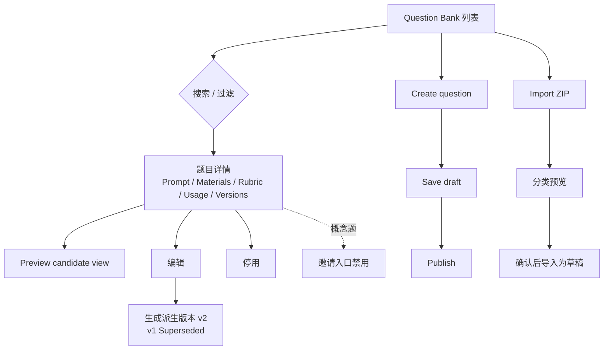

# W01 User Journey：题库与题目版本

| 项 | 内容 |
|---|---|
| 模块 | W01 |
| 版本 / 日期 | v1.0 / 2026-10-16（草稿，待评审） |
| 同目录文档 | [产品文档](PRD.md) · [输入输出闭环](Loop_IO.md) · [User Cases](User_Cases.md) |
| 来源 | [PRD v1.4 §4](../../../../hireos-written/docs/Assessment_Written_Test_PRD_v1.4.md)、[Brief v1.1 §5.2、P01、P02](../../../../hireos-written/docs/Assessment_Written_Test_Prototype_Design_Brief_v1.1.md) |

## 角色与权限（公共）

| 角色 | 登录后的主要目的 | 核心操作 | 默认限制 |
|---|---|---|---|
| HR / Recruiter | 为岗位准备、邀请、跟踪测评，发布结果 | 建项目和计划、发邀请、处理收件、发布结果 | 不替代 HM 的专业评分判断；不能绕过 Release 白名单 |
| Hiring Manager / Reviewer | 设计评分标准、评分复核、给反馈 | 编辑题目和 Rubric、评分、覆盖、确认结果 | 覆盖必须写理由；不能自动拒绝候选人 |
| Operations | 处理收件、身份、交付异常 | 确认 / 拒绝邮件匹配、隔离文件、重试交付 | 不改评分 |
| Admin | 管理连接、模型配置、完整授权 workspace | 配置平台连接与模型策略 | 模型配置不改岗位标准或人工结论 |
| Candidate | 用自己的邮箱验证并作答 | 接受 / 拒绝、上传、提交、查看结果 | 只能看本人任务和已发布结果；无员工菜单 |

> 原型 Settings 的「Startup Team Access」写明任何在职员工都能执行全部雇主端动作，没有审批队列；PRD 有多种审批任务。两者以哪个为准尚未决定，相关步骤在各模块「待确认」中标出。

# 旅程

**主角色**：Hiring Manager / Reviewer（设计题目）、HR / Recruiter（查找和复用题目）
**登录目的**：找到适合某岗位、某能力的题目，或者把新题目整理成可复用、带版本的题库条目。
**入口**：左侧导航 Question Bank

## 输入

| 类型 | 内容 |
|---|---|
| 前置数据 | S_bank_fin；S_question_published_v1；S_zip_fin_pack |
| 用户数据 | 搜索词、岗位 / 能力过滤；新题目字段；合成 ZIP |
| 外部依赖 | 文件扫描（ZIP 导入）；Core Job / FileVersion |

## 流程

## 步骤

| # | 用户意图与操作 | 系统反馈 | 用户需要判断 |
|---|---|---|---|
| 1 | 打开 Question Bank | 列表显示编号、标题、岗位标签、能力、方式、难度、版本、状态；说明「发布题目不等于发送」 | 题库里有没有可用的题 |
| 2 | 按岗位 Finance、能力 Analysis 过滤 | 只列出匹配题目；没有结果时显示空状态 | 是否需要新建 |
| 3 | 打开 FIN-001 | 右侧 / 详情显示五个 tab | — |
| 4 | 看 Rubric tab | criterion、满分、能力分配；内部答案标 Reviewer only | 评分标准是否适合本岗位 |
| 5 | 看 Usage tab | 用到该题的 Case、看过该版本的候选人、岗位映射；无外部记录显示 Unknown | 候选人是否已经见过这道题 |
| 6 | 点 Preview candidate view | 只显示题目、可见材料、交付清单 | 候选人能否看懂要求 |
| 7 | 编辑已发布的题目并发布 | 生成 v2；v1 标 Superseded 保留；提示已发邀请仍用 v1 | 是否需要让已有计划切换到 v2 |
| 8 | Create question，填写后 Save draft | 草稿；不能被计划选用 | — |
| 9 | Publish | 状态变为 Published，留发布历史 | — |
| 10 | Import ZIP | 预览分出题目、材料、内部答案、旧候选人提交 | 内部答案和旧提交是否被正确识别 |
| 11 | 确认不会外发后导入 | 题目进入草稿；材料登记为公共文件 | — |
| 12 | 打开概念题 FIN-009 | 提示「Draft the assessment before inviting candidates」，邀请入口禁用并说明原因 | 需要先完善题目 |
| 13 | 停用一道题 | 新计划不能再选；已发送的不受影响 | — |

## 可见 / 不可见

| 对象 | 员工可见 | 候选人可见 |
|---|---|---|
| Prompt、候选人可见材料、交付清单 | ✅ | ✅（接受邀请后） |
| Rubric、anchors、能力分配 | ✅ | ❌ |
| 内部答案、AI 指令、内部 notes | ✅（Reviewer only） | ❌ |
| 旧候选人提交（ZIP 中） | ✅（历史参考） | ❌ |

## 异常与恢复

| 情况 | 系统表现 | 恢复 |
|---|---|---|
| 保存时 500 或断网 | 不显示 Saved，输入保留 | 重试 |
| 编号重复 / 标题为空 | 字段报错，不入库 | 修改后保存 |
| 主观题缺 criterion / anchors 时发布 | 阻止发布并指出缺失项 | 补齐 Rubric |
| ZIP 损坏 / 含宏 | 显示原因，不导入；宏不执行 | 重新打包上传 |
| 两人同时编辑 | 冲突提示，不静默覆盖 | 刷新后合并 |

## 输出与交接

- 持久化：Question / QuestionVersion（draft / published / deprecated）、RoleMapping、ScoringProfile、材料 FileVersion 引用、发布历史。
- 交接 → W02（在 Builder 中组卷 / AI 补全）、W04（把精确版本加入候选人计划）。

**禁止副作用**：发布即发送给候选人；编辑覆盖已发布版本；候选人视图包含内部答案；导入时把旧候选人提交当作材料外发。

**成功标准**：题目可跨岗位、跨能力复用；每个已发送内容都能追溯到精确版本；候选人永远看不到内部字段。

**测试映射**：PRD 验收组 A；Brief P01、P02。

**待确认**：题目发布是否需要他人复核；QuestionVersion 表的建模（PRD 待确认 1、2）。
