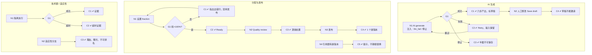

# W02 输入输出闭环：组卷 Builder 与 AI 出题

| 项 | 内容 |
|---|---|
| 模块 | W02 |
| 版本 / 日期 | v1.0 / 2026-10-16（草稿，待评审） |
| 同目录文档 | [产品文档](PRD.md) · [User Journey](User_Journey.md) · [User Cases](User_Cases.md) |
| 格式说明 | 见 [Written Test README](../README.md#闭环文档格式) |

## 1. 结构化规格

```yaml
flow_id: W02a              # AI 生成草稿
actor: hm_daniel
seed: S_bank_fin
entry: W02a.N1
max_loop: 3
external: [llm]

nodes:
  - {id: W02a.N1, type: action, do: "打开 Builder，输入目标 G，点击 AI generate", inject: [llm_fail, stop_generation]}
  - {id: W02a.G1, type: decision, on: "AI 调用结果"}
  - {id: W02a.C1, type: check, expect: {ui: "依次产出要求→能力→所需证据→Blueprint→题目→Rubric；结果标为草稿", record: "AI run ref 含模型、prompt、策略版本"}}
  - {id: W02a.C2, type: check, expect: {ui: "显示失败原因和 Retry；已有输入保留；可手工编辑", db: "无新版本"}}
  - {id: W02a.C3, type: check, expect: {ui: "停止后半截内容不可保存为可发布内容"}}
  - {id: W02a.N2, type: action, do: "人工修改生成内容，Save draft"}
  - {id: W02a.C4, type: check, expect: {db: "草稿保存；题库中发布版本不变", api: "草稿不能进入邀请"}}
  - {id: W02a.T1, type: terminal, state: assessment.draft}
  - {id: W02a.T2, type: terminal, state: no_change}

edges:
  - [W02a.N1, W02a.G1]
  - [W02a.G1, W02a.C1, {when: "成功"}]
  - [W02a.G1, W02a.C2, {when: "llm_fail"}]
  - [W02a.G1, W02a.C3, {when: "stop_generation"}]
  - [W02a.C2, W02a.N1, {when: "Retry（max_loop 内）"}]
  - [W02a.C1, W02a.N2]
  - [W02a.N2, W02a.C4]
  - [W02a.C4, W02a.T1]
  - [W02a.C3, W02a.T2]
---
flow_id: W02b              # 能力分配、质量审阅、发布
actor: hm_daniel
seed: S_question_published_v1
entry: W02b.N1
max_loop: 3
external: [llm]

nodes:
  - {id: W02b.N1, type: action, do: "在 Competency allocation 按测试数据 A 设置 criterion fraction"}
  - {id: W02b.G1, type: decision, on: "每个 criterion 分配和是否 = 100%"}
  - {id: W02b.C1, type: check, expect: {ui: "指出出错的具体行；Save & publish 禁用", api: "直接调用发布返回 4xx"}}
  - {id: W02b.C2, type: check, expect: {ui: "显示 Fractions sum to 100%. Ready to publish."}}
  - {id: W02b.N2, type: action, do: "运行 Quality review，对每个问题选择接受或忽略并说明"}
  - {id: W02b.C3, type: check, expect: {ui: "逐条列出问题类型、位置、建议、处置", db: "处置人和时间入库"}}
  - {id: W02b.N3, type: action, do: "打开发布预览，点击 Save & publish new version", inject: [double_click]}
  - {id: W02b.C4, type: check, expect: {ui: "预览含题包、交付清单、权重、可见材料、未处置问题", db: "生成 1 个新版本；示例总分算法保持 70"}}
  - {id: W02b.N4, type: action, do: "题库中引用题有新版本时打开 Builder"}
  - {id: W02b.C5, type: check, expect: {ui: "提示 A newer version is available；未选择前仍引用旧版本"}}
  - {id: W02b.T1, type: terminal, state: assessment.published}
  - {id: W02b.T2, type: terminal, state: no_change}

edges:
  - [W02b.N1, W02b.G1]
  - [W02b.G1, W02b.C1, {when: "A 属于 alloc_invalid_*"}]
  - [W02b.G1, W02b.C2, {when: "A = alloc_valid"}]
  - [W02b.C1, W02b.N1, {when: "修正"}]
  - [W02b.C2, W02b.N2]
  - [W02b.N2, W02b.C3]
  - [W02b.C3, W02b.N3]
  - [W02b.N3, W02b.C4]
  - [W02b.C4, W02b.T1]
  - [W02b.N4, W02b.C5]
  - [W02b.C5, W02b.T2]
---
flow_id: W02c              # 技术题与适应性测评
actor: hm_daniel
seed: S_bank_fin
entry: W02c.N1
max_loop: 2
external: [sandbox_executor]

nodes:
  - {id: W02c.N1, type: action, do: "上传测试数据 T（代码 / SQL），在隔离执行适配器中运行"}
  - {id: W02c.G1, type: decision, on: "执行结果"}
  - {id: W02c.C1, type: check, expect: {db: "保存执行结果和版本化测试证据", record: "执行发生在隔离环境，不在雇主设备或收件服务"}}
  - {id: W02c.C2, type: check, expect: {ui: "显示超时，证据中记录超时", db: "无分数被写入"}}
  - {id: W02c.N2, type: action, do: "配置适应性测评固定分支策略并预览路径"}
  - {id: W02c.C3, type: check, expect: {ui: "每次选题显示理由和曝光；未校准路径标为不可排名"}}
  - {id: W02c.T1, type: terminal, state: execution_profile.saved}

edges:
  - [W02c.N1, W02c.G1]
  - [W02c.G1, W02c.C1, {when: "T = tech_ok"}]
  - [W02c.G1, W02c.C2, {when: "T = tech_timeout"}]
  - [W02c.C1, W02c.N2]
  - [W02c.C2, W02c.N2]
  - [W02c.N2, W02c.C3]
  - [W02c.C3, W02c.T1]
```

## 2. 测试数据

| 名称 | 内容 |
|---|---|
| goal_fin | 目标「验证候选人月末结账、差异分析和书面沟通能力」，岗位 Finance Operations Analyst |
| goal_bias | 目标中包含「适合 25–30 岁」等受保护属性表述 |
| alloc_valid | 3 个 criterion：Accounting 40 分（100% Accounting）、Analysis 40 分（70% Analysis + 30% Accounting）、Communication 20 分（100% Communication） |
| alloc_invalid_sum90 | Analysis criterion 分配 60% + 30% = 90% |
| alloc_invalid_sum110 | 某 criterion 分配和 110% |
| tech_ok | 合成 SQL 题答案，测试全部通过 |
| tech_timeout | 合成代码含死循环 |

## 3. 路径清单

| 路径 | 节点序列 | 数据 / 注入 | 终态 |
|---|---|---|---|
| P1 AI 生成并保存草稿 | W02a N1 → G1 → C1 → N2 → C4 | goal_fin | assessment.draft |
| P2 AI 失败后重试 | W02a N1 → G1 → C2 → N1 → C1 | goal_fin；llm_fail | assessment.draft |
| P3 停止生成 | W02a N1 → G1 → C3 | goal_fin；stop_generation | no_change |
| P4 受保护属性目标 | W02a N1 → C1，质量审阅标出偏差 | goal_bias | 不可发布 |
| P5 分配正确并发布 | W02b N1 → G1 → C2 → N2 → C3 → N3 → C4 | alloc_valid | assessment.published |
| P6–P7 分配错误被阻止 | W02b N1 → G1 → C1 | alloc_invalid_*（2 条） | no_change |
| P8 双击发布 | P5，在 N3 注入 double_click | alloc_valid | 只有 1 个新版本 |
| P9 新版本提示 | W02b N4 → C5 | FIN-001 v2 已发布 | no_change |
| P10 技术题执行成功 | W02c N1 → G1 → C1 | tech_ok | execution_profile.saved |
| P11 技术题超时 | W02c N1 → G1 → C2 | tech_timeout | execution_profile.saved |
| P12 适应性路径 | W02c N2 → C3 | — | execution_profile.saved |

## 4. 流程图（由规格生成）



## 5. 待确认

- Builder 编辑单位（单题 vs 整份测评，PRD 待确认 1）会改变 W02b 的入口。
- 技术题执行器、适应性测评未实现，W02c 全部路径为 known gap。
- AI 生成实际接口：`POST /ai/generate-question`；能力提取：`POST /ai/extract-competencies`。
