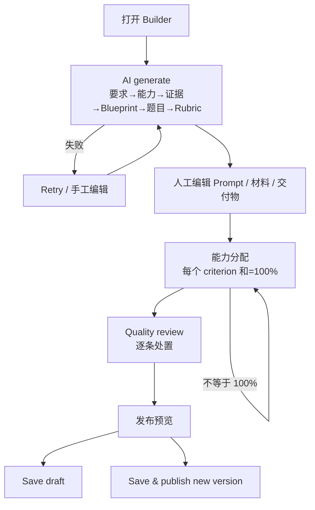

# W02 User Journey：组卷 Builder 与 AI 出题

| 项 | 内容 |
|---|---|
| 模块 | W02 |
| 版本 / 日期 | v1.0 / 2026-10-16（草稿，待评审） |
| 同目录文档 | [产品文档](PRD.md) · [输入输出闭环](Loop_IO.md) · [User Cases](User_Cases.md) |
| 来源 | [PRD v1.4 §4](../../../../hireos-written/docs/Assessment_Written_Test_PRD_v1.4.md)、[Brief v1.1 §5.2、P01、P22](../../../../hireos-written/docs/Assessment_Written_Test_Prototype_Design_Brief_v1.1.md) |

角色与权限见 [W01 User Journey](../W01_Question_Bank/User_Journey.md#角色与权限公共)。

# 旅程

**主角色**：Hiring Manager / Reviewer
**登录目的**：根据岗位要求快速得到一份评分标准清晰、能力分配正确的题目，再人工把关后发布。
**入口**：题目详情 **Edit / Builder**；项目详情的组卷入口

## 输入

| 类型 | 内容 |
|---|---|
| 前置数据 | S_bank_fin；S_question_published_v1 |
| 用户数据 | 测评目标、岗位要求；criterion fraction；技术题答案文件 |
| 外部依赖 | 公共 AI Service（question_generate、blueprint_generate、quality_review）；隔离执行适配器 |

## 流程

## 步骤

| # | 用户意图与操作 | 系统反馈 | 用户需要判断 |
|---|---|---|---|
| 1 | 打开 Builder | 左侧 Sections / Questions，主区编辑，右侧 Coverage / Difficulty / Estimated effort；说明编辑会生成派生版本 | — |
| 2 | 输入目标，点 AI generate | 显示生成中；逐步给出能力、证据、Blueprint、题目和 Rubric，结果标草稿 | AI 理解的能力是否正确 |
| 3 | AI 超时 | 显示失败和 Retry，已填目标保留 | 重试还是手工写 |
| 4 | 修改 Prompt、材料、交付清单 | 保存为草稿 | 候选人能否看懂 |
| 5 | 设置能力分配 | 每个 criterion 显示能力 chips 和百分比 | 一题多能力是否合理 |
| 6 | 某 criterion 和为 90% | 指出该行；发布按钮禁用 | 哪里少分配了 |
| 7 | 修正为 100% | 显示「Fractions sum to 100%. Ready to publish.」 | — |
| 8 | 运行 Quality review | 逐条列出覆盖率、难度、时间、歧义、重复、评分合理性、偏差问题 | 每条接受还是忽略（需说明） |
| 9 | 打开发布预览 | 题包、交付清单、权重、可见材料、未处置问题 | 是否可以发布 |
| 10 | Save draft | 草稿；题库发布版本不变 | — |
| 11 | Save & publish new version | 新版本发布；已发邀请仍用旧版本 | — |
| 12 | 引用的题库题有新版本 | 提示「A newer version is available」 | 是否切换到新版本 |
| 13 | （技术题）上传参考答案运行 | 在隔离环境执行，显示通过 / 超时及证据 | 测试用例是否充分 |
| 14 | （适应性）配置分支 | 显示每条路径的选题理由和曝光；未校准路径标为不可排名 | — |

## 可见 / 不可见

- AI 生成的内部答案、AI 指令只对员工可见。
- 质量问题和处置记录只对员工可见。
- 候选人只看到发布版本中的候选人可见字段。

## 异常与恢复

| 情况 | 系统表现 | 恢复 |
|---|---|---|
| AI 失败 / 超时 | 显示原因和 Retry；无可用模型时显示 No eligible model | 重试或手工编辑 |
| 停止生成 | 半截内容不能保存为可发布 | 重新生成 |
| 目标含受保护属性 | 质量审阅标出偏差，阻止发布 | 改写目标 |
| 离开未保存的 Builder | 提示未保存 | 保存或放弃 |
| 技术题执行超时 | 记录超时证据，不写分 | 调整测试 |

## 输出与交接

- 持久化：Assessment / Blueprint / Section、QualityReview、ExecutionProfile / AdaptivePolicy、新 QuestionVersion；AI run ref 存于公共 AI Service。
- 交接 → W04（计划中选用发布版本）、W08（评分使用 ScoringProfile）。

**禁止副作用**：AI 草稿直接进入邀请；能力分配不等于 100% 仍可发布；静默替换引用版本；在雇主设备或收件服务上运行候选人代码。

**成功标准**：发布的每道题都有完整 Rubric 和正确的能力分配；AI 失败时人工路径始终可用。

**测试映射**：PRD 验收组 A；Brief P01、P02、P22。

**待确认**：Builder 的编辑单位（单题 / 整份测评）；技术题执行器是否本期真实实现。
