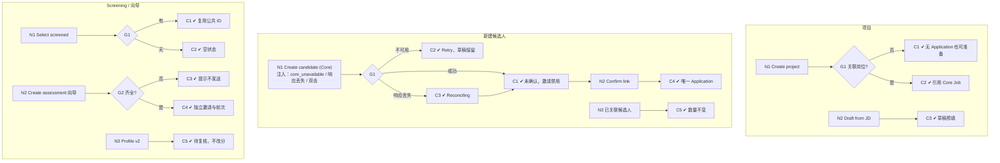

# W03 输入输出闭环：测评项目与候选人关联

| 项 | 内容 |
|---|---|
| 模块 | W03 |
| 版本 / 日期 | v1.0 / 2026-10-16（草稿，待评审） |
| 同目录文档 | [产品文档](PRD.md) · [User Journey](User_Journey.md) · [User Cases](User_Cases.md) |
| 格式说明 | 见 [Written Test README](../README.md#闭环文档格式) |

## 1. 结构化规格

```yaml
flow_id: W03a              # 项目创建
actor: hr_emma
seed: S0_employer
entry: W03a.N1
max_loop: 2
external: [core]

nodes:
  - {id: W03a.N1, type: action, do: "Assessments → Create project，按测试数据 J 填写", inject: [double_click]}
  - {id: W03a.G1, type: decision, on: "是否关联岗位"}
  - {id: W03a.C1, type: check, expect: {db: "AssessmentProject status=active，job_ref=null；无 Application", ui: "可继续进入题库和 Builder"}}
  - {id: W03a.C2, type: check, expect: {db: "AssessmentProject job_ref 指向 Core Job；不复制 JD 为可写主档"}}
  - {id: W03a.N2, type: action, do: "在 Other open roles 中点击 Draft a project from this JD"}
  - {id: W03a.C3, type: check, expect: {ui: "草稿项目预填岗位目标", db: "项目草稿引用 Core Job"}}
  - {id: W03a.T1, type: terminal, state: project.active}

edges:
  - [W03a.N1, W03a.G1]
  - [W03a.G1, W03a.C1, {when: "J = project_goal_only"}]
  - [W03a.G1, W03a.C2, {when: "J = project_with_job"}]
  - [W03a.C1, W03a.T1]
  - [W03a.C2, W03a.T1]
  - [W03a.N2, W03a.C3]
  - [W03a.C3, W03a.T1]
---
flow_id: W03b              # 新建候选人并确认关系
actor: hr_emma
seed: S0_employer
entry: W03b.N1
max_loop: 3
external: [core]

nodes:
  - {id: W03b.N1, type: action, do: "项目详情 → Add candidate，填写测试数据 C，点击 Create candidate (Core)", inject: [core_unavailable, core_response_lost, double_click]}
  - {id: W03b.G1, type: decision, on: "Core 创建结果"}
  - {id: W03b.C1, type: check, expect: {ui: "提示已在 Core 但无确认关系；邀请按钮禁用并显示 Confirm the candidate's role link first", api: "Core Candidate 1 个；Application 0 个"}}
  - {id: W03b.C2, type: check, expect: {ui: "显示 Shared records are temporarily unavailable 和 Retry；表单保留", api: "Core 无新 Candidate"}}
  - {id: W03b.C3, type: check, expect: {ui: "显示 Confirming the saved record；无「再创建一个」默认动作", record: "同 request_id 查询恢复"}}
  - {id: W03b.N2, type: action, do: "点击 Confirm link → create Application", inject: [double_click]}
  - {id: W03b.C4, type: check, expect: {api: "Core Application 唯一；Case.application_ref 已填", ui: "显示 Open plan"}}
  - {id: W03b.N3, type: action, do: "对已关联候选人再次 Add candidate（同邮箱）"}
  - {id: W03b.C5, type: check, expect: {ui: "显示已关联，直接 Open plan", api: "Candidate、Application 数量不变"}}
  - {id: W03b.T1, type: terminal, state: case.linked}
  - {id: W03b.T2, type: terminal, state: no_change}

edges:
  - [W03b.N1, W03b.G1]
  - [W03b.G1, W03b.C1, {when: "成功"}]
  - [W03b.G1, W03b.C2, {when: "core_unavailable"}]
  - [W03b.G1, W03b.C3, {when: "core_response_lost"}]
  - [W03b.C3, W03b.C1, {when: "恢复成功"}]
  - [W03b.C2, W03b.T2]
  - [W03b.C1, W03b.N2]
  - [W03b.N2, W03b.C4]
  - [W03b.C4, W03b.T1]
  - [W03b.N3, W03b.C5]
  - [W03b.C5, W03b.T1]
---
flow_id: W03c              # 从 Screening 选择 / 快速创建
actor: hr_emma
seed: S_screened_candidates
entry: W03c.N1
max_loop: 2
external: [core, bus]

nodes:
  - {id: W03c.N1, type: action, do: "Select from screened candidates，选择 2 人，Create assessment plan"}
  - {id: W03c.G1, type: decision, on: "是否有可选候选人"}
  - {id: W03c.C1, type: check, expect: {db: "每人一个 Case，引用相同 candidate_id / application_id / file_version_id", api: "不重新上传简历、不重复确认岗位"}}
  - {id: W03c.C2, type: check, expect: {ui: "显示 No unassigned screened candidates for this role right now."}}
  - {id: W03c.N2, type: action, do: "Create assessment 向导：选候选人 → 选题包 → Timed/Deadline → Send invitations"}
  - {id: W03c.G2, type: decision, on: "必选项是否齐全"}
  - {id: W03c.C3, type: check, expect: {ui: "提示 Select at least one candidate first / Select a test first，不发送"}}
  - {id: W03c.C4, type: check, expect: {db: "每个候选人一个独立 Invitation 和首轮", ui: "Invitations sent and assessment rounds created."}}
  - {id: W03c.N3, type: action, do: "Core Profile 更新到 v2 后打开已评分 Case"}
  - {id: W03c.C5, type: check, expect: {ui: "显示 Assessed using profile v1 并提示待复核", db: "旧分不变"}}
  - {id: W03c.T1, type: terminal, state: case.linked}
  - {id: W03c.T2, type: terminal, state: no_change}

edges:
  - [W03c.N1, W03c.G1]
  - [W03c.G1, W03c.C1, {when: "有"}]
  - [W03c.G1, W03c.C2, {when: "无"}]
  - [W03c.C1, W03c.T1]
  - [W03c.C2, W03c.T2]
  - [W03c.N2, W03c.G2]
  - [W03c.G2, W03c.C3, {when: "缺候选人或题包"}]
  - [W03c.G2, W03c.C4, {when: "齐全"}]
  - [W03c.C3, W03c.T2]
  - [W03c.C4, W03c.T1]
  - [W03c.N3, W03c.C5]
  - [W03c.C5, W03c.T2]
```

## 2. 测试数据

| 名称 | 内容 |
|---|---|
| project_goal_only | 名称 `[UJ-TEST] General analytical skills`，只有目标，无岗位 |
| project_with_job | 名称 `[UJ-TEST] Finance Ops batch 2`，岗位 Finance Operations Analyst |
| cand_new | 姓名 `[UJ-TEST] Riley Stone`，邮箱 `riley.stone@example.com` |
| cand_existing_linked | Alex Morgan 的邮箱 |
| wizard_missing_candidate / wizard_missing_test | 向导中不选候选人 / 不选题包 |

## 3. 路径清单

| 路径 | 节点序列 | 数据 / 注入 | 终态 |
|---|---|---|---|
| P1 只有目标的项目 | W03a N1 → G1 → C1 | project_goal_only | project.active |
| P2 关联岗位的项目 | W03a N1 → G1 → C2 | project_with_job | project.active |
| P3 从 JD 起草项目 | W03a N2 → C3 | 未接入测评的岗位 | project.active |
| P4 新建候选人并确认关系 | W03b N1 → G1 → C1 → N2 → C4 | cand_new | case.linked |
| P5 Core 不可用 | W03b N1 → G1 → C2 | cand_new；core_unavailable | no_change |
| P6 Core 响应丢失 | W03b N1 → G1 → C3 → C1 → N2 → C4 | cand_new；core_response_lost | case.linked；数量不增加 |
| P7 双击 Confirm link | P4，在 N2 注入 double_click | cand_new | Application 唯一 |
| P8 已关联候选人 | W03b N3 → C5 | cand_existing_linked | case.linked |
| P9 从 Screening 选择 | W03c N1 → G1 → C1 | S_screened_candidates | case.linked |
| P10 无可选候选人 | W03c N1 → G1 → C2 | 全部已进入测评 | no_change |
| P11–P12 向导缺项 | W03c N2 → G2 → C3 | wizard_missing_*（2 条） | no_change |
| P13 向导发送 | W03c N2 → G2 → C4 | 2 名已关联候选人 + FIN-001 | case.linked |
| P14 Profile 更新待复核 | W03c N3 → C5 | case_a，Profile v2 | no_change |

## 4. 流程图（由规格生成）



## 5. 待确认

- 后端无 AssessmentProject 实体，W03a 全部为 known gap；现有 Case 由 `POST /intake/screening-handoff` 创建。
- 后端本地 Candidate / Job 表与「Core 唯一写入方」冲突，W03b 的 `api` 断言目前只能检查本地表。
- 向导与 W05 Composer 是否都保留（PRD 待确认 3）。
