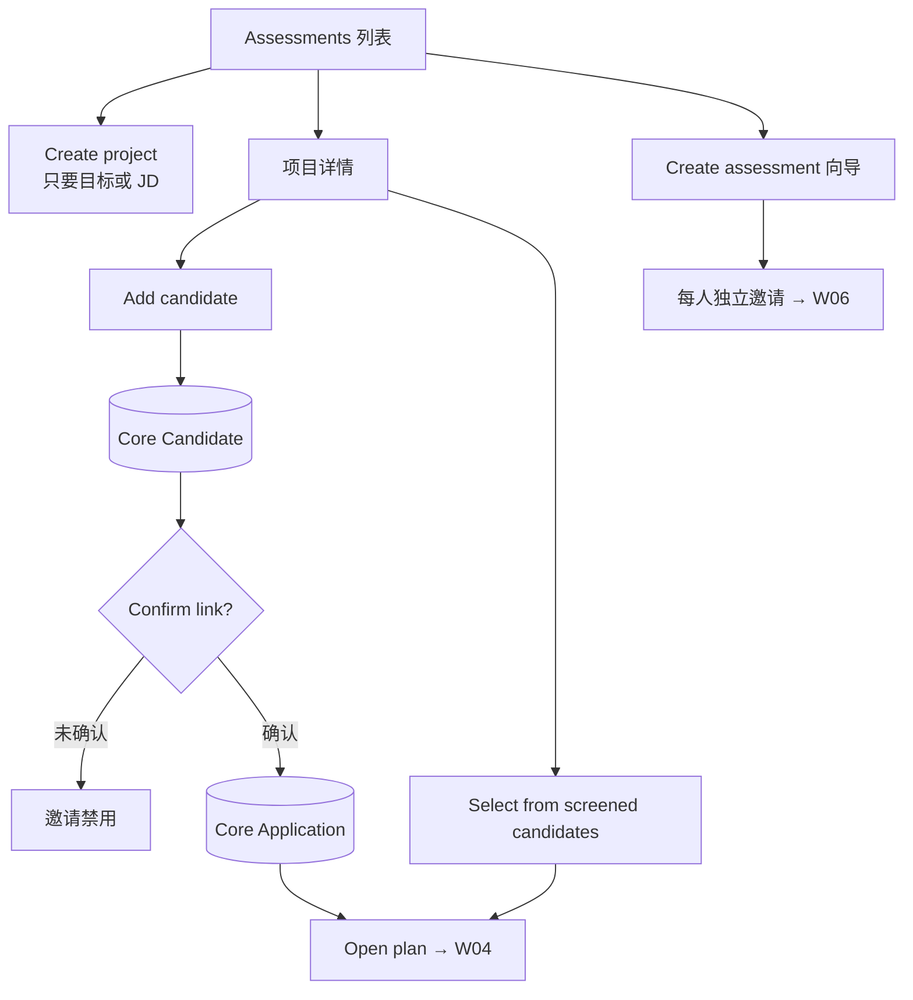

# W03 User Journey：测评项目与候选人关联

| 项 | 内容 |
|---|---|
| 模块 | W03 |
| 版本 / 日期 | v1.0 / 2026-10-16（草稿，待评审） |
| 同目录文档 | [产品文档](PRD.md) · [输入输出闭环](Loop_IO.md) · [User Cases](User_Cases.md) |
| 来源 | [PRD v1.4 §3、§5、§18](../../../../hireos-written/docs/Assessment_Written_Test_PRD_v1.4.md)、[Brief v1.1 §14.1、P03、F02–F04、F10](../../../../hireos-written/docs/Assessment_Written_Test_Prototype_Design_Brief_v1.1.md) |

角色与权限见 [W01 User Journey](../W01_Question_Bank/User_Journey.md#角色与权限公共)。

# 旅程

**主角色**：HR / Recruiter
**登录目的**：为一个岗位或一个能力目标准备测评，并把要测的候选人以正确的招聘关系挂进来。
**入口**：左侧导航 Assessments

## 输入

| 类型 | 内容 |
|---|---|
| 前置数据 | S0_employer；S_screened_candidates |
| 用户数据 | 项目名称和目标；新候选人姓名和邮箱；向导中的候选人、题包、时间设置 |
| 外部依赖 | Core Record（Candidate / Job / Application / File）；Screening 交接（总线） |

## 流程

## 步骤

| # | 用户意图与操作 | 系统反馈 | 用户需要判断 |
|---|---|---|---|
| 1 | 打开 Assessments | 每个项目显示岗位、必评 / 选评题、候选人数、Awaiting submission、Issues open、Results to release | 哪个项目需要处理 |
| 2 | Create project，只填目标 | 项目创建；可直接进入题库 / Builder，不需要候选人 | — |
| 3 | 在 Other open roles 点 Draft a project from this JD | 生成预填岗位目标的项目草稿 | 目标是否准确 |
| 4 | 打开项目详情 | 候选人表显示 Application、Plan、Status、Score、Confirmed link | — |
| 5 | Add candidate，填姓名和邮箱 | 在 Core 创建候选人；提示还没有确认的招聘关系 | 这个人是否真的应聘这个岗位 |
| 6 | Confirm link → create Application | 生成唯一的 Application；显示 Open plan | — |
| 7 | 对已关联的人再次添加 | 提示已关联，直接 Open plan | — |
| 8 | Select from screened candidates | 列出已筛选、未进入测评的候选人；选中后建计划，不重新上传简历 | 选哪些人 |
| 9 | Create assessment 向导 | 选候选人 → 选题包 → Timed / Deadline → Review & send；每人一封独立邀请 | 时间设置是否合理 |
| 10 | Core 不可用时新建候选人 | 「Shared records are temporarily unavailable」+ Retry；已填内容保留 | 稍后重试 |
| 11 | Core 响应丢失 | 「Confirming the saved record」，恢复后显示同一个候选人 | 不要重复创建 |
| 12 | 公共 Profile 更新后看已评分候选人 | 「Assessed using profile v1」+ 待复核提示 | 是否需要重新评估 |

## 可见 / 不可见

- 普通 HR 看到的是同一个人、同一个岗位、同一份材料；技术 ID 只在 Details / Demo inspector 中。
- 候选人看不到项目和其他候选人。

## 异常与恢复

| 情况 | 系统表现 | 恢复 |
|---|---|---|
| Core 不可用 | 如实阻塞，不显示已创建 | Retry |
| Core 响应丢失 | Reconciling，同 request_id 恢复 | 等待确认，不新建 |
| 双击 Confirm link | 只生成一个 Application | — |
| 收到候选人邮件 | 不自动建招聘关系 | 人工 Confirm link |
| 无可选的已筛选候选人 | 空状态说明 | 改用 Add candidate |

## 输出与交接

- 持久化：AssessmentProject、Case（引用 Core candidate / job / application）、Core 命令记录（request_id）。
- 交接 → W04（Open plan）；向导路径直接 → W05 / W06。

**禁止副作用**：本模块写可写的候选人 / 岗位主档；未确认关系就能发正式邀请；收到邮件自动建关系；恢复时重复创建候选人或 Application。

**成功标准**：只有目标也能准备；正式岗位邀请前都有唯一、经人确认的 Application；公共主档故障时不伪造成功。

**测试映射**：PRD 验收组 A；Brief P03、F02、F03、F04、F10。

**待确认**：本地 Candidate / Job 表的去留；AssessmentProject 是否必需；向导与 Composer 是否都保留（PRD 待确认 1–3）。
