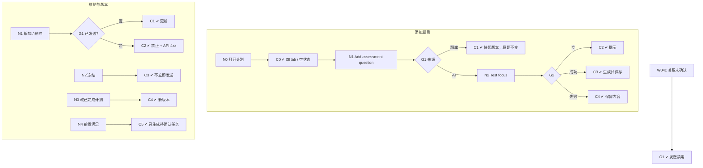

# W04 输入输出闭环：候选人测评计划

| 项 | 内容 |
|---|---|
| 模块 | W04 |
| 版本 / 日期 | v1.0 / 2026-10-16（草稿，待评审） |
| 同目录文档 | [产品文档](PRD.md) · [User Journey](User_Journey.md) · [User Cases](User_Cases.md) |
| 格式说明 | 见 [Written Test README](../README.md#闭环文档格式) |

## 1. 结构化规格

```yaml
flow_id: W04a              # 添加题目
actor: hr_emma
seed: S_case_plan_empty
entry: W04a.N0
max_loop: 3
external: [llm]

nodes:
  - {id: W04a.N0, type: action, do: "从 My Tasks 打开候选人计划"}
  - {id: W04a.C0, type: check, expect: {ui: "四个 tab；验证目标、Owner（未设置时为发起人）、截止时间；空状态提示 Add assessment question"}}
  - {id: W04a.N1, type: action, do: "Add assessment question，选择来源 S", inject: [llm_fail, double_click]}
  - {id: W04a.G1, type: decision, on: "来源"}
  - {id: W04a.C1, type: check, expect: {ui: "显示 Approved v1；说明修改只作用于该候选人草稿", db: "PlanItem 快照 question_version；题库原题不变"}}
  - {id: W04a.N2, type: action, do: "填写 Test focus，Confirm generate"}
  - {id: W04a.G2, type: decision, on: "Test focus 与 AI 结果"}
  - {id: W04a.C2, type: check, expect: {ui: "提示 Enter a test focus first.", db: "无新 PlanItem"}}
  - {id: W04a.C3, type: check, expect: {ui: "生成题目与 Rubric，标为 AI 生成", db: "PlanItem 保存内容快照"}}
  - {id: W04a.C4, type: check, expect: {ui: "显示失败与重试，抽屉内容保留", db: "无新 PlanItem"}}
  - {id: W04a.T1, type: terminal, state: plan.item_added}
  - {id: W04a.T2, type: terminal, state: no_change}

edges:
  - [W04a.N0, W04a.C0]
  - [W04a.C0, W04a.N1]
  - [W04a.N1, W04a.G1]
  - [W04a.G1, W04a.C1, {when: "S = from_bank"}]
  - [W04a.G1, W04a.N2, {when: "S = ai_generated"}]
  - [W04a.C1, W04a.T1]
  - [W04a.N2, W04a.G2]
  - [W04a.G2, W04a.C2, {when: "focus 为空"}]
  - [W04a.G2, W04a.C3, {when: "成功"}]
  - [W04a.G2, W04a.C4, {when: "llm_fail"}]
  - [W04a.C2, W04a.T2]
  - [W04a.C3, W04a.T1]
  - [W04a.C4, W04a.T2]
---
flow_id: W04b              # 编辑、删除、冻结、版本
actor: hr_emma
seed: S_case_plan_ready
entry: W04b.N1
max_loop: 3
external: []

nodes:
  - {id: W04b.N1, type: action, do: "对计划项执行操作 O"}
  - {id: W04b.G1, type: decision, on: "计划项是否已发送"}
  - {id: W04b.C1, type: check, expect: {ui: "编辑 / 删除成功提示 Question updated / Question deleted.", db: "PlanItem 更新或删除"}}
  - {id: W04b.C2, type: check, expect: {ui: "已发送项显示 Sent，编辑 / 删除不可用", api: "PATCH / DELETE 返回 4xx"}}
  - {id: W04b.N2, type: action, do: "确认计划（冻结为待发送版本）"}
  - {id: W04b.C3, type: check, expect: {ui: "说明冻结后不立即发送", db: "AssessmentPlan 新版本；未生成 Invitation"}}
  - {id: W04b.N3, type: action, do: "已完成一项后修改计划"}
  - {id: W04b.C4, type: check, expect: {db: "生成新计划版本；已完成 Attempt 仍挂在原版本", ui: "History 可查看两个版本"}}
  - {id: W04b.N4, type: action, do: "前置项完成，触发后续项"}
  - {id: W04b.C5, type: check, expect: {db: "生成待确认 Task", api: "没有自动创建 Invitation"}}
  - {id: W04b.T1, type: terminal, state: plan.updated}
  - {id: W04b.T2, type: terminal, state: no_change}

edges:
  - [W04b.N1, W04b.G1]
  - [W04b.G1, W04b.C1, {when: "未发送"}]
  - [W04b.G1, W04b.C2, {when: "已发送"}]
  - [W04b.C1, W04b.T1]
  - [W04b.C2, W04b.T2]
  - [W04b.N2, W04b.C3]
  - [W04b.C3, W04b.T1]
  - [W04b.N3, W04b.C4]
  - [W04b.C4, W04b.T1]
  - [W04b.N4, W04b.C5]
  - [W04b.C5, W04b.T1]
---
flow_id: W04c              # 关系未确认
actor: hr_emma
seed: S_core_candidate_unlinked
entry: W04c.N1
max_loop: 1
external: []

nodes:
  - {id: W04c.N1, type: action, do: "打开 Riley 的计划"}
  - {id: W04c.C1, type: check, expect: {ui: "提示 Confirm the candidate's role link first；Send to candidate 禁用"}}
  - {id: W04c.T1, type: terminal, state: no_change}

edges:
  - [W04c.N1, W04c.C1]
  - [W04c.C1, W04c.T1]
```

## 2. 测试数据

| 名称 | 内容 |
|---|---|
| from_bank | 从题库选择 FIN-001 v1 |
| from_bank_concept | 尝试选择概念题 FIN-009 |
| ai_generated | Test focus「variance analysis on month-end accruals」 |
| ai_empty_focus | Test focus 为空 |
| op_edit / op_delete | 编辑题目内容 / 删除计划项 |
| supplemental_fin002 | 以补证类型添加 FIN-002 |

## 3. 路径清单

| 路径 | 节点序列 | 数据 / 注入 | 终态 |
|---|---|---|---|
| P1 计划页与空状态 | W04a N0 → C0 | — | no_change |
| P2 从题库添加 | W04a N1 → G1 → C1 | from_bank | plan.item_added |
| P3 概念题不可添加 | W04a N1 → G1（概念题不在可选列表） | from_bank_concept | no_change |
| P4 AI 生成 | W04a N1 → G1 → N2 → G2 → C3 | ai_generated | plan.item_added |
| P5 Test focus 为空 | W04a N2 → G2 → C2 | ai_empty_focus | no_change |
| P6 AI 失败 | W04a N2 → G2 → C4 | ai_generated；llm_fail | no_change |
| P7 双击添加 | P2，在 N1 注入 double_click | from_bank | 只加 1 项 |
| P8–P9 编辑 / 删除未发送项 | W04b N1 → G1 → C1 | op_edit、op_delete | plan.updated |
| P10 已发送项不可改 | W04b N1 → G1 → C2 | op_edit（已发送） | no_change |
| P11 冻结待发送版本 | W04b N2 → C3 | — | plan.updated |
| P12 计划版本不覆盖已完成 Attempt | W04b N3 → C4 | supplemental_fin002 | plan.updated |
| P13 前置条件只生成待确认任务 | W04b N4 → C5 | — | plan.updated |
| P14 关系未确认 | W04c N1 → C1 | — | no_change |

## 4. 流程图（由规格生成）



## 5. 待确认

- 计划是否需要批准（PRD 待确认 1）；如需要，W04b.N2 后增加批准节点。
- 计划版本、前置条件、PlanItem 类型（补证 / 修订）后端未实现，P11–P13 为 known gap。
- 实际接口：`GET/POST /cases/:caseId/plan-items`、`PATCH/DELETE /cases/:caseId/plan-items/:id`。
