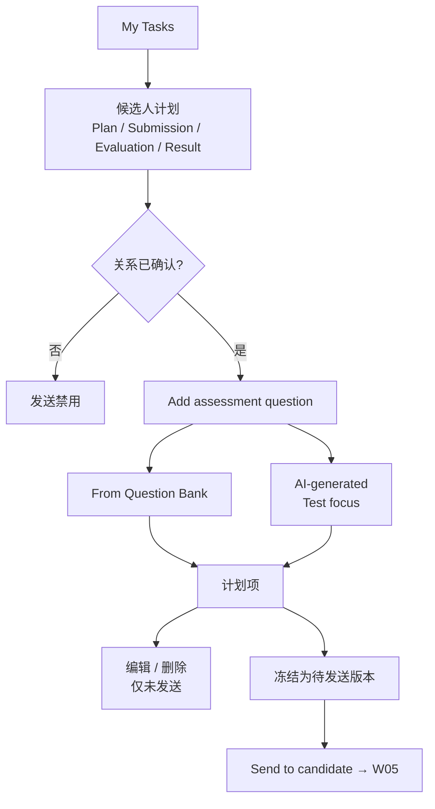

# W04 User Journey：候选人测评计划

| 项 | 内容 |
|---|---|
| 模块 | W04 |
| 版本 / 日期 | v1.0 / 2026-10-16（草稿，待评审） |
| 同目录文档 | [产品文档](PRD.md) · [输入输出闭环](Loop_IO.md) · [User Cases](User_Cases.md) |
| 来源 | [PRD v1.4 §5、§9](../../../../hireos-written/docs/Assessment_Written_Test_PRD_v1.4.md)、[Brief v1.1 §4、P12](../../../../hireos-written/docs/Assessment_Written_Test_Prototype_Design_Brief_v1.1.md) |

角色与权限见 [W01 User Journey](../W01_Question_Bank/User_Journey.md#角色与权限公共)。

# 旅程

**主角色**：HR / Recruiter（Hiring Manager 也可使用）
**登录目的**：为某个候选人确定这次要测哪些题、什么条件，准备好后再发送。
**入口**：My Tasks 任务行 → 候选人计划；项目详情 → Open plan

## 输入

| 类型 | 内容 |
|---|---|
| 前置数据 | S_case_plan_empty；S_case_plan_ready；S_core_candidate_unlinked |
| 用户数据 | 题库选择、AI Test focus、候选人级别的修改、截止时间、Owner |
| 外部依赖 | 公共 AI Service（AI 出题） |

## 流程

## 步骤

| # | 用户意图与操作 | 系统反馈 | 用户需要判断 |
|---|---|---|---|
| 1 | 从 My Tasks 打开候选人计划 | 四个 tab；顶部候选人、岗位、状态；面包屑返回 My Tasks | — |
| 2 | 看验证目标、Owner、截止时间 | Owner 未设置时默认发起人 | 目标是否表达清楚 |
| 3 | 计划为空 | 空状态和 Add assessment question | — |
| 4 | Add from Question Bank，选 FIN-001 | 显示 Approved v1；说明修改只作用于该候选人 | 题目是否适合这个人 |
| 5 | AI-generated，输入 Test focus | 给出基于岗位要求的建议；生成题目和 Rubric | 生成内容是否可用 |
| 6 | 编辑一个未发送的计划项 | 「Question updated.」 | — |
| 7 | 删除一个未发送的计划项 | 「Question deleted.」 | — |
| 8 | 尝试编辑已发送的项 | 显示 Sent，编辑 / 删除不可用 | — |
| 9 | 确认计划 | 冻结为待发送版本，说明不会立即发送 | 是否需要他人看一下 |
| 10 | 候选人已上传未提交 | 「Answers uploaded — awaiting candidate submission」 | 是否需要提醒候选人 |
| 11 | 已完成一项后加补测 FIN-002 | 新计划版本；新 PlanItem 类型为补证；旧 Attempt 不变 | — |
| 12 | 打开关系未确认的候选人 | 「Confirm the candidate's role link first」；发送禁用 | 先去确认关系 |

## 可见 / 不可见

- 计划页、内部 Rubric、AI 生成的答案只对员工可见。
- 候选人只在收到邀请后看到冻结版本中的候选人可见内容。

## 异常与恢复

| 情况 | 系统表现 | 恢复 |
|---|---|---|
| AI 生成失败 | 失败提示，抽屉内容保留 | 重试或改用题库 |
| Test focus 为空 | 「Enter a test focus first.」 | 填写 |
| 未选预设题 | 「Select a preset question first.」 | 选择 |
| 刷新页面 | 计划项仍在 | — |
| 双击添加 | 只加一项 | — |

## 输出与交接

- 持久化：AssessmentPlan（版本）、PlanItem（题目版本快照、类型、前置条件、状态）、PlanReview。
- 交接 → W05（Send to candidate / Composer）；W06–W09 的结果回显在计划页其他 tab。

**禁止副作用**：冻结即发送；修改计划改写已完成的作答；前置条件满足后自动发邀请；修改单个候选人的题目改动题库。

**成功标准**：每个候选人的测试内容、条件、版本清楚可追溯；已发送和已完成的内容不会被改。

**测试映射**：PRD 验收组 A；Brief P12、F03。

**待确认**：计划是否需要批准；候选人级别修改是否算新版本；补证 / 修订类型的建模（PRD 待确认 1–3）。
