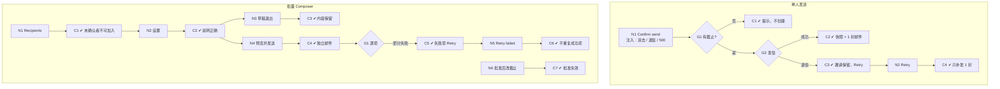

# W05 输入输出闭环：邀请与批量发送

| 项 | 内容 |
|---|---|
| 模块 | W05 |
| 版本 / 日期 | v1.0 / 2026-10-16（草稿，待评审） |
| 同目录文档 | [产品文档](PRD.md) · [User Journey](User_Journey.md) · [User Cases](User_Cases.md) |
| 格式说明 | 见 [Written Test README](../README.md#闭环文档格式) |

## 1. 结构化规格

```yaml
flow_id: W05a              # 单人发送（计划页抽屉）
actor: hr_emma
seed: S_case_plan_ready
entry: W05a.N1
max_loop: 2
external: [mail_adapter]

nodes:
  - {id: W05a.N1, type: action, do: "计划页 Send to candidate，按测试数据 M 设置后 Confirm send", inject: [double_click, mail_bounce, http_500]}
  - {id: W05a.G1, type: decision, on: "表单校验"}
  - {id: W05a.C1, type: check, expect: {ui: "提示 Set a deadline first.", db: "无 Invitation"}}
  - {id: W05a.G2, type: decision, on: "发信结果"}
  - {id: W05a.C2, type: check, expect: {ui: "Invitation sent to candidate.；计划项显示 Sent", db: "Invitation 冻结题目快照、mode、deadline、披露方式；Case 状态推进", ext: "mock 收件箱收到 1 封，From/Reply-To=hr@sendinglabs.com，正文含工作量、期限、时区、规则"}}
  - {id: W05a.C3, type: check, expect: {ui: "Delivery 显示失败并提供 Retry", db: "Invitation 已创建；Delivery 状态 failed"}}
  - {id: W05a.N2, type: action, do: "Retry 失败的 Delivery"}
  - {id: W05a.C4, type: check, expect: {ext: "只补发 1 封", db: "仍只有 1 个 Invitation"}}
  - {id: W05a.T1, type: terminal, state: invitation.sent}
  - {id: W05a.T2, type: terminal, state: no_change}

edges:
  - [W05a.N1, W05a.G1]
  - [W05a.G1, W05a.C1, {when: "M = single_no_deadline"}]
  - [W05a.G1, W05a.G2, {when: "M 属于 single_valid_*"}]
  - [W05a.G2, W05a.C2, {when: "成功"}]
  - [W05a.G2, W05a.C3, {when: "mail_bounce"}]
  - [W05a.C3, W05a.N2]
  - [W05a.N2, W05a.C4]
  - [W05a.C4, W05a.T1]
  - [W05a.C2, W05a.T1]
  - [W05a.C1, W05a.T2]
---
flow_id: W05b              # 批量 Composer
actor: hr_emma
seed: S0_employer
entry: W05b.N1
max_loop: 3
external: [mail_adapter, core]

nodes:
  - {id: W05b.N1, type: action, do: "Invite candidates：Recipients 选择测试数据 R"}
  - {id: W05b.C1, type: check, expect: {ui: "未确认 Application 的候选人不能加入并说明原因；无计划项的收件人提示先去计划页"}}
  - {id: W05b.N2, type: action, do: "Tests & materials → Timing & submission → Result disclosure，按测试数据 B 设置"}
  - {id: W05b.C2, type: check, expect: {ui: "Timed 显示时长+截止；Deadline only 只显示截止；auto-submit 说明；披露说明不含内部排名/notes/答案"}}
  - {id: W05b.N3, type: action, do: "Save draft & exit，再回到 Composer"}
  - {id: W05b.C3, type: check, expect: {ui: "所有步骤内容保留", db: "InvitationBatch status=draft，无发信"}}
  - {id: W05b.N4, type: action, do: "Review & send：逐人预览，点击 Send invitations", inject: [double_click, mail_bounce]}
  - {id: W05b.C4, type: check, expect: {ui: "逐人预览显示模板、题包版本、工作量、时区、From/Reply-To；发送后进入逐项 Delivery", ext: "每人独立 1 封，收件人互不可见"}}
  - {id: W05b.G1, type: decision, on: "逐项结果"}
  - {id: W05b.C5, type: check, expect: {ui: "成功项 Sent，失败项 Simulated bounce + Retry"}}
  - {id: W05b.N5, type: action, do: "Retry failed"}
  - {id: W05b.C6, type: check, expect: {ext: "只重发失败项", db: "成功项不重复；候选人和 Invitation 不重复创建"}}
  - {id: W05b.N6, type: action, do: "批准后修改截止时间"}
  - {id: W05b.C7, type: check, expect: {ui: "旧批准标记失效，需要重新确认"}}
  - {id: W05b.T1, type: terminal, state: batch.sent}
  - {id: W05b.T2, type: terminal, state: batch.draft}

edges:
  - [W05b.N1, W05b.C1]
  - [W05b.C1, W05b.N2]
  - [W05b.N2, W05b.C2]
  - [W05b.C2, W05b.N3]
  - [W05b.N3, W05b.C3]
  - [W05b.C3, W05b.T2]
  - [W05b.C2, W05b.N4]
  - [W05b.N4, W05b.C4]
  - [W05b.C4, W05b.G1]
  - [W05b.G1, W05b.T1, {when: "全部成功"}]
  - [W05b.G1, W05b.C5, {when: "部分失败"}]
  - [W05b.C5, W05b.N5]
  - [W05b.N5, W05b.C6]
  - [W05b.C6, W05b.T1]
  - [W05b.N6, W05b.C7]
  - [W05b.C7, W05b.T2]
```

## 2. 测试数据

| 名称 | 内容 |
|---|---|
| single_valid_timed | Timed，90 分钟，截止 2026-09-18 18:00 Asia/Shanghai，Score + summary |
| single_valid_deadline | Deadline only，截止 2026-09-18，Summary only |
| single_no_deadline | 未填截止时间 |
| recipients_mixed | Alex（已确认）、Riley（未确认）、Priya Kapoor（新加入、已确认、无计划项） |
| recipients_two | Jordan、`[UJ-TEST] Priya Kapoor`（均已确认且有 FIN-001） |
| batch_auto_submit | 提交渠道 Portal + 邮件 auto-submit |
| batch_confirm_mode | 提交渠道邮件先收后 Portal 确认 |

## 3. 路径清单

| 路径 | 节点序列 | 数据 / 注入 | 终态 |
|---|---|---|---|
| P1 单人 Timed 发送 | W05a N1 → G1 → G2 → C2 | single_valid_timed | invitation.sent |
| P2 单人 Deadline only 发送 | W05a N1 → G1 → G2 → C2 | single_valid_deadline | invitation.sent |
| P3 缺截止时间 | W05a N1 → G1 → C1 | single_no_deadline | no_change |
| P4 单人发信失败重试 | W05a N1 → G1 → G2 → C3 → N2 → C4 | single_valid_timed；mail_bounce | invitation.sent |
| P5 单人双击 | P1，在 N1 注入 double_click | single_valid_timed | 1 个 Invitation，1 封邮件 |
| P6 收件人校验 | W05b N1 → C1 | recipients_mixed | no_change |
| P7 设置与说明 | W05b N2 → C2 | batch_auto_submit、batch_confirm_mode | — |
| P8 草稿退出再回 | W05b N3 → C3 | recipients_two | batch.draft |
| P9 批量全部成功 | W05b N4 → C4 → G1 → T1 | recipients_two | batch.sent |
| P10 批量部分失败只重试失败项 | W05b N4 → C4 → G1 → C5 → N5 → C6 | recipients_two；mail_bounce（1 人） | batch.sent |
| P11 批量双击 | P9，在 N4 注入 double_click | recipients_two | 每人 1 封 |
| P12 关键条件变化使批准失效 | W05b N6 → C7 | — | batch.draft |

## 4. 流程图（由规格生成）



## 5. 待确认

- 批量邀请是否需要第二人批准（PRD 待确认 1）；P12 的「批准」在无审批模式下等价于发送前的本人确认。
- 现有实现发信失败时只返回 `emailSent=false`，无 Delivery 记录和重试接口，P4、P10 为 known gap。
- 实际接口：`POST /cases/:caseId/invitations`；发信走 `mail-accounts` 的 SMTP（PRD 待确认 2）。
