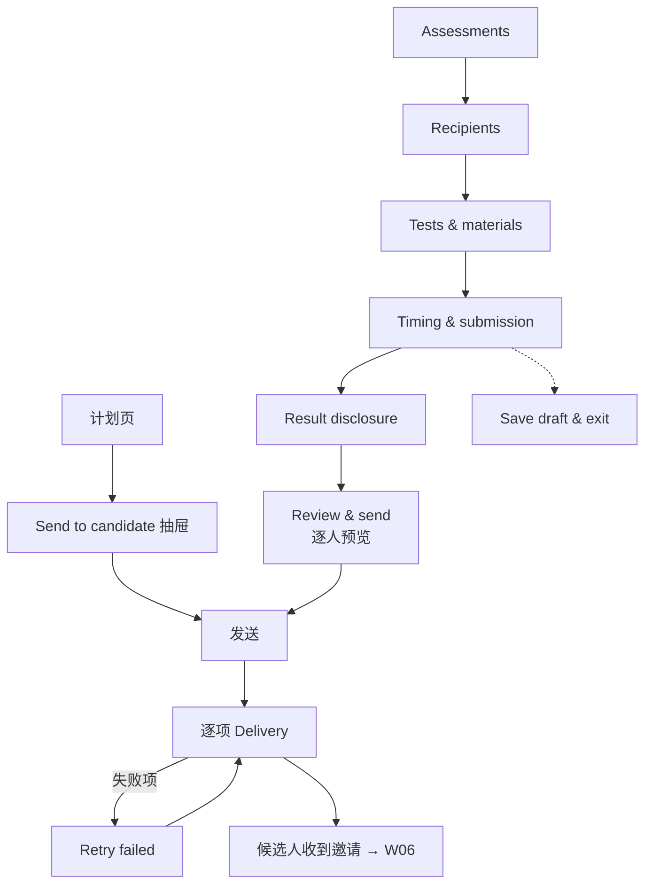

# W05 User Journey：邀请与批量发送

| 项 | 内容 |
|---|---|
| 模块 | W05 |
| 版本 / 日期 | v1.0 / 2026-10-16（草稿，待评审） |
| 同目录文档 | [产品文档](PRD.md) · [输入输出闭环](Loop_IO.md) · [User Cases](User_Cases.md) |
| 来源 | [PRD v1.4 §5、§6](../../../../hireos-written/docs/Assessment_Written_Test_PRD_v1.4.md)、[Brief v1.1 §5.3、§14.3、P03](../../../../hireos-written/docs/Assessment_Written_Test_Prototype_Design_Brief_v1.1.md) |

角色与权限见 [W01 User Journey](../W01_Question_Bank/User_Journey.md#角色与权限公共)。

# 旅程

**主角色**：HR / Recruiter
**登录目的**：把准备好的测评发给一个或一批候选人，确认每个人都收到了，失败的单独补发。
**入口**：计划页 **Send to candidate**（单人）；Assessments → **Invite candidates**（批量）

## 输入

| 类型 | 内容 |
|---|---|
| 前置数据 | S_case_plan_ready；S0_employer（多名已确认候选人） |
| 用户数据 | 收件人、mode、时长、截止、提交渠道、披露方式 |
| 外部依赖 | 平台通知服务（原型为 simulation adapter；现有实现为工作区 SMTP） |

## 流程

## 步骤

| # | 用户意图与操作 | 系统反馈 | 用户需要判断 |
|---|---|---|---|
| 1 | 计划页点 Send to candidate | 抽屉显示题目、Mode、Duration、Deadline、Result disclosure、From / Reply-To 预览 | — |
| 2 | 不填截止就确认 | 「Set a deadline first.」 | — |
| 3 | 填好后 Confirm send | 「Invitation sent to candidate.」；计划项显示 Sent | — |
| 4 | 批量：打开 Invite candidates | 五步向导 | — |
| 5 | Recipients 加入未确认关系的人 | 不能加入，说明需先确认 Core Application | 先去 W03 确认 |
| 6 | Tests & materials | 每人的测试、预计工作量、材料；无计划项的人提示先去计划页 | 工作量是否合理 |
| 7 | Timing & submission | Timed：时长 + 截止；Deadline only：只截止；提交渠道及 auto-submit 说明 | 选哪种模式和渠道 |
| 8 | Result disclosure | Score + summary 或 Summary only；说明永不包含内部排名、notes、答案 | 是否给候选人看分数 |
| 9 | Save draft & exit，稍后回来 | 内容保留 | — |
| 10 | Review & send | 逐人预览：模板、题包版本、工作量、时区、Reply-To | 每个人的内容是否正确 |
| 11 | Send invitations | 进入逐项 Delivery：Sent / Simulated bounce | 哪些没发出去 |
| 12 | Retry 失败项 | 只重发失败的人 | — |
| 13 | 批准后又改截止时间 | 旧批准失效，需要重新确认 | — |

## 可见 / 不可见

- 每个候选人只看到发给自己的邮件，看不到其他收件人。
- 邀请邮件不含 Rubric、内部答案；题包默认接受后才释放。

## 异常与恢复

| 情况 | 系统表现 | 恢复 |
|---|---|---|
| 退信 / 发送失败 | 邀请保留，Delivery 显示失败 | Retry 该项 |
| 发送结果未知 | 先查询状态，不直接重发 | 等待状态确认 |
| 双击发送 | 只发一次 | — |
| 收件人没有计划项 | 提示先去计划页加题 | 回 W04 |
| 关键条件在批准后变化 | 批准失效 | 重新确认 |

## 输出与交接

- 持久化：Invitation（题目版本快照、mode、deadline、提交渠道、披露方式、状态）、PolicySnapshot、InvitationBatch、Delivery ref。
- 交接 → W06（候选人验证、接受、作答）；W13（Awaiting acceptance 统计、Delivery issues）。

**禁止副作用**：一封失败整批回滚；重试给成功的人重复发；一封邮件群发多个候选人；本模块签发登录凭据；发送后题库修改影响邀请内容。

**成功标准**：每个候选人一份独立、内容正确的邀请；发送结果逐项可追踪，失败可单独补救。

**测试映射**：PRD 验收组 A、B；Brief P03、§5.3。

**待确认**：是否需要第二人批准；SMTP 过渡方案；候选人端语言；收件能力上线前的提交渠道（PRD 待确认 1–4）。
