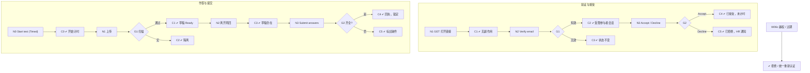

# W06 输入输出闭环：候选人门户：验证、接受与作答

| 项 | 内容 |
|---|---|
| 模块 | W06 |
| 版本 / 日期 | v1.0 / 2026-10-16（草稿，待评审） |
| 同目录文档 | [产品文档](PRD.md) · [User Journey](User_Journey.md) · [User Cases](User_Cases.md) |
| 格式说明 | 见 [Written Test README](../README.md#闭环文档格式) |

## 1. 结构化规格

```yaml
flow_id: W06a              # 打开、验证、接受 / 拒绝
actor: cand_riley
seed: S_inv_sent_timed
entry: W06a.N1
max_loop: 3
external: [identity]

nodes:
  - {id: W06a.N1, type: action, do: "GET 打开邀请链接（模拟邮件扫描器预取 + 候选人点击）"}
  - {id: W06a.C1, type: check, expect: {ui: "显示公司、岗位、题目、工作量、期限、AI 规则、时区、Verify your email", db: "Invitation 未 accepted；Attempt 未 started；验证码未消耗"}}
  - {id: W06a.N2, type: action, do: "Verify your email，输入验证码 V", inject: [core_unavailable]}
  - {id: W06a.G1, type: decision, on: "验证结果"}
  - {id: W06a.C2, type: check, expect: {ui: "Email verified.；出现 Accept / Decline", record: "统一 Identity 受限参与者会话，无员工 Membership"}}
  - {id: W06a.C3, type: check, expect: {ui: "验证失败提示，可重发", db: "状态不变"}}
  - {id: W06a.N3, type: action, do: "选择 A（Accept / Decline）", inject: [double_click]}
  - {id: W06a.G2, type: decision, on: "A"}
  - {id: W06a.C4, type: check, expect: {ui: "Invitation accepted.；Timed 显示 Start test，Deadline only 显示 Open assignment", db: "Acceptance=accepted；计时未开始"}}
  - {id: W06a.C5, type: check, expect: {ui: "二次确认后 Invitation declined.", db: "Acceptance=declined；HR 收到通知", api: "再次 Accept 返回 4xx"}}
  - {id: W06a.T1, type: terminal, state: invitation.accepted}
  - {id: W06a.T2, type: terminal, state: invitation.declined}
  - {id: W06a.T3, type: terminal, state: no_change}

edges:
  - [W06a.N1, W06a.C1]
  - [W06a.C1, W06a.N2]
  - [W06a.N2, W06a.G1]
  - [W06a.G1, W06a.C2, {when: "V = otp_valid"}]
  - [W06a.G1, W06a.C3, {when: "V 属于 otp_wrong / otp_expired"}]
  - [W06a.C3, W06a.T3]
  - [W06a.C2, W06a.N3]
  - [W06a.N3, W06a.G2]
  - [W06a.G2, W06a.C4, {when: "Accept"}]
  - [W06a.G2, W06a.C5, {when: "Decline"}]
  - [W06a.C4, W06a.T1]
  - [W06a.C5, W06a.T2]
---
flow_id: W06b              # 开始、上传、提交
actor: cand_jordan
seed: S_inv_accepted_deadline
entry: W06b.N0
max_loop: 3
external: [file_scan]

nodes:
  - {id: W06b.N0, type: action, do: "（Timed 时）点击 Start test"}
  - {id: W06b.C0, type: check, expect: {ui: "Timer running，显示剩余时间", db: "Attempt.started_at 写入"}}
  - {id: W06b.N1, type: action, do: "Open assignment，下载材料，上传文件 U", inject: [network_down]}
  - {id: W06b.G1, type: decision, on: "扫描结果"}
  - {id: W06b.C1, type: check, expect: {ui: "文件行 Uploaded draft → Scanning → Ready；说明上传是草稿", db: "SubmissionDraft 存在；无 Receipt"}}
  - {id: W06b.C2, type: check, expect: {ui: "文件标为隔离 / 不可用并说明原因", db: "文件未绑定到作答"}}
  - {id: W06b.N2, type: action, do: "离开页面再回来", inject: [refresh]}
  - {id: W06b.C3, type: check, expect: {ui: "离开时提示有未提交草稿；回来后草稿仍在"}}
  - {id: W06b.N3, type: action, do: "Submit answers，查看最终清单并确认", inject: [double_click]}
  - {id: W06b.G2, type: decision, on: "必交物是否齐全"}
  - {id: W06b.C4, type: check, expect: {ui: "显示回执时间和 Your answers are submitted.；轮次锁定", db: "Receipt 1 个；Attempt 锁定；评分任务入队", api: "再次上传 / 提交返回 4xx"}}
  - {id: W06b.C5, type: check, expect: {ui: "清单标出缺失项（处理方式见待确认）"}}
  - {id: W06b.T1, type: terminal, state: attempt.submitted}
  - {id: W06b.T2, type: terminal, state: attempt.draft}

edges:
  - [W06b.N0, W06b.C0]
  - [W06b.C0, W06b.N1]
  - [W06b.N1, W06b.G1]
  - [W06b.G1, W06b.C1, {when: "U = file_ok"}]
  - [W06b.G1, W06b.C2, {when: "U = file_macro"}]
  - [W06b.C1, W06b.N2]
  - [W06b.C2, W06b.T2]
  - [W06b.N2, W06b.C3]
  - [W06b.C3, W06b.N3]
  - [W06b.N3, W06b.G2]
  - [W06b.G2, W06b.C4, {when: "齐全"}]
  - [W06b.G2, W06b.C5, {when: "缺件"}]
  - [W06b.C4, W06b.T1]
  - [W06b.C5, W06b.T2]
---
flow_id: W06c              # 越权与会话
actor: cand_other
seed: S_inv_accepted_deadline
entry: W06c.N1
max_loop: 1
external: [identity]

nodes:
  - {id: W06c.N1, type: action, do: "用 Jordan 的邀请链接，以 cand_other 的邮箱 / 会话访问"}
  - {id: W06c.C1, type: check, expect: {api: "返回 403 / 404，不含任何 Jordan 数据", ui: "无短暂数据闪现；无员工菜单"}}
  - {id: W06c.N2, type: action, do: "会话过期后继续操作"}
  - {id: W06c.C2, type: check, expect: {ui: "要求通过统一 Identity 重新验证，不出现本地密码登录", db: "草稿不丢"}}
  - {id: W06c.T1, type: terminal, state: no_change}

edges:
  - [W06c.N1, W06c.C1]
  - [W06c.C1, W06c.T1]
  - [W06c.N2, W06c.C2]
  - [W06c.C2, W06c.T1]
```

## 2. 测试数据

| 名称 | 内容 |
|---|---|
| otp_valid / otp_wrong / otp_expired | 正确验证码（demo 482913）/ 错误 / 过期 |
| file_ok | `[UJ-TEST]_accrual_memo.docx`、`[UJ-TEST]_variance.xlsx` |
| file_macro | `[UJ-TEST]_model.xlsm`（含宏） |
| file_partial | 只上传 memo，缺 xlsx |
| device_mobile | 390×844 视口 |

## 3. 路径清单

| 路径 | 节点序列 | 数据 / 注入 | 终态 |
|---|---|---|---|
| P1 GET 无副作用 | W06a N1 → C1 | — | no_change |
| P2 验证并接受（Timed） | W06a N1 → C1 → N2 → G1 → C2 → N3 → G2 → C4 | otp_valid；Accept | invitation.accepted |
| P3 验证失败 | W06a N2 → G1 → C3 | otp_wrong、otp_expired | no_change |
| P4 拒绝 | W06a N3 → G2 → C5 | otp_valid；Decline | invitation.declined |
| P5 Identity 不可用 | W06a N2，注入 core_unavailable | otp_valid | no_change；如实提示 |
| P6 Timed 开始计时 | W06b N0 → C0 | S_inv_sent_timed 已接受 | — |
| P7 Deadline only 上传并提交 | W06b N1 → G1 → C1 → N2 → C3 → N3 → G2 → C4 | file_ok | attempt.submitted |
| P8 恶意文件 | W06b N1 → G1 → C2 | file_macro | attempt.draft |
| P9 缺件提交 | W06b N3 → G2 → C5 | file_partial | attempt.draft |
| P10 双击提交 | P7，在 N3 注入 double_click | file_ok | 1 个 Receipt |
| P11 上传时断网 | P7，在 N1 注入 network_down | file_ok | 显示失败可重传 |
| P12 越权访问 | W06c N1 → C1 | — | no_change |
| P13 会话过期 | W06c N2 → C2 | — | no_change |
| P14 手机完成全流程 | P2 + P7 | device_mobile | attempt.submitted |

## 4. 流程图（由规格生成）



## 5. 待确认

- 现有实现无邮箱验证、Accept / Decline、Start test、文件上传；`GET /public/invitations/:token` 会改状态（违反 P1）。W06a、W06b 大部分为 known gap。
- 缺件时 Portal 是否允许提交（PRD 待确认 2），决定 W06b.C5 的终态。
- 现有提交接口：`POST /public/invitations/:token/submit`（逐题文本）。
