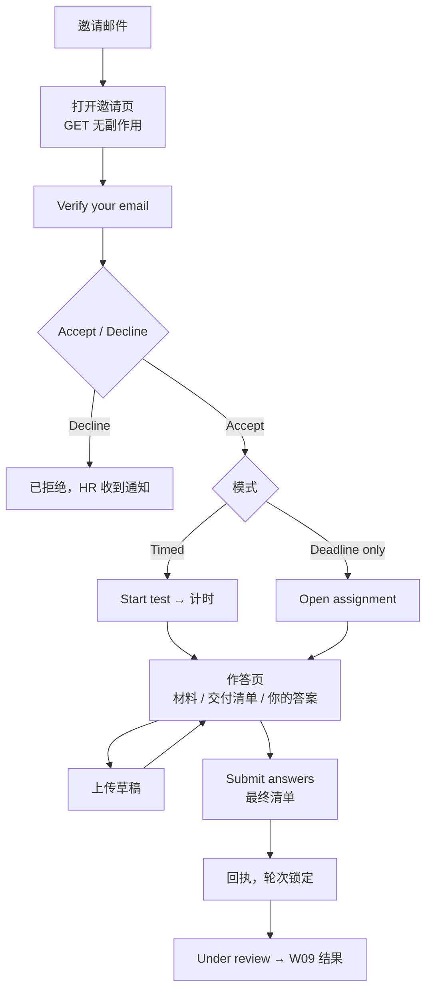

# W06 User Journey：候选人门户：验证、接受与作答

| 项 | 内容 |
|---|---|
| 模块 | W06 |
| 版本 / 日期 | v1.0 / 2026-10-16（草稿，待评审） |
| 同目录文档 | [产品文档](PRD.md) · [输入输出闭环](Loop_IO.md) · [User Cases](User_Cases.md) |
| 来源 | [PRD v1.4 §6、§7](../../../../hireos-written/docs/Assessment_Written_Test_PRD_v1.4.md)、[Brief v1.1 §3.2、§5.4、P04、P05、P21、F08](../../../../hireos-written/docs/Assessment_Written_Test_Prototype_Design_Brief_v1.1.md) |

角色与权限见 [W01 User Journey](../W01_Question_Bank/User_Journey.md#角色与权限公共)。

# 旅程

**主角色**：Candidate
**登录目的**：确认这是给我的测评，了解要求和期限，按自己的节奏完成并提交，知道提交成功了。
**入口**：邀请邮件中的链接；候选人首页 `#/candidate`

## 输入

| 类型 | 内容 |
|---|---|
| 前置数据 | S_inv_sent_timed；S_inv_sent_deadline；S_inv_accepted_deadline |
| 用户数据 | 验证码；答案文件；Accept / Decline 选择 |
| 外部依赖 | 统一 Identity（受限参与者、验证码）；公共文件存储与扫描 |

## 流程

## 步骤

| # | 用户意图与操作 | 系统反馈 | 用户需要判断 |
|---|---|---|---|
| 1 | 点击邮件链接 | 邀请页：公司、岗位、题目、预计工作量、期限、AI use policy、时区、帮助入口 | 是不是我的测评、时间够不够 |
| 2 | Verify your email | 统一身份入口发送验证码；输入后「Email verified.」 | — |
| 3 | Accept | 「Invitation accepted.」；Timed 显示 Start test 并说明点击后开始计时 | 现在开始还是稍后 |
| 3' | Decline | 二次确认「You can't undo this from the portal. HR will be notified.」 | 是否确定拒绝 |
| 4 | Timed：Start test | 倒计时开始（Timer running） | — |
| 4' | Deadline only：Open assignment | 只显示截止日，无倒计时 | — |
| 5 | 下载材料 | 材料可下载；交付清单列出要交的文件 | 要交哪些文件 |
| 6 | 上传文件 | 每行 Uploaded draft → Scanning → Ready；说明上传是草稿，可以离开再回来 | 文件是否传对 |
| 7 | 离开页面再回来 | 离开前提示；回来草稿仍在 | — |
| 8 | Submit answers | 最终清单：已上传和缺失项 | 是否都交齐了 |
| 9 | 确认提交 | 回执时间和「Your answers are submitted.」；本轮锁定 | — |
| 10 | 看结果 | 未发布时显示「Under review」，说明不是最终结果 | — |
| 11 | （可选）看 Email option | 统一 hr 邮箱、本轮回复线程、附件要求、何时算正式提交 | 用邮件交还是网页交 |

## 可见 / 不可见

| 对象 | 候选人可见 |
|---|---|
| 题目、候选人可见材料、交付清单、规则、期限 | ✅ |
| 自己的草稿、回执 | ✅ |
| Rubric、内部答案、评分、其他候选人 | ❌ |
| 员工菜单、雇主界面 | ❌ |
| 认证通过、评分等「自己选择」的按钮 | ❌ |

## 异常与恢复

| 情况 | 系统表现 | 恢复 |
|---|---|---|
| 验证码错误 / 过期 | 提示失败，可重发 | 重新验证 |
| Identity 不可用 | 如实提示，不改用本地登录 | 稍后重试 |
| 上传断网 | 该文件显示失败 | 重新上传 |
| 含宏文件 | 隔离，不可用，说明原因 | 换格式上传 |
| 缺件提交 | 清单标出缺失项（是否允许提交待确认） | 补传后再提交 |
| 会话过期 | 统一重新认证；草稿保留 | 重新验证 |
| 用他人链接访问 | 拒绝，无数据泄露 | — |
| 手机上编辑复杂 Excel | 提示 Open on desktop，但仍可上传已完成的文件 | 换桌面或直接上传 |

## 输出与交接

- 持久化：Acceptance、Attempt（started_at、锁定）、SubmissionDraft（FileVersion、扫描状态）、Receipt。
- 交接 → W07（提交进入 Submission 视图）、W08（评分任务入队）、W13（Awaiting submission 统计变化）。

**禁止副作用**：GET 打开链接即接受 / 开始计时 / 消耗验证码；上传即提交；提交后还能改；本模块签发密码；候选人看到内部信息。

**成功标准**：打开、接受、开始、上传、提交五个状态清晰分开；提交有回执且锁定；手机可完成主要操作。

**测试映射**：PRD 验收组 B、F；Brief P04、P05、P21、F08。

**待确认**：GET 改状态的现有实现；缺件提交；token 过渡方案；文本作答与文件作答（PRD 待确认 1–4）。
