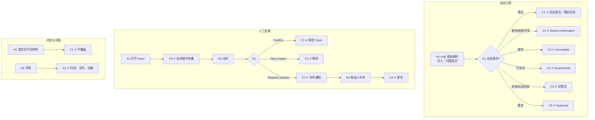

# W07 输入输出闭环：提交收件与 Submission Inbox

| 项 | 内容 |
|---|---|
| 模块 | W07 |
| 版本 / 日期 | v1.0 / 2026-10-16（草稿，待评审） |
| 同目录文档 | [产品文档](PRD.md) · [User Journey](User_Journey.md) · [User Cases](User_Cases.md) |
| 格式说明 | 见 [Written Test README](../README.md#闭环文档格式) |

## 1. 结构化规格

```yaml
flow_id: W07a              # 邮件到达与自动分类（系统）
actor: system
seed: S_inv_accepted_deadline
entry: W07a.N1
max_loop: 1
external: [mail_ingress, file_scan]

nodes:
  - {id: W07a.N1, type: action, do: "模拟 hr@ 收到邮件 E", inject: [mail_scan_delay]}
  - {id: W07a.G1, type: decision, on: "身份 / 认证 / 线程 / 接受 / 轮次 / 必交物 / 安全 / 期限"}
  - {id: W07a.C1, type: check, expect: {db: "Response 提交，来源=email；期限按可信接收时间判定；Received 与 Processed 时间分别保存", ext: "候选人收到收件回执和正式提交回执两封", ui: "Inbox 分类 Submitted；Task / 评分队列更新"}}
  - {id: W07a.C2, type: check, expect: {ui: "Needs confirmation，显示匹配原因（More than one assignment found / Round 1 — closed / Unknown sender）", db: "未提交"}}
  - {id: W07a.C3, type: check, expect: {ui: "Incomplete，列出 Missing", db: "IssueGroup open；未提交"}}
  - {id: W07a.C4, type: check, expect: {ui: "Quarantined：Held for Operations review — not auto-processed", record: "宏 / 附件未执行"}}
  - {id: W07a.C5, type: check, expect: {ui: "Not a submission（咨询 / 自动回复）", db: "未提交"}}
  - {id: W07a.C6, type: check, expect: {ui: "Duplicate", db: "仍只有 1 个提交"}}
  - {id: W07a.T1, type: terminal, state: response.submitted}
  - {id: W07a.T2, type: terminal, state: mail.pending_human}

edges:
  - [W07a.N1, W07a.G1]
  - [W07a.G1, W07a.C1, {when: "E = mail_complete"}]
  - [W07a.G1, W07a.C2, {when: "E 属于 mail_wrong_sender / mail_old_thread / mail_two_assignments / mail_new_thread"}]
  - [W07a.G1, W07a.C3, {when: "E = mail_missing"}]
  - [W07a.G1, W07a.C4, {when: "E = mail_macro_spf_fail"}]
  - [W07a.G1, W07a.C5, {when: "E 属于 mail_question / mail_autoreply"}]
  - [W07a.G1, W07a.C6, {when: "E = mail_same_as_upload"}]
  - [W07a.C1, W07a.T1]
  - [W07a.C2, W07a.T2]
  - [W07a.C3, W07a.T2]
  - [W07a.C4, W07a.T2]
  - [W07a.C5, W07a.T2]
  - [W07a.C6, W07a.T1]
---
flow_id: W07b              # 人工处理
actor: hr_emma
seed: S_inv_started_missing
entry: W07b.N1
max_loop: 3
external: [mail_adapter]

nodes:
  - {id: W07b.N1, type: action, do: "打开 Submission Inbox，选中邮件"}
  - {id: W07b.C0, type: check, expect: {ui: "第一层为任务匹配和状态；Message-ID/DKIM/SPF/hash 在 Technical details"}}
  - {id: W07b.N2, type: action, do: "执行动作 H"}
  - {id: W07b.G1, type: decision, on: "H"}
  - {id: W07b.C1, type: check, expect: {db: "邮件绑定到所选 Case 和轮次；若完整则提交", record: "确认人、时间"}}
  - {id: W07b.C2, type: check, expect: {db: "邮件标为非提交", ui: "从待处理移除"}}
  - {id: W07b.C3, type: check, expect: {ext: "候选人收到补件通知（统一 hr@ 线程）", db: "IssueGroup 仍 open，等待补件"}}
  - {id: W07b.N3, type: action, do: "候选人补发缺失文件"}
  - {id: W07b.C4, type: check, expect: {db: "IssueGroup closed；提交时间=最后必需件到达时间", ui: "Submitted"}}
  - {id: W07b.T1, type: terminal, state: response.submitted}
  - {id: W07b.T2, type: terminal, state: mail.dismissed}

edges:
  - [W07b.N1, W07b.C0]
  - [W07b.C0, W07b.N2]
  - [W07b.N2, W07b.G1]
  - [W07b.G1, W07b.C1, {when: "H = confirm_assignment"}]
  - [W07b.G1, W07b.C2, {when: "H = not_a_match"}]
  - [W07b.G1, W07b.C3, {when: "H = request_missing"}]
  - [W07b.C1, W07b.T1]
  - [W07b.C2, W07b.T2]
  - [W07b.C3, W07b.N3]
  - [W07b.N3, W07b.C4]
  - [W07b.C4, W07b.T1]
---
flow_id: W07c              # 冲突与迟到
actor: hr_emma
seed: S_attempt_submitted_ai_draft
entry: W07c.N1
max_loop: 2
external: [mail_ingress]

nodes:
  - {id: W07c.N1, type: action, do: "已提交后收到不同版本的附件"}
  - {id: W07c.C1, type: check, expect: {ui: "显示冲突，左右对比文件差异；提供新修订轮或经批准更正", db: "原提交不被覆盖"}}
  - {id: W07c.N2, type: action, do: "打开 Submission 详情"}
  - {id: W07c.C2, type: check, expect: {ui: "Received / Processed 时间、原始压缩包下载、交付文件逐项 Preview / Missing、Candidate / Round / Task binding", api: "Excel 证据含公式与 Calculation not verified"}}
  - {id: W07c.T1, type: terminal, state: no_change}

edges:
  - [W07c.N1, W07c.C1]
  - [W07c.C1, W07c.T1]
  - [W07c.N2, W07c.C2]
  - [W07c.C2, W07c.T1]
```

## 2. 测试数据

| 名称 | 内容 |
|---|---|
| mail_complete | 已验证邮箱、正确线程（Re: FIN-001 — Round 1）、附件齐全、截止前 |
| mail_missing | 正确线程，缺 xlsx |
| mail_wrong_sender | 未受邀邮箱发来附件 |
| mail_old_thread | 回复 Round 1 已关闭的线程，Round 2 进行中 |
| mail_two_assignments | 同一候选人有两个岗位任务，新写邮件无线程 |
| mail_new_thread | 新邮件，主题含任务编号但无线程 |
| mail_macro_spf_fail | SPF 失败 + xlsm |
| mail_question / mail_autoreply | 询问截止时间 / Out of office |
| mail_same_as_upload | 与 Portal 已提交文件 hash 相同 |
| mail_late_scan | 可信接收时间在截止前 5 分钟，扫描完成在截止后 10 分钟 |
| mail_conflict | 已提交后到达内容不同的附件 |
| mail_cross_ws | 发到同一 hr@ 但属于另一 workspace 的任务 |

## 3. 路径清单

| 路径 | 节点序列 | 数据 / 注入 | 终态 |
|---|---|---|---|
| P1 完整邮件自动提交 | W07a N1 → G1 → C1 | mail_complete | response.submitted |
| P2 扫描延迟仍按时 | W07a N1 → G1 → C1 | mail_late_scan；mail_scan_delay | response.submitted；按时 |
| P3–P6 需要确认 | W07a N1 → G1 → C2 | mail_wrong_sender、mail_old_thread、mail_two_assignments、mail_new_thread | mail.pending_human |
| P7 缺件 | W07a N1 → G1 → C3 | mail_missing | mail.pending_human |
| P8 隔离 | W07a N1 → G1 → C4 | mail_macro_spf_fail | mail.pending_human |
| P9–P10 非提交 | W07a N1 → G1 → C5 | mail_question、mail_autoreply | mail.pending_human |
| P11 与上传重复 | W07a N1 → G1 → C6 | mail_same_as_upload | 1 个提交 |
| P12 人工确认归属 | W07b N1 → C0 → N2 → G1 → C1 | mail_new_thread；confirm_assignment | response.submitted |
| P13 Not a match | W07b N2 → G1 → C2 | mail_question；not_a_match | mail.dismissed |
| P14 请求补件并恢复 | W07b N2 → G1 → C3 → N3 → C4 | mail_missing；request_missing | response.submitted |
| P15 已提交后冲突 | W07c N1 → C1 | mail_conflict | no_change |
| P16 Submission 详情 | W07c N2 → C2 | case_d | no_change |
| P17 跨 workspace 隔离 | W07a N1 → G1 → C2，hr_other_ws 不可见 | mail_cross_ws | mail.pending_human |

## 4. 流程图（由规格生成）



## 5. 待确认

- 收件、匹配、SubmissionBundle、IssueGroup 全部未实现，本闭环所有路径为 known gap。
- 收件过渡方案（自建 IMAP 还是等平台服务，PRD 待确认 1）。
- 补件通知是否需要 HR 确认后发送（PRD 待确认 2）；当前 W07b 按 HR 主动发起建模。
