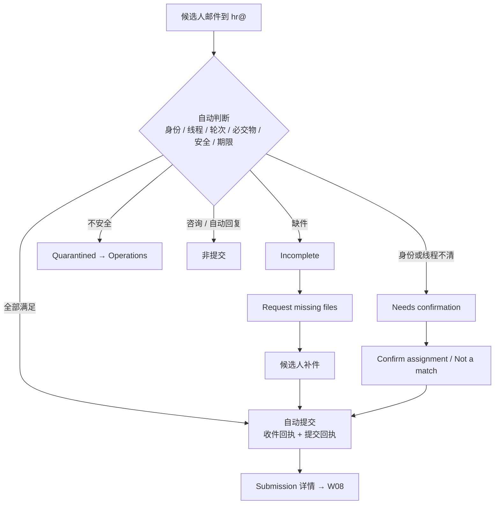

# W07 User Journey：提交收件与 Submission Inbox

| 项 | 内容 |
|---|---|
| 模块 | W07 |
| 版本 / 日期 | v1.0 / 2026-10-16（草稿，待评审） |
| 同目录文档 | [产品文档](PRD.md) · [输入输出闭环](Loop_IO.md) · [User Cases](User_Cases.md) |
| 来源 | [PRD v1.4 §7](../../../../hireos-written/docs/Assessment_Written_Test_PRD_v1.4.md)、[Brief v1.1 §5.5、§14.3、P06–P08、F07](../../../../hireos-written/docs/Assessment_Written_Test_Prototype_Design_Brief_v1.1.md) |

角色与权限见 [W01 User Journey](../W01_Question_Bank/User_Journey.md#角色与权限公共)。

# 旅程

**主角色**：HR / Recruiter；Operations（隔离与身份问题）；Candidate（补件）
**登录目的**：确认候选人交上来的东西落到了正确的人、正确的轮次，处理缺件、身份不明和可疑附件，不让错误的提交进入评分。
**入口**：Assessments 子导航 **Submission Inbox**；My Tasks 中的 Submission issues 卡片

## 输入

| 类型 | 内容 |
|---|---|
| 前置数据 | S_inv_accepted_deadline；S_inv_started_missing；S_attempt_submitted_ai_draft |
| 用户数据 | 候选人邮件及附件（见 Loop_IO 测试数据） |
| 外部依赖 | 平台收件（hr@ 连接）；文件扫描；通知服务（回执、补件） |

## 流程

## 步骤

| # | 用户意图与操作 | 系统反馈 | 用户需要判断 |
|---|---|---|---|
| 1 | 打开 Submission Inbox | 按状态分组：Received、Needs confirmation、Incomplete、Submitted、Duplicate、Quarantined；技术信息在 Details | 先处理哪类 |
| 2 | 打开一封 Needs confirmation | 发件人、可信接收时间、匹配原因（如「More than one assignment found」）、附件 | 这封属于哪个任务 |
| 3 | Confirm assignment | 选择 Case 和轮次后绑定；完整则提交 | 不能只凭主题或姓名判断 |
| 4 | 对咨询邮件点 Not a match | 标为非提交，移出待处理 | — |
| 5 | 打开 Incomplete 邮件 | 列出缺失的必交物 | 是否请候选人补交 |
| 6 | Request missing files | 候选人在本轮线程收到补件通知 | — |
| 7 | 候选人补发 | 自动关闭问题组，状态变 Submitted；提交时间按最后一个必需件 | — |
| 8 | （Operations）打开 Quarantined | 「Held for Operations review — not auto-processed」；宏未执行 | 是否联系候选人重发 |
| 9 | 打开 Submission 详情 | Received / Processed 时间、原始压缩包、交付文件逐项、Candidate / Round / Task binding | 是否可以进入评分 |
| 10 | 已提交后又来了不同附件 | 冲突提示，左右对比；不覆盖原提交 | 开新修订轮还是批准更正 |

## 可见 / 不可见

- 普通 HR 默认看可读说明；Message-ID、DKIM / SPF、hash 只在 Technical details。
- 只显示自己有权限的 Case 的邮件；其他 workspace 的邮件不可见。
- 候选人只收到回执和补件通知，看不到匹配细节。

## 异常与恢复

| 情况 | 系统表现 | 恢复 |
|---|---|---|
| 扫描延迟导致处理晚于截止 | 按可信接收时间判定按时 | — |
| 同一附件邮件 + 上传各一次 | Duplicate，只算一次 | — |
| 旧轮线程迟到回复 | 不进入新轮，Needs confirmation | 人工判断 |
| 同人两个岗位 | 不自动落到最近任务 | Confirm assignment |
| 邮箱断连 | 恢复后从检查点继续，不漏收、不重复 | — |
| 打开附件 | 不触发提交 | — |
| 解析失败 | 不是零分；标为需处理 | 请求重发 |

## 输出与交接

- 持久化：MailConsumption（匹配结果和原因）、SubmissionBundle、Response / Receipt、Evidence、IssueGroup。
- 交接 → W08（Go to evaluation）；W13（Submission issues 统计、缺件任务）；W10（冲突转新修订轮）。

**禁止副作用**：AI 猜测自动确认归属；咨询 / 自动回复被当作提交；提交后被后到文件覆盖；打开附件自动提交；执行宏；改写源邮箱。

**成功标准**：每份提交都确定地属于一个 Case 和轮次；不确定的都有原因并能被人处理；按时与否判断正确。

**测试映射**：PRD 验收组 B、G；Brief P05–P08、F07。

**待确认**：收件过渡方案；补件通知是否需确认；Duplicate 判定依据（PRD 待确认 1–3）。
