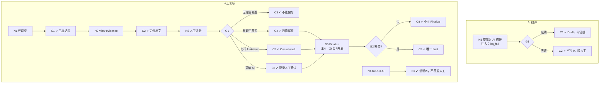

# W08 输入输出闭环：评分与人工复核

| 项 | 内容 |
|---|---|
| 模块 | W08 |
| 版本 / 日期 | v1.0 / 2026-10-16（草稿，待评审） |
| 同目录文档 | [产品文档](PRD.md) · [User Journey](User_Journey.md) · [User Cases](User_Cases.md) |
| 格式说明 | 见 [Written Test README](../README.md#闭环文档格式) |

## 1. 结构化规格

```yaml
flow_id: W08a              # AI 初评
actor: system
seed: S_inv_accepted_deadline
entry: W08a.N1
max_loop: 3
external: [llm]

nodes:
  - {id: W08a.N1, type: action, do: "候选人提交后触发 AI 初评", inject: [llm_fail]}
  - {id: W08a.G1, type: decision, on: "AI 结果"}
  - {id: W08a.C1, type: check, expect: {db: "Evaluation source=ai，status=draft；每个 criterion 有分数、理由、证据引用、Confidence", ui: "Overall (AI) 标 Draft only, not a hiring probability", record: "AI run ref"}}
  - {id: W08a.C2, type: check, expect: {ui: "显示 AI 失败原因；可 Re-run AI 或直接人工评分", db: "无 AI 分数；不写 0"}}
  - {id: W08a.T1, type: terminal, state: evaluation.ai_draft}
  - {id: W08a.T2, type: terminal, state: evaluation.pending_human}

edges:
  - [W08a.N1, W08a.G1]
  - [W08a.G1, W08a.C1, {when: "成功"}]
  - [W08a.G1, W08a.C2, {when: "llm_fail"}]
  - [W08a.C1, W08a.T1]
  - [W08a.C2, W08a.T2]
---
flow_id: W08b              # 人工复核与 Finalize
actor: hm_daniel
seed: S_attempt_submitted_ai_draft
entry: W08b.N1
max_loop: 3
external: [llm]

nodes:
  - {id: W08b.N1, type: action, do: "打开 Taylor 的评审页"}
  - {id: W08b.C1, type: check, expect: {ui: "首层 Overall (human) / Overall (AI) / Coverage / Confidence；第二层 criterion 表；严重问题单独显示"}}
  - {id: W08b.N2, type: action, do: "点击某分数的 View evidence"}
  - {id: W08b.C2, type: check, expect: {ui: "criterion → 理由 → 原文片段（页码 / 单元格）"}}
  - {id: W08b.N3, type: action, do: "按测试数据 S 设置人工分数"}
  - {id: W08b.G1, type: decision, on: "S"}
  - {id: W08b.C3, type: check, expect: {ui: "Override reason 必填提示，不能保存"}}
  - {id: W08b.C4, type: check, expect: {db: "Override 记录原值、新值、理由、操作人、时间；AI 值保留"}}
  - {id: W08b.C5, type: check, expect: {ui: "Overall 显示为空并说明原因", api: "overall=null，不为 0，不重新归一化"}}
  - {id: W08b.C6, type: check, expect: {db: "全部 criterion 采纳 AI 值，记录为人工确认"}}
  - {id: W08b.N4, type: action, do: "Re-run AI"}
  - {id: W08b.C7, type: check, expect: {db: "新的 AI Evaluation 版本；旧版本保留；人工分不被覆盖"}}
  - {id: W08b.N5, type: action, do: "Finalize evaluation → Confirm finalize", inject: [double_click, concurrent]}
  - {id: W08b.G2, type: decision, on: "提交是否完整、证据是否处理完"}
  - {id: W08b.C8, type: check, expect: {ui: "提示 incomplete / Evidence has not finished processing；Finalize 不可用"}}
  - {id: W08b.C9, type: check, expect: {db: "Result status=final，finalized_by，profile 版本；只有 1 个 final", ui: "评分只读；Results to release +1"}}
  - {id: W08b.T1, type: terminal, state: result.final}
  - {id: W08b.T2, type: terminal, state: no_change}

edges:
  - [W08b.N1, W08b.C1]
  - [W08b.C1, W08b.N2]
  - [W08b.N2, W08b.C2]
  - [W08b.C2, W08b.N3]
  - [W08b.N3, W08b.G1]
  - [W08b.G1, W08b.C3, {when: "S = override_no_reason"}]
  - [W08b.G1, W08b.C4, {when: "S = override_with_reason"}]
  - [W08b.G1, W08b.C5, {when: "S = required_unknown"}]
  - [W08b.G1, W08b.C6, {when: "S = accept_all_ai"}]
  - [W08b.C3, W08b.T2]
  - [W08b.C4, W08b.N5]
  - [W08b.C6, W08b.N5]
  - [W08b.C5, W08b.N5]
  - [W08b.N4, W08b.C7]
  - [W08b.C7, W08b.T2]
  - [W08b.N5, W08b.G2]
  - [W08b.G2, W08b.C8, {when: "不完整"}]
  - [W08b.G2, W08b.C9, {when: "完整"}]
  - [W08b.C8, W08b.T2]
  - [W08b.C9, W08b.T1]
```

## 2. 测试数据

| 名称 | 内容 |
|---|---|
| alex_scores | Accounting 30/40、Analysis 20/40、Communication 20/20 → Overall 70 |
| override_no_reason | 把 Analysis 从 AI 28 改为 22，不填理由 |
| override_with_reason | 同上，理由「Variance explanation misses FX impact (sheet Q3!C14)」 |
| required_unknown | Communication（必评）标 Unknown |
| accept_all_ai | 点击 Accept all AI scores |
| big_gap | AI 80、人工 40（分差过大） |

## 3. 路径清单

| 路径 | 节点序列 | 数据 / 注入 | 终态 |
|---|---|---|---|
| P1 AI 初评成功 | W08a N1 → G1 → C1 | — | evaluation.ai_draft |
| P2 AI 失败转人工 | W08a N1 → G1 → C2 | llm_fail | evaluation.pending_human |
| P3 评审页结构与证据 | W08b N1 → C1 → N2 → C2 | case_d | no_change |
| P4 覆盖不填理由 | W08b N3 → G1 → C3 | override_no_reason | no_change |
| P5 覆盖并 Finalize | W08b N3 → G1 → C4 → N5 → G2 → C9 | override_with_reason | result.final |
| P6 必评 Unknown | W08b N3 → G1 → C5 → N5 → G2 → C9 | required_unknown | result.final（overall=null） |
| P7 采纳全部 AI 分 | W08b N3 → G1 → C6 → N5 → G2 → C9 | accept_all_ai | result.final |
| P8 Re-run AI | W08b N4 → C7 | — | no_change |
| P9 不完整不能 Finalize | W08b N5 → G2 → C8 | S_inv_started_missing | no_change |
| P10 双击 / 并发 Finalize | P5，在 N5 注入 double_click、concurrent | override_with_reason | 1 个 final |
| P11 分差过大停止自动处理 | W08b N3 | big_gap | 提示人工复核 |
| P12 总分算法 | W08b N3 → G1 → C4 | alex_scores | Overall = 70 |

## 4. 流程图（由规格生成）



## 5. 待确认

- Finalize 是否需要第二人确认（PRD 待确认 1）。
- 评价版本、Override 历史、Unknown 规则依赖拆表（PRD 待确认 2）；现有数据在 `Submission.evaluation` / `finalEvaluation` JSON 中。
- 分差阈值（PRD 待确认 3）。
- 实际接口：`POST /cases/:caseId/result/finalize`。
