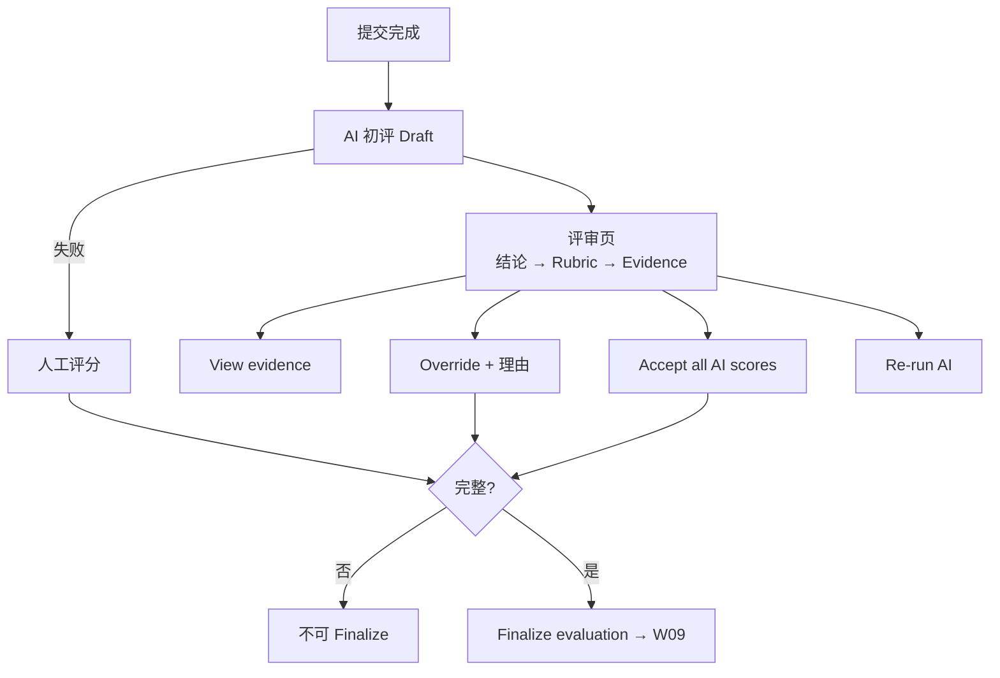

# W08 User Journey：评分与人工复核

| 项 | 内容 |
|---|---|
| 模块 | W08 |
| 版本 / 日期 | v1.0 / 2026-10-16（草稿，待评审） |
| 同目录文档 | [产品文档](PRD.md) · [输入输出闭环](Loop_IO.md) · [User Cases](User_Cases.md) |
| 来源 | [PRD v1.4 §8](../../../../hireos-written/docs/Assessment_Written_Test_PRD_v1.4.md)、[Brief v1.1 §5.5、§7、P09](../../../../hireos-written/docs/Assessment_Written_Test_Prototype_Design_Brief_v1.1.md)、[Agent 对话流程 §5、§9](../../../../hireos-written/docs/Written_Test_Agent_Conversation_Flow.md) |

角色与权限见 [W01 User Journey](../W01_Question_Bank/User_Journey.md#角色与权限公共)。

# 旅程

**主角色**：Hiring Manager / Reviewer
**登录目的**：判断 AI 给出的分数是否有依据，必要时修正，确认一份可以解释的最终结果。
**入口**：My Tasks 中的评分复核任务；Submission 详情 **Go to evaluation**；计划页 **Comprehensive evaluation** tab

## 输入

| 类型 | 内容 |
|---|---|
| 前置数据 | S_attempt_submitted_ai_draft（AI draft = 80）；S_inv_started_missing |
| 用户数据 | 人工分数、覆盖理由、Unknown 标记 |
| 外部依赖 | 公共 AI Service（rubric_evaluate、evidence_map） |

## 流程

## 步骤

| # | 用户意图与操作 | 系统反馈 | 用户需要判断 |
|---|---|---|---|
| 1 | 打开评审页 | 首层：Overall（human）、Overall（AI，Draft only, not a hiring probability）、Coverage / Confidence；严重问题单独显示 | 整体结论是什么 |
| 2 | 看 Criteria 表 | 每个 criterion：满分、AI 分、人工分、Confidence、Coverage、理由 | 哪个维度 AI 判断可疑 |
| 3 | 点 View evidence | 打开证据抽屉：理由对应的原文片段、页码或单元格 | 证据是否支持这个分数 |
| 4 | 修改某个分数 | 要求填写 Override reason；原 AI 值保留在历史 | 理由能否说服其他评审 |
| 5 | 把必评项标为 Unknown | Overall 变为空并说明原因 | 是否需要补测（W10） |
| 6 | Accept all AI scores | 全部采纳，记录为人工确认 | AI 分是否全部可信 |
| 7 | Re-run AI | 生成新 AI 版本，人工分不变 | — |
| 8 | AI 失败 | 显示原因；可直接人工评分 | — |
| 9 | 提交不完整时尝试 Finalize | 「This submission is incomplete — resolve the missing deliverable before scoring.」 | 先回 W07 处理 |
| 10 | Finalize evaluation → Confirm finalize | 评分只读；生成 final 结果 | — |
| 11 | Profile 更新后打开 | 「Assessed using profile v1」+ 待复核 | 是否重新评估 |

## 可见 / 不可见

- 评分、覆盖理由、诚信信号只对员工可见；候选人只看到 W09 发布的白名单内容。
- 受限 scope 员工看不到无权限的证据，显示 Restricted。

## 异常与恢复

| 情况 | 系统表现 | 恢复 |
|---|---|---|
| AI 失败 / 超时 | 不写 0；可重试或人工评分 | Re-run AI / 人工 |
| 证据未处理完 | 「Evidence has not finished processing.」 | 等待或刷新 |
| AI 与人工分差过大 | 停止自动处理，提示人工复核 | 第二人复核 |
| 两人同时评分 | 冲突提示 | 刷新合并 |
| AI-assisted detection 信号 | 只显示为非结论性信号 | 人工判断，不自动扣分 |

## 输出与交接

- 持久化：Evaluation（ai / human / rule，版本）、CriterionScore、Override、Result（draft / final，overall 可为 null）。
- 交接 → W09（Release 页）；W12（对比用 final 结果）；W13（Results to release +1、评分复核任务完成）。

**禁止副作用**：未评估项计 0；缺项后重新归一化；AI 分直接成为 final；覆盖不留原值；自动拒绝候选人；把分数当录用概率展示。

**成功标准**：每个分数可追到证据；Unknown 时总分为空；最终结果由人确认且改动可追溯。

**测试映射**：PRD 验收组 C；Brief P09、§7。

**待确认**：Finalize 是否需第二人；评价版本拆表；分差阈值（PRD 待确认 1–3）。
