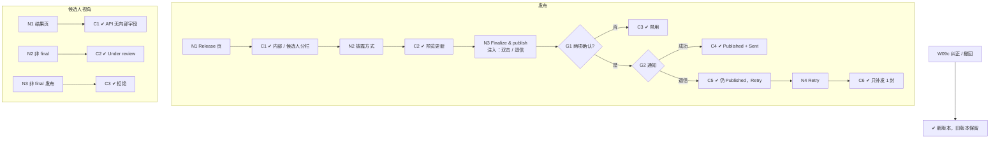

# W09 输入输出闭环：结果发布与候选人通知

| 项 | 内容 |
|---|---|
| 模块 | W09 |
| 版本 / 日期 | v1.0 / 2026-10-16（草稿，待评审） |
| 同目录文档 | [产品文档](PRD.md) · [User Journey](User_Journey.md) · [User Cases](User_Cases.md) |
| 格式说明 | 见 [Written Test README](../README.md#闭环文档格式) |

## 1. 结构化规格

```yaml
flow_id: W09a              # 发布
actor: hr_emma
seed: S_result_final_unreleased
entry: W09a.N1
max_loop: 3
external: [mail_adapter]

nodes:
  - {id: W09a.N1, type: action, do: "打开 Alex 的 Release 页"}
  - {id: W09a.C1, type: check, expect: {ui: "左栏 Overall (human) 70、是否覆盖、Finalized by；右栏候选人预览 Outcome / Score / Feedback / Next step；注明不含内部排名、notes、答案"}}
  - {id: W09a.N2, type: action, do: "选择披露方式 P"}
  - {id: W09a.C2, type: check, expect: {ui: "预览即时更新；Summary only 时不显示分数"}}
  - {id: W09a.N3, type: action, do: "勾选 K 后点击 Finalize & publish result", inject: [double_click, mail_bounce]}
  - {id: W09a.G1, type: decision, on: "两项确认是否都勾选"}
  - {id: W09a.C3, type: check, expect: {ui: "发布按钮禁用并说明需要的确认"}}
  - {id: W09a.G2, type: decision, on: "通知发送结果"}
  - {id: W09a.C4, type: check, expect: {db: "CandidateResultRelease v1 published；只 1 个版本", ui: "Published + Delivery Sent；出现 Next action", ext: "候选人收到 1 封结果通知"}}
  - {id: W09a.C5, type: check, expect: {db: "Release 仍 published；Delivery failed", ui: "Retry notification"}}
  - {id: W09a.N4, type: action, do: "Retry notification"}
  - {id: W09a.C6, type: check, expect: {ext: "只补发 1 封", db: "Release 不重复"}}
  - {id: W09a.T1, type: terminal, state: release.published}
  - {id: W09a.T2, type: terminal, state: no_change}

edges:
  - [W09a.N1, W09a.C1]
  - [W09a.C1, W09a.N2]
  - [W09a.N2, W09a.C2]
  - [W09a.C2, W09a.N3]
  - [W09a.N3, W09a.G1]
  - [W09a.G1, W09a.C3, {when: "K 不全"}]
  - [W09a.G1, W09a.G2, {when: "K 全选"}]
  - [W09a.G2, W09a.C4, {when: "成功"}]
  - [W09a.G2, W09a.C5, {when: "mail_bounce"}]
  - [W09a.C5, W09a.N4]
  - [W09a.N4, W09a.C6]
  - [W09a.C6, W09a.T1]
  - [W09a.C4, W09a.T1]
  - [W09a.C3, W09a.T2]
---
flow_id: W09b              # 候选人查看与非 final
actor: cand_alex
seed: S_result_released
entry: W09b.N1
max_loop: 1
external: []

nodes:
  - {id: W09b.N1, type: action, do: "候选人打开结果页"}
  - {id: W09b.C1, type: check, expect: {ui: "Outcome、Feedback、Next step（按披露方式含 / 不含分数）", api: "响应中无 internal_notes、ranking、answer_key、integrity 原始信号、AI 分"}}
  - {id: W09b.N2, type: action, do: "cand_taylor 打开结果页（结果非 final）"}
  - {id: W09b.C2, type: check, expect: {ui: "Under review：this is not your final result yet", api: "无分数"}}
  - {id: W09b.N3, type: action, do: "HR 对 case_d 尝试发布"}
  - {id: W09b.C3, type: check, expect: {ui: "No finalized result for this case yet.", api: "release 接口返回 4xx"}}
  - {id: W09b.T1, type: terminal, state: no_change}

edges:
  - [W09b.N1, W09b.C1]
  - [W09b.C1, W09b.T1]
  - [W09b.N2, W09b.C2]
  - [W09b.C2, W09b.T1]
  - [W09b.N3, W09b.C3]
  - [W09b.C3, W09b.T1]
---
flow_id: W09c              # 纠正 / 撤回
actor: hr_emma
seed: S_result_released
entry: W09c.N1
max_loop: 2
external: [mail_adapter]

nodes:
  - {id: W09c.N1, type: action, do: "对已发布结果执行纠正（修改 Feedback）或撤回"}
  - {id: W09c.C1, type: check, expect: {db: "生成 Release v2（corrected / withdrawn）；v1 保留在历史", ui: "说明无法收回已发出的邮件"}}
  - {id: W09c.T1, type: terminal, state: release.corrected}

edges:
  - [W09c.N1, W09c.C1]
  - [W09c.C1, W09c.T1]
```

## 2. 测试数据

| 名称 | 内容 |
|---|---|
| disclose_score | Score + summary |
| disclose_summary | Summary only |
| confirm_both | 勾选 Internal review complete 和 Disclosure content approved for release |
| confirm_one | 只勾选其中一项 |
| feedback_text | 「Clear structure; accounting treatment mostly correct with one gap in variance analysis.」 |
| internal_note | 评审 notes「Compare with Taylor before deciding」（不应外泄） |

## 3. 路径清单

| 路径 | 节点序列 | 数据 / 注入 | 终态 |
|---|---|---|---|
| P1 Release 页结构 | W09a N1 → C1 | — | no_change |
| P2–P3 披露方式预览 | W09a N2 → C2 | disclose_score、disclose_summary | no_change |
| P4 确认不全不能发布 | W09a N3 → G1 → C3 | confirm_one | no_change |
| P5 发布成功 | W09a N3 → G1 → G2 → C4 | confirm_both | release.published |
| P6 退信后重试通知 | W09a N3 → G1 → G2 → C5 → N4 → C6 | confirm_both；mail_bounce | release.published |
| P7 双击发布 | P5，在 N3 注入 double_click | confirm_both | 1 个 Release，1 封通知 |
| P8 候选人看白名单结果 | W09b N1 → C1 | internal_note | no_change |
| P9 非 final 显示 Under review | W09b N2 → C2 | case_d | no_change |
| P10 非 final 不能发布 | W09b N3 → C3 | case_d | no_change |
| P11 纠正 / 撤回 | W09c N1 → C1 | feedback_text 修改 | release.corrected |

## 4. 流程图（由规格生成）



## 5. 待确认

- 发布是否需要第二人批准（PRD 待确认 1）。
- 现有 `POST /cases/:caseId/result/release` 无版本、无 Delivery 记录、无候选人结果页；W09b、W09c 和 P6 为 known gap。
