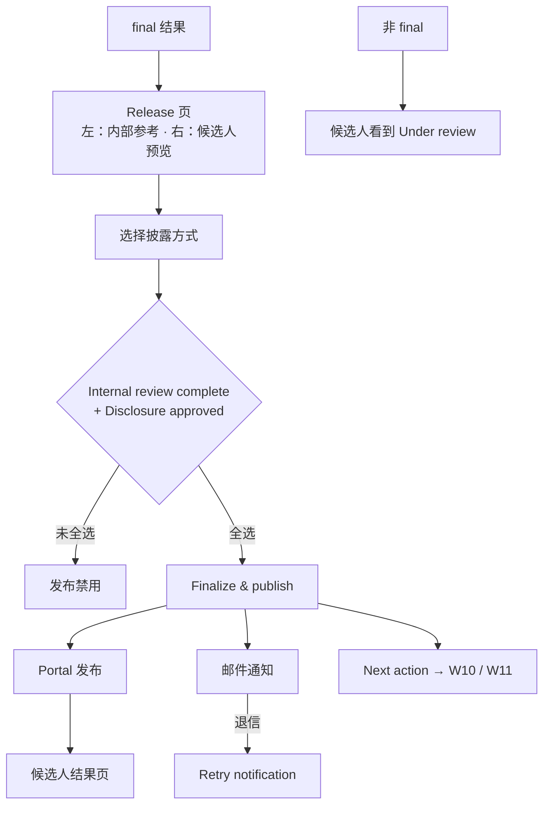

# W09 User Journey：结果发布与候选人通知

| 项 | 内容 |
|---|---|
| 模块 | W09 |
| 版本 / 日期 | v1.0 / 2026-10-16（草稿，待评审） |
| 同目录文档 | [产品文档](PRD.md) · [输入输出闭环](Loop_IO.md) · [User Cases](User_Cases.md) |
| 来源 | [PRD v1.4 §8](../../../../hireos-written/docs/Assessment_Written_Test_PRD_v1.4.md)、[Brief v1.1 §5.4、§5.6、P10](../../../../hireos-written/docs/Assessment_Written_Test_Prototype_Design_Brief_v1.1.md)、[Agent 对话流程 §10](../../../../hireos-written/docs/Written_Test_Agent_Conversation_Flow.md) |

角色与权限见 [W01 User Journey](../W01_Question_Bank/User_Journey.md#角色与权限公共)。

# 旅程

**主角色**：HR / Recruiter（发布）；Candidate（查看）
**登录目的**：HR 要把确认过的结果以合适的方式告诉候选人，并确认对方收到；候选人想知道结果和下一步。
**入口**：My Tasks 中的结果发布任务；计划页 **Evaluation result** tab；候选人结果通知邮件

## 输入

| 类型 | 内容 |
|---|---|
| 前置数据 | S_result_final_unreleased；S_result_released；S_attempt_submitted_ai_draft |
| 用户数据 | 披露方式、Outcome / Feedback / Next step 文案、两项确认 |
| 外部依赖 | 平台通知服务 |

## 流程

## 步骤

| # | 用户意图与操作 | 系统反馈 | 用户需要判断 |
|---|---|---|---|
| 1 | 打开 Release 页 | 左栏：Overall（human）、是否覆盖、Finalized by；右栏：候选人看到的内容 | 内部结论与对外表述是否一致 |
| 2 | 切换 Score + summary / Summary only | 右侧预览即时变化 | 是否让候选人看到分数 |
| 3 | 修改 Feedback、Next step | 预览更新；注明永不包含内部排名、notes、答案 | 措辞是否恰当 |
| 4 | 只勾一项确认 | 发布按钮禁用 | — |
| 5 | 两项都勾，Finalize & publish result | Published；Delivery 状态；出现 Next action 区 | — |
| 6 | 通知退信 | 结果仍 Published；Delivery 失败；Retry notification | 是否需要换联系方式 |
| 7 | 候选人打开结果页 | Outcome、Feedback、Next step；有修订 / 补测时显示入口 | — |
| 8 | 结果还在复核时候选人打开 | 「Under review」，明确不是最终结果 | — |
| 9 | 发布后发现 Feedback 有误，纠正 | 生成新版本，旧版本可查；说明已发邮件无法收回 | 是否需要另行联系候选人 |

## 可见 / 不可见

| 对象 | 员工可见 | 候选人可见 |
|---|---|---|
| Outcome、Feedback、Next step | ✅ | ✅ |
| 分数 | ✅ | 仅 Score + summary 时 |
| AI 分、覆盖记录、内部 notes、排名、参考答案、诚信原始信号 | ✅ | ❌（页面和接口都不返回） |

## 异常与恢复

| 情况 | 系统表现 | 恢复 |
|---|---|---|
| 结果非 final | 不能发布：「No finalized result for this case yet.」 | 回 W08 Finalize |
| 退信 | 发布不回滚；Delivery 失败 | Retry notification |
| 发送结果未知 | 先查状态，不直接重发 | — |
| 双击发布 | 只生成一个版本、一封通知 | — |
| Release 中含内部信息 | 停止自动发布（Agent 规则） | 修改文案 |

## 输出与交接

- 持久化：CandidateResultRelease（版本、披露方式、内容、批准人、发布时间、状态）、Notification ref。
- 交接 → W10（Request revision / Add supplemental test）；W11（Interview handoff / Hold / Close）；W13（Results to release −1）。

**禁止副作用**：候选人页面或接口带出内部字段；退信回滚评分或发布；非 final 结果以最终形式发布；纠正时覆盖旧版本。

**成功标准**：候选人只看到批准的白名单内容；发布与送达分别可追踪；修改留有历史。

**测试映射**：PRD 验收组 C、G；Brief P10。

**待确认**：是否需第二人批准；Release 版本表；Identity 上线前候选人如何访问结果（PRD 待确认 1–3）。
