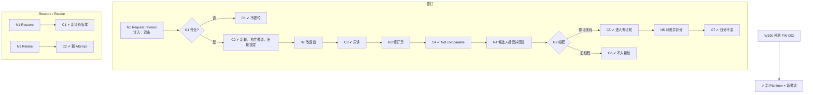

# W10 输入输出闭环：修订、重考与补测

| 项 | 内容 |
|---|---|
| 模块 | W10 |
| 版本 / 日期 | v1.0 / 2026-10-16（草稿，待评审） |
| 同目录文档 | [产品文档](PRD.md) · [User Journey](User_Journey.md) · [User Cases](User_Cases.md) |
| 格式说明 | 见 [Written Test README](../README.md#闭环文档格式) |

## 1. 结构化规格

```yaml
flow_id: W10a              # 修订轮
actors: [hr_emma, cand_alex]
seed: S_result_released
entry: W10a.N1
max_loop: 2
external: [mail_adapter, mail_ingress, identity]

nodes:
  - {id: W10a.N1, type: action, actor: hr_emma, do: "Release 页 Request revision，填写反馈 F、披露级别、新截止，Send revision request", inject: [double_click]}
  - {id: W10a.G1, type: decision, on: "必填项"}
  - {id: W10a.C1, type: check, expect: {ui: "提示缺少反馈或截止", db: "无新轮"}}
  - {id: W10a.C2, type: check, expect: {db: "FeedbackPackage 固定；Round 2 (revision) 新建；独立 Invitation 与线程；Round 1 锁定", ui: "Revision round 1 requested — candidate has been notified."}}
  - {id: W10a.N2, type: action, actor: hr_emma, do: "尝试修改已发送的反馈"}
  - {id: W10a.C3, type: check, expect: {ui: "反馈只读", api: "修改返回 4xx"}}
  - {id: W10a.N3, type: action, actor: hr_emma, do: "打开修订页"}
  - {id: W10a.C4, type: check, expect: {ui: "Not yet accepted by candidate；Not comparable — awaiting revised submission；Original 可查看"}}
  - {id: W10a.N4, type: action, actor: cand_alex, do: "候选人结果页 Accept revision，经邮件回复修订答案 R"}
  - {id: W10a.G2, type: decision, on: "R 的线程"}
  - {id: W10a.C5, type: check, expect: {ui: "Matched by reply thread — Round 1 revision；Revised answers submitted", db: "新 Attempt 属于修订轮"}}
  - {id: W10a.C6, type: check, expect: {ui: "旧线程邮件进入 Needs confirmation", db: "不进入修订轮"}}
  - {id: W10a.N5, type: action, actor: hr_emma, do: "修订页 Original / Feedback / Revised 对照，Approve revised scores"}
  - {id: W10a.C7, type: check, expect: {ui: "每个问题标已修正 / 部分 / 未解决及提示披露级别", db: "修订轮 final；Round 1 分数 70 与 Release 不变；delta 仅同条件时计算，否则 null"}}
  - {id: W10a.T1, type: terminal, state: revision.final}
  - {id: W10a.T2, type: terminal, state: no_change}

edges:
  - [W10a.N1, W10a.G1]
  - [W10a.G1, W10a.C1, {when: "缺项"}]
  - [W10a.G1, W10a.C2, {when: "齐全"}]
  - [W10a.C1, W10a.T2]
  - [W10a.C2, W10a.N2]
  - [W10a.N2, W10a.C3]
  - [W10a.C3, W10a.N3]
  - [W10a.N3, W10a.C4]
  - [W10a.C4, W10a.N4]
  - [W10a.N4, W10a.G2]
  - [W10a.G2, W10a.C5, {when: "R = reply_revision_thread"}]
  - [W10a.G2, W10a.C6, {when: "R = reply_round1_thread"}]
  - [W10a.C5, W10a.N5]
  - [W10a.N5, W10a.C7]
  - [W10a.C7, W10a.T1]
  - [W10a.C6, W10a.T2]
---
flow_id: W10b              # 补测
actor: hr_emma
seed: S_result_released
entry: W10b.N1
max_loop: 1
external: [mail_adapter]

nodes:
  - {id: W10b.N1, type: action, do: "Add supplemental test，按未测能力从题库选 FIN-002"}
  - {id: W10b.C1, type: check, expect: {db: "新 PlanItem 类型=补证；新 Invitation；原 PlanItem / 分数不变", ui: "候选人端显示 Additional assessment，需接受"}}
  - {id: W10b.T1, type: terminal, state: supplemental.invited}

edges:
  - [W10b.N1, W10b.C1]
  - [W10b.C1, W10b.T1]
---
flow_id: W10c              # Rescore / Retake
actor: hm_daniel
seed: S_result_released
entry: W10c.N1
max_loop: 1
external: [llm]

nodes:
  - {id: W10c.N1, type: action, do: "对同一答案 Rescore"}
  - {id: W10c.C1, type: check, expect: {db: "新 Evaluation 版本；不新建 Attempt；已发布 Release 不变"}}
  - {id: W10c.N2, type: action, do: "发起 Retake"}
  - {id: W10c.C2, type: check, expect: {db: "新 Attempt + 新 Invitation；与原轮不混排"}}
  - {id: W10c.T1, type: terminal, state: no_change}

edges:
  - [W10c.N1, W10c.C1]
  - [W10c.C1, W10c.T1]
  - [W10c.N2, W10c.C2]
  - [W10c.C2, W10c.T1]
```

## 2. 测试数据

| 名称 | 内容 |
|---|---|
| feedback_hint | 披露级别 hint_only：「Re-check how FX movement affects the variance bridge.」；内部 notes「expects FX line in Q3!C14」 |
| feedback_worked | 披露级别 worked_solution |
| feedback_empty | 反馈为空 |
| new_deadline | 2026-09-20 18:00 Asia/Shanghai |
| reply_revision_thread | 回复 `Re: FIN-001 — Revision round 1` |
| reply_round1_thread | 回复原 Round 1 线程 |

## 3. 路径清单

| 路径 | 节点序列 | 数据 / 注入 | 终态 |
|---|---|---|---|
| P1 发起修订 | W10a N1 → G1 → C2 | feedback_hint；new_deadline | — |
| P2 缺反馈 | W10a N1 → G1 → C1 | feedback_empty | no_change |
| P3 反馈发出后不可改 | W10a N2 → C3 | — | no_change |
| P4 修订页未收到答案 | W10a N3 → C4 | — | no_change |
| P5 修订提交并评分 | W10a N4 → G2 → C5 → N5 → C7 | reply_revision_thread | revision.final |
| P6 旧线程不入新轮 | W10a N4 → G2 → C6 | reply_round1_thread | no_change |
| P7 双击发送修订 | P1，在 N1 注入 double_click | feedback_hint | 只有 1 个新轮 |
| P8 补测 | W10b N1 → C1 | FIN-002 | supplemental.invited |
| P9 Rescore | W10c N1 → C1 | — | no_change |
| P10 Retake | W10c N2 → C2 | — | no_change |

## 4. 流程图（由规格生成）



## 5. 待确认

- 本模块后端全部未实现（无 Round、FeedbackPackage），所有路径为 known gap。
- 反馈包和补测是否需要第二人批准（PRD 待确认 1）。
- Retake 本期是否提供入口（PRD 待确认 3）。
