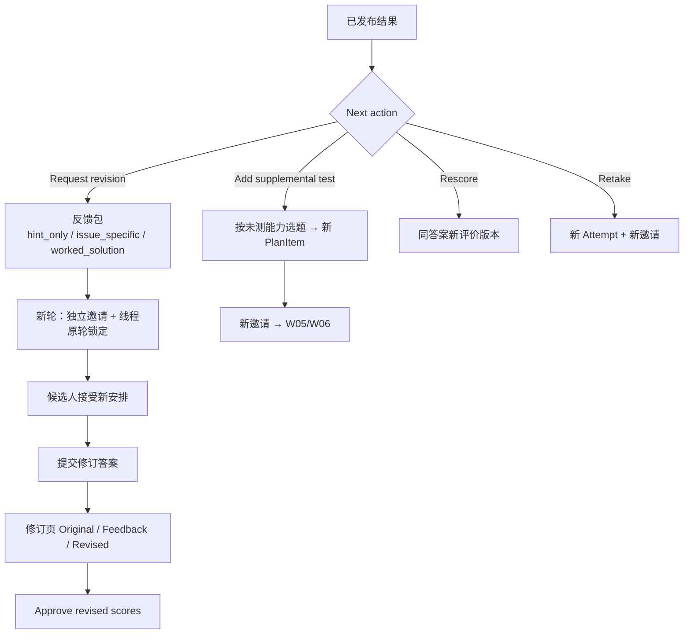

# W10 User Journey：修订、重考与补测

| 项 | 内容 |
|---|---|
| 模块 | W10 |
| 版本 / 日期 | v1.0 / 2026-10-16（草稿，待评审） |
| 同目录文档 | [产品文档](PRD.md) · [输入输出闭环](Loop_IO.md) · [User Cases](User_Cases.md) |
| 来源 | [PRD v1.4 §9](../../../../hireos-written/docs/Assessment_Written_Test_PRD_v1.4.md)、[Brief v1.1 §5.6、P11、P12](../../../../hireos-written/docs/Assessment_Written_Test_Prototype_Design_Brief_v1.1.md)、[Agent 对话流程 §6、§7](../../../../hireos-written/docs/Written_Test_Agent_Conversation_Flow.md) |

角色与权限见 [W01 User Journey](../W01_Question_Bank/User_Journey.md#角色与权限公共)。

# 旅程

**主角色**：HR / Recruiter、Hiring Manager；Candidate
**登录目的**：结果不足以下结论时，给候选人提示让其修改，或者加一道题验证未测到的能力，同时不破坏原有结果。
**入口**：Release 页 Next action：**Request revision**、**Add supplemental test**；候选人结果页的修订 / 补测入口

## 输入

| 类型 | 内容 |
|---|---|
| 前置数据 | S_result_released；S_revision_round1_sent |
| 用户数据 | 反馈内容与披露级别、新截止；补测题；候选人修订答案 |
| 外部依赖 | 通知服务；hr@ 收件（线程匹配）；统一 Identity |

## 流程

## 步骤

| # | 用户意图与操作 | 系统反馈 | 用户需要判断 |
|---|---|---|---|
| 1 | 点 Request revision | 弹窗：给候选人的反馈、新截止；说明原轮锁定，新轮有自己的邀请和线程 | 给多少提示（披露级别） |
| 2 | 写内部 notes | 与候选人可见内容分开 | — |
| 3 | Send revision request | 「Revision round 1 requested — candidate has been notified.」；反馈固定不可再改 | — |
| 4 | 打开修订页 | 轮次号、「Not yet accepted by candidate」、Not comparable；Original 可看 | — |
| 5 | （候选人）结果页看到 Revision round 1 | 显示提示、新期限；需 Accept revision | 是否接受修订 |
| 6 | （候选人）邮件回复修订答案 | 「Matched by reply thread — Round 1 revision」；「Revised answers submitted — HR has been notified.」 | — |
| 7 | 回到修订页 | Original / Feedback / Revised 三个 tab；Compare changes 显示每个问题的已修正 / 部分 / 未解决 | 改进是否真实 |
| 8 | Approve revised scores | 修订轮 final；原轮分数和 Release 不变 | — |
| 9 | Add supplemental test | 题库抽屉按未测能力选 FIN-002；新 PlanItem（补证） | 补测哪种能力 |
| 10 | （候选人）看到 Additional assessment | 需接受新安排 | — |
| 11 | Rescore | 同答案新评价版本，不新建作答 | — |

## 可见 / 不可见

- 候选人看到：披露给自己的反馈、新期限、新轮任务。
- 候选人看不到：内部 notes、原轮评分细节（除非 Release 已披露）。
- 修订页的分差只在同标准、同条件时显示，否则为 Not comparable。

## 异常与恢复

| 情况 | 系统表现 | 恢复 |
|---|---|---|
| 反馈为空 | 不能发送 | 填写 |
| 回复旧线程 | 不进入新轮，Needs confirmation | W07 人工确认 |
| 候选人未接受新轮 | 修订页显示未接受 | 提醒或等待 |
| 双击发送 | 只建一个新轮 | — |
| 修订未创建独立邀请 | Agent 停止自动处理 | 人工检查 |

## 输出与交接

- 持久化：FeedbackPackage、Round、新 Attempt、补测 PlanItem、RevisionComparison（delta 可为 null）。
- 交接 → W05 / W06（新轮邀请与作答）、W07（线程匹配）、W08（新轮评分）、W12（修订轮不与初稿混排）。

**禁止副作用**：改写原稿、旧分、旧 Release；旧线程邮件进入新轮；仅凭分数提高推断学习能力；AI 建议直接发出修订。

**成功标准**：四种后续各自留痕；原轮完全保留；修订前后能清楚对照。

**测试映射**：PRD 验收组 C；Brief P11、P12。

**待确认**：反馈包 / 补测审批；Round 建模；Retake 入口（PRD 待确认 1–3）。
