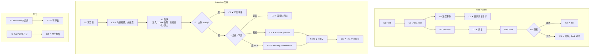

# W11 输入输出闭环：下一步决定与交接

| 项 | 内容 |
|---|---|
| 模块 | W11 |
| 版本 / 日期 | v1.0 / 2026-10-16（草稿，待评审） |
| 同目录文档 | [产品文档](PRD.md) · [User Journey](User_Journey.md) · [User Cases](User_Cases.md) |
| 格式说明 | 见 [Written Test README](../README.md#闭环文档格式) |

## 1. 结构化规格

```yaml
flow_id: W11a              # Hold / Resume / Close
actor: hr_emma
seed: S_result_released
entry: W11a.N1
max_loop: 2
external: []

nodes:
  - {id: W11a.N1, type: action, do: "Next action 选择 Hold"}
  - {id: W11a.C1, type: check, expect: {db: "Case status=on_hold，statusBeforeHold=released", ui: "显示已暂缓"}}
  - {id: W11a.N2, type: action, do: "暂缓期间收到进度事件（如修订提交）"}
  - {id: W11a.C2, type: check, expect: {db: "status 仍 on_hold；statusBeforeHold 更新为最新进度"}}
  - {id: W11a.N3, type: action, do: "Resume"}
  - {id: W11a.C3, type: check, expect: {db: "status 恢复为 statusBeforeHold"}}
  - {id: W11a.N4, type: action, do: "Close testing，选择原因 C"}
  - {id: W11a.G1, type: decision, on: "C 是否合法"}
  - {id: W11a.C4, type: check, expect: {api: "返回 4xx", db: "状态不变"}}
  - {id: W11a.C5, type: check, expect: {db: "status=closed，closeReason=C，closedAt；Task completed", api: "终态后进度事件被忽略"}}
  - {id: W11a.T1, type: terminal, state: case.closed}
  - {id: W11a.T2, type: terminal, state: case.on_hold}

edges:
  - [W11a.N1, W11a.C1]
  - [W11a.C1, W11a.N2]
  - [W11a.N2, W11a.C2]
  - [W11a.C2, W11a.T2]
  - [W11a.C1, W11a.N3]
  - [W11a.N3, W11a.C3]
  - [W11a.C3, W11a.N4]
  - [W11a.N4, W11a.G1]
  - [W11a.G1, W11a.C4, {when: "C = close_invalid"}]
  - [W11a.G1, W11a.C5, {when: "C 属于 passed / rejected / withdrawn"}]
  - [W11a.C5, W11a.T1]
---
flow_id: W11b              # Interview 交接
actor: hr_emma
seed: S_result_released
entry: W11b.N1
max_loop: 3
external: [core_file, bus, interview]

nodes:
  - {id: W11b.N1, type: action, do: "Prepare Interview handoff，预览交付包"}
  - {id: W11b.C1, type: check, expect: {ui: "包含当前结果、精确快照、证据、已做案例、反馈披露、未测能力、关键冲突、InterviewFocus；先提案再确认"}}
  - {id: W11b.N2, type: action, do: "确认交接", inject: [core_unavailable, bus_down, double_click]}
  - {id: W11b.G1, type: decision, on: "交付包文件状态"}
  - {id: W11b.C2, type: check, expect: {ui: "Uploading 时不发事件；Failed 提供重试上传；Core 不可用时不声称 ready", db: "无 Outbox 事件"}}
  - {id: W11b.G2, type: decision, on: "总线与下游"}
  - {id: W11b.C3, type: check, expect: {ui: "时间线 Result finalized → Preparing → File ready → Event queued → Published → Intake received → Imported", db: "Outbox 事件只含包 ref，不含完整报告；Case status=handed_off"}}
  - {id: W11b.C4, type: check, expect: {ui: "Handoff queued；评分结果不变", db: "Outbox pending"}}
  - {id: W11b.C5, type: check, expect: {ui: "Awaiting confirmation"}}
  - {id: W11b.N3, type: action, do: "总线恢复 / 事件重投 / 乱序到达"}
  - {id: W11b.C6, type: check, expect: {ext: "Interview 只建 1 个 intake", db: "Receipt imported"}}
  - {id: W11b.T1, type: terminal, state: case.handed_off}
  - {id: W11b.T2, type: terminal, state: handoff.pending}

edges:
  - [W11b.N1, W11b.C1]
  - [W11b.C1, W11b.N2]
  - [W11b.N2, W11b.G1]
  - [W11b.G1, W11b.C2, {when: "uploading / failed / core_unavailable"}]
  - [W11b.G1, W11b.G2, {when: "ready"}]
  - [W11b.G2, W11b.C3, {when: "正常"}]
  - [W11b.G2, W11b.C4, {when: "bus_down"}]
  - [W11b.G2, W11b.C5, {when: "下游无 ACK"}]
  - [W11b.C2, W11b.T2]
  - [W11b.C4, W11b.N3]
  - [W11b.C5, W11b.N3]
  - [W11b.N3, W11b.C6]
  - [W11b.C6, W11b.T1]
  - [W11b.C3, W11b.T1]
---
flow_id: W11c              # Interview 未启用 / 独立报告
actor: hr_emma
seed: S_result_released
entry: W11c.N1
max_loop: 1
external: []

nodes:
  - {id: W11c.N1, type: action, do: "Interview 未启用时打开交付页，Export report-only package"}
  - {id: W11c.C1, type: check, expect: {ui: "说明 Interview not enabled；导出可用", ext: "生成 JSON + PDF 包", db: "无内部交接事件"}}
  - {id: W11c.N2, type: action, do: "结果为 Fail / 证据不足时导出独立报告"}
  - {id: W11c.C2, type: check, expect: {ext: "报告生成；标出未测能力和证据不足"}}
  - {id: W11c.T1, type: terminal, state: package.exported}

edges:
  - [W11c.N1, W11c.C1]
  - [W11c.C1, W11c.T1]
  - [W11c.N2, W11c.C2]
  - [W11c.C2, W11c.T1]
```

## 2. 测试数据

| 名称 | 内容 |
|---|---|
| close_passed / close_rejected / close_withdrawn | 合法关闭原因 |
| close_invalid | 原因 `unknown` |
| interview_disabled | workspace 未开通 Interview |
| result_fail | case_a 修订后 final 结果低于标准 |

## 3. 路径清单

| 路径 | 节点序列 | 数据 / 注入 | 终态 |
|---|---|---|---|
| P1 Hold / Resume | W11a N1 → C1 → N3 → C3 | — | 恢复原状态 |
| P2 暂缓期间进度事件 | W11a N1 → C1 → N2 → C2 | 修订提交事件 | case.on_hold |
| P3–P5 合法关闭 | W11a N4 → G1 → C5 | close_*（3 条） | case.closed |
| P6 非法关闭原因 | W11a N4 → G1 → C4 | close_invalid | 不变 |
| P7 交付包预览 | W11b N1 → C1 | — | — |
| P8 正常交接 | W11b N2 → G1 → G2 → C3 | — | case.handed_off |
| P9 文件未 ready | W11b N2 → G1 → C2 | core_unavailable | handoff.pending |
| P10 总线宕机后恢复 | W11b N2 → G1 → G2 → C4 → N3 → C6 | bus_down | case.handed_off |
| P11 无 ACK | W11b N2 → G1 → G2 → C5 → N3 → C6 | — | case.handed_off |
| P12 双击 / 重投不重复 | P8，注入 double_click + 重投 | — | 1 个 intake |
| P13 Interview 未启用导出 | W11c N1 → C1 | interview_disabled | package.exported |
| P14 Fail 也能出报告 | W11c N2 → C2 | result_fail | package.exported |

## 4. 流程图（由规格生成）



## 5. 待确认

- 现有 Interview 交接为同步 HTTP（`INTERVIEW_BASE_URL/screening-handoff`），没有交付包文件、Outbox、时间线；W11b 除「Case status=handed_off」外均为 known gap（PRD 待确认 1）。
- 现有接口：`POST /cases/:caseId/hold`、`/resume`、`/close`、`/interview-handoff`。
- 报告导出格式（PRD 待确认 3）。
