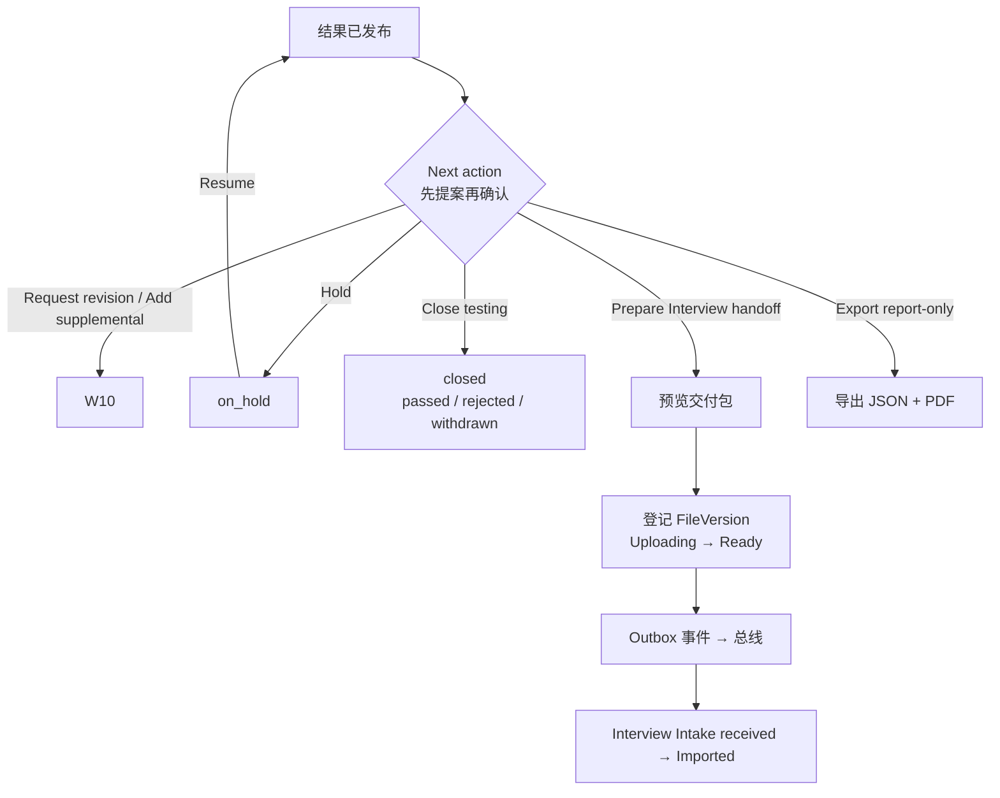

# W11 User Journey：下一步决定与交接

| 项 | 内容 |
|---|---|
| 模块 | W11 |
| 版本 / 日期 | v1.0 / 2026-10-16（草稿，待评审） |
| 同目录文档 | [产品文档](PRD.md) · [输入输出闭环](Loop_IO.md) · [User Cases](User_Cases.md) |
| 来源 | [PRD v1.4 §3、§9、§18.2](../../../../hireos-written/docs/Assessment_Written_Test_PRD_v1.4.md)、[Brief v1.1 §5.6、P15、F05、F06、F12](../../../../hireos-written/docs/Assessment_Written_Test_Prototype_Design_Brief_v1.1.md)、[Agent 对话流程 §11](../../../../hireos-written/docs/Written_Test_Agent_Conversation_Flow.md) |

角色与权限见 [W01 User Journey](../W01_Question_Bank/User_Journey.md#角色与权限公共)。

# 旅程

**主角色**：HR / Recruiter、Hiring Manager
**登录目的**：测评结果出来后决定候选人下一步：进入面试、暂缓、或者结束测评；交给面试时让面试官拿到完整、一致的资料。
**入口**：Release 页 **Next action**；交付页 `#/deliveries/:id`

## 输入

| 类型 | 内容 |
|---|---|
| 前置数据 | S_result_released；S_result_final_unreleased |
| 用户数据 | 下一步选择、关闭原因 |
| 外部依赖 | Core File（交付包）；事件总线；Interview 模块（可未启用） |

## 流程

## 步骤

| # | 用户意图与操作 | 系统反馈 | 用户需要判断 |
|---|---|---|---|
| 1 | 在 Release 页看 Next action | 可选：Request revision、Add supplemental test、Prepare Interview handoff、Hold、Close testing；说明先准备提案、批准后才发送，排序或对比不会触发发送 | 下一步做什么 |
| 2 | Hold | 案件暂缓 | 何时恢复 |
| 3 | Resume | 回到暂缓前的状态（期间有进度则回到最新进度） | — |
| 4 | Close testing，选原因 | 测评结束；相关任务完成 | 原因是否准确 |
| 5 | Prepare Interview handoff | 预览交付包：结果、快照、证据、已做案例、反馈披露、未测能力、关键冲突、InterviewFocus | 面试官需要关注什么 |
| 6 | 确认交接 | 交付页时间线逐步推进 | — |
| 7 | 文件还在上传 / 失败 | 不发事件；失败可重试上传 | — |
| 8 | 总线不可用 | 「Handoff queued」，结果不变 | 等待恢复 |
| 9 | 下游未回执 | 「Awaiting confirmation」 | 是否联系面试负责人 |
| 10 | Interview 未启用 | 说明情况；Export report-only package 可用 | 改为导出发给面试官 |
| 11 | 结果为 Fail / 证据不足 | 仍可导出独立报告 | — |

## 可见 / 不可见

- 交付包只含下游有权看到的内容；技术 ID、事件细节只在 Details。
- 候选人看不到下一步决定，除非通过 Release 或新邀请告知。

## 异常与恢复

| 情况 | 系统表现 | 恢复 |
|---|---|---|
| Core 不可用 | 不声称文件 ready，不发事件 | 恢复后重试 |
| 总线宕机 | Outbox 保留，恢复后自动继续 | — |
| 事件重投 / 乱序 | 下游去重，只建一个 intake | — |
| 双击确认 | 只交接一次 | — |
| 已关闭的 Case 收到进度事件 | 忽略 | — |

## 输出与交接

- 持久化：NextAction / Decision、Case 状态（on_hold / closed / handed_off）、AssessmentPackage（FileVersion）、Outbox 事件、HandoffReceipt。
- 交接 → Interview（总线）；W10（修订 / 补测）；W13（任务完成、Delivery issues）。

**禁止副作用**：同步调用 Interview；文件未 ready 就发事件；事件携带完整报告；AI 建议直接推进；用本模块代替招聘或 Offer 决定。

**成功标准**：每个下一步都由人确认并留痕；交接可靠、可重放、不重复；Interview 未启用时仍能交付报告。

**测试映射**：PRD 验收组 C、G；Brief P15、F05、F06、F12。

**待确认**：同步调用的过渡期；Close rejected 是否通知候选人；导出格式（PRD 待确认 1–3）。
