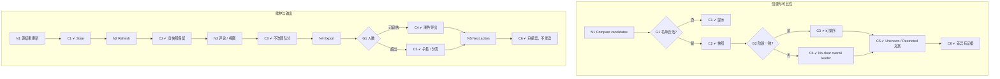

# W12 输入输出闭环：候选人对比

| 项 | 内容 |
|---|---|
| 模块 | W12 |
| 版本 / 日期 | v1.0 / 2026-10-16（草稿，待评审） |
| 同目录文档 | [产品文档](PRD.md) · [User Journey](User_Journey.md) · [User Cases](User_Cases.md) |
| 格式说明 | 见 [Written Test README](../README.md#闭环文档格式) |

## 1. 结构化规格

```yaml
flow_id: W12a              # 创建对比与可比性
actor: hm_daniel
seed: S0_employer
entry: W12a.N1
max_loop: 2
external: [llm]

nodes:
  - {id: W12a.N1, type: action, do: "My Tasks → Cluster by JD → Compare candidates，选择名单 L"}
  - {id: W12a.G1, type: decision, on: "名单是否合法（2–4 人且有分数）"}
  - {id: W12a.C1, type: check, expect: {ui: "未评分候选人不可选；不足 2 人时提示 No scored candidates to compare yet."}}
  - {id: W12a.C2, type: check, expect: {ui: "首列维度固定；Role / Snapshot / Mode / 名单；默认 Current summary", db: "ComparisonSnapshot 保存源结果版本"}}
  - {id: W12a.G2, type: decision, on: "结果阶段是否一致"}
  - {id: W12a.C3, type: check, expect: {ui: "Both results are final and directly comparable.；可排序"}}
  - {id: W12a.C4, type: check, expect: {ui: "提示含 AI draft，仅供参考；No clear overall leader；不排序"}}
  - {id: W12a.C5, type: check, expect: {ui: "未测维度 Unknown、未提供 Not provided、无权限 Restricted、不同条件 Not comparable，文案各不同；不显示 0"}}
  - {id: W12a.C6, type: check, expect: {ui: "Key differences 每条可下钻证据；AI 摘要不强选赢家", record: "candidate_compare AI run ref"}}
  - {id: W12a.T1, type: terminal, state: comparison.saved}
  - {id: W12a.T2, type: terminal, state: no_change}

edges:
  - [W12a.N1, W12a.G1]
  - [W12a.G1, W12a.C1, {when: "L 属于 list_invalid_*"}]
  - [W12a.G1, W12a.C2, {when: "L 属于 list_*_valid"}]
  - [W12a.C1, W12a.T2]
  - [W12a.C2, W12a.G2]
  - [W12a.G2, W12a.C3, {when: "L = list_final_valid"}]
  - [W12a.G2, W12a.C4, {when: "L = list_mixed_valid"}]
  - [W12a.C3, W12a.C5]
  - [W12a.C4, W12a.C5]
  - [W12a.C5, W12a.C6]
  - [W12a.C6, W12a.T1]
---
flow_id: W12b              # 刷新、评论、导出、下一步
actor: hm_daniel
seed: S_two_final_results
entry: W12b.N1
max_loop: 2
external: [mail_adapter]

nodes:
  - {id: W12b.N1, type: action, do: "其中一人产生新 final 结果后打开旧快照"}
  - {id: W12b.C1, type: check, expect: {ui: "显示 Stale"}}
  - {id: W12b.N2, type: action, do: "Refresh"}
  - {id: W12b.C2, type: check, expect: {db: "新快照；旧快照保留"}}
  - {id: W12b.N3, type: action, do: "只看差异、显示 Unknown、添加评论、保存视图"}
  - {id: W12b.C3, type: check, expect: {db: "评论与个人视图保存；团队 Rubric 与分数不变"}}
  - {id: W12b.N4, type: action, do: "Export，格式 X"}
  - {id: W12b.G1, type: decision, on: "人数是否超过单页舒适人数"}
  - {id: W12b.C4, type: check, expect: {ext: "生成浅色 PNG / PDF / 报告", ui: "不缩小字号"}}
  - {id: W12b.C5, type: check, expect: {ui: "要求选择子集或分页；不静默漏人"}}
  - {id: W12b.N5, type: action, do: "某列 Next action → 准备提案"}
  - {id: W12b.C6, type: check, expect: {ui: "生成提案，需批准", ext: "生成对比 / 排序 / 导出都没有发出任何邀请或通知"}}
  - {id: W12b.T1, type: terminal, state: comparison.saved}

edges:
  - [W12b.N1, W12b.C1]
  - [W12b.C1, W12b.N2]
  - [W12b.N2, W12b.C2]
  - [W12b.C2, W12b.N3]
  - [W12b.N3, W12b.C3]
  - [W12b.C3, W12b.N4]
  - [W12b.N4, W12b.G1]
  - [W12b.G1, W12b.C4, {when: "≤ 单页人数"}]
  - [W12b.G1, W12b.C5, {when: "超出"}]
  - [W12b.C4, W12b.N5]
  - [W12b.C5, W12b.N5]
  - [W12b.N5, W12b.C6]
  - [W12b.C6, W12b.T1]
```

## 2. 测试数据

| 名称 | 内容 |
|---|---|
| list_final_valid | S_two_final_results 两人，同试卷版本、同阶段 |
| list_mixed_valid | Alex（final 70）+ Taylor（AI draft 80） |
| list_with_unknown | Alex + Taylor + Jordan（未测） |
| list_with_revision | Alex 初稿 + Alex 修订轮 + 另一人初稿 |
| list_invalid_one | 只选 1 人 |
| list_invalid_unscored | 只能选到 Jordan、Casey（无分数） |
| list_invalid_five | 选 5 人 |
| restricted_viewer | hr_restricted 打开对比 |

## 3. 路径清单

| 路径 | 节点序列 | 数据 / 注入 | 终态 |
|---|---|---|---|
| P1 同阶段 final 可比 | W12a N1 → G1 → C2 → G2 → C3 → C5 → C6 | list_final_valid | comparison.saved |
| P2 混合阶段不排名 | W12a N1 → G1 → C2 → G2 → C4 → C5 → C6 | list_mixed_valid | comparison.saved |
| P3 Unknown 显示 | P2 | list_with_unknown | comparison.saved |
| P4 修订轮不混排 | P2 | list_with_revision | comparison.saved |
| P5–P7 名单不合法 | W12a N1 → G1 → C1 | list_invalid_*（3 条） | no_change |
| P8 Restricted | P1，以 hr_restricted 执行 | restricted_viewer | comparison.saved |
| P9 Stale 与刷新 | W12b N1 → C1 → N2 → C2 | — | comparison.saved |
| P10 评论与视图 | W12b N3 → C3 | — | comparison.saved |
| P11 导出 | W12b N4 → G1 → C4 | PNG、PDF | comparison.saved |
| P12 超人数导出 | W12b N4 → G1 → C5 | 4 人 + 单页限制 | comparison.saved |
| P13 下一步不自动发送 | W12b N5 → C6 | — | comparison.saved |

## 4. 流程图（由规格生成）



## 5. 待确认

- 后端无对比模块，前端为 fixture；本闭环全部为 known gap。
- 公共 Compare 框架的建设方（PRD 待确认 1）。
