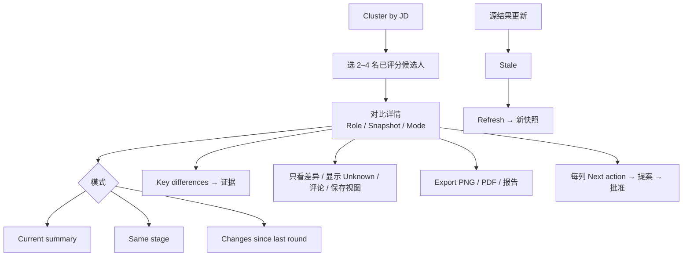

# W12 User Journey：候选人对比

| 项 | 内容 |
|---|---|
| 模块 | W12 |
| 版本 / 日期 | v1.0 / 2026-10-16（草稿，待评审） |
| 同目录文档 | [产品文档](PRD.md) · [输入输出闭环](Loop_IO.md) · [User Cases](User_Cases.md) |
| 来源 | [PRD v1.4 §10](../../../../hireos-written/docs/Assessment_Written_Test_PRD_v1.4.md)、[Brief v1.1 §5.6、§7、P13、P14](../../../../hireos-written/docs/Assessment_Written_Test_Prototype_Design_Brief_v1.1.md) |

角色与权限见 [W01 User Journey](../W01_Question_Bank/User_Journey.md#角色与权限公共)。

# 旅程

**主角色**：Hiring Manager（HR / Recruiter 也可使用）
**登录目的**：把同一岗位的几位候选人并排看清楚各自强弱，找到值得进入面试的人，但不被不可比的分数误导。
**入口**：My Tasks → **Cluster by JD** → Compare candidates；项目详情 **Compare candidates**；Comparisons 列表

## 输入

| 类型 | 内容 |
|---|---|
| 前置数据 | S0_employer（Alex final 70、Taylor AI draft 80、Jordan / Casey 未测）；S_two_final_results |
| 用户数据 | 候选人名单、模式、评论、导出格式 |
| 外部依赖 | 公共 Compare 框架；AI Service（candidate_compare 摘要） |

## 流程

## 步骤

| # | 用户意图与操作 | 系统反馈 | 用户需要判断 |
|---|---|---|---|
| 1 | Cluster by JD 中点 Compare candidates | 只能选已评分的候选人；无可选时「No scored candidates to compare yet.」 | 选谁来比 |
| 2 | 打开对比 | 维度为行、候选人为列；顶部 Role、Snapshot 时间、Mode；默认 Current summary | — |
| 3 | 看提示条 | 全 final：「Both results are final and directly comparable.」；含 AI draft：仅供参考、不能声称整体领先者 | 这些分数能不能直接比 |
| 4 | 看 Unknown 格子 | Unknown / Not provided / Restricted / Not comparable 文案不同 | 是否需要补测 |
| 5 | 看 Key differences | 每条差异可点开证据 | 差异是否有依据 |
| 6 | 只看差异、加评论、保存视图 | 视图保存为个人偏好；团队分数不变 | — |
| 7 | 有人新出了 final 结果 | 旧快照显示 Stale | 是否刷新 |
| 8 | Refresh | 生成新快照，旧快照仍可查 | — |
| 9 | Export | 浅色 PNG / PDF / 报告；人数过多时要求选子集或分页 | 给谁看 |
| 10 | 某列 Next action | 先生成提案，需要批准；不会自动发送任何内容 | 下一步是什么 |

## 可见 / 不可见

- 只显示当前用户有权限的候选人和证据，其他显示 Restricted。
- 对比、评论、导出都是内部的，候选人不可见。

## 异常与恢复

| 情况 | 系统表现 | 恢复 |
|---|---|---|
| 混合 AI draft 与 final | 不排名，No clear overall leader | 等待 Finalize |
| 初稿与修订轮 | 不混排 | 用 Changes since last round 模式看 |
| 源结果更新 | Stale | Refresh |
| 超出单页人数 | 要求子集或分页 | 选择子集 |
| AI 摘要失败 | 矩阵仍可用，摘要显示失败 | 重试 |

## 输出与交接

- 持久化：ComparisonSnapshot（源结果版本）、ComparisonComment、导出文件、个人视图偏好。
- 交接 → W11 / W10（经提案批准的下一步）。

**禁止副作用**：未测计 0；不同阶段 / 条件的分数排名；AI 强选赢家；排序或导出触发邀请；个人视图改变团队 Rubric；导出缩小字号或漏人。

**成功标准**：可比的才排序，不可比的说清原因；每个差异有证据；对比不产生任何外部动作。

**测试映射**：PRD 验收组 D；Brief P13、P14。

**待确认**：公共 Compare 框架建设方；评论是否通知同事（PRD 待确认 1–2）。
